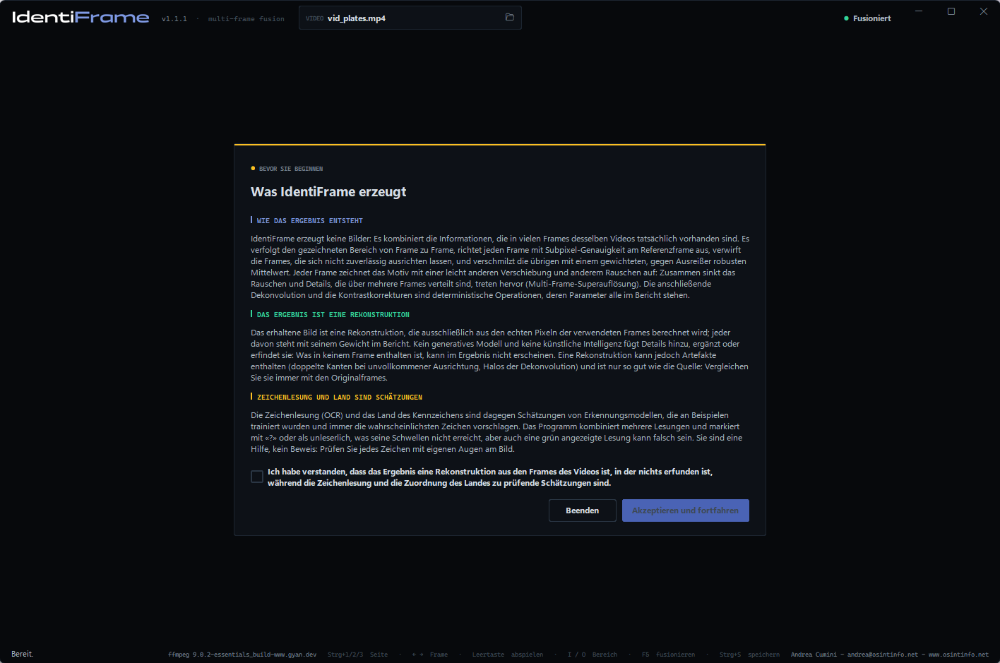
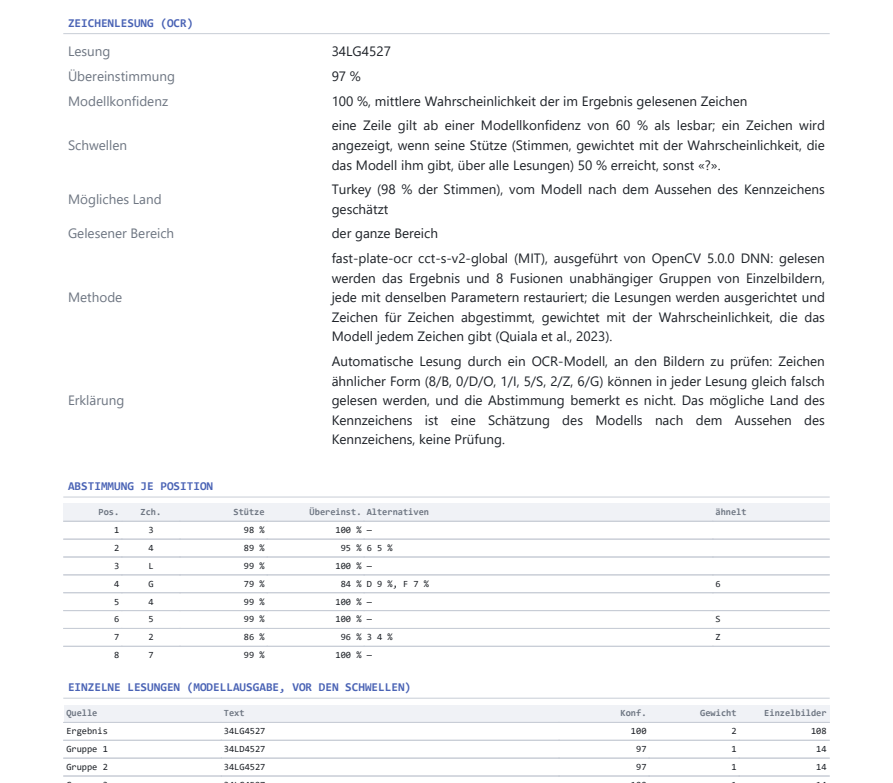

# IdentiFrame — Benutzerhandbuch

[English](manual.en.md) · [Italiano](manual.it.md) · **Deutsch** · [Français](manual.fr.md) · [Español](manual.es.md) · [Nederlands](manual.nl.md) · [Polski](manual.pl.md) · [Ελληνικά](manual.el.md) · [Shqip](manual.sq.md)

IdentiFrame verbessert die Lesbarkeit eines kleinen Details — eines
Kennzeichens, eines Gesichts, eines Schildes —, das in mehreren Frames eines
Videos aufgenommen wurde. Es richtet diese Frames mit Subpixel-Genauigkeit
aus, fusioniert sie auf einem feineren Raster, verringert Rauschen und
Unschärfe und erzeugt **ein einziges Bild** mit einem Bericht, der jeden
Parameter und jeden Schritt dokumentiert.

*Andrea Cumini — www.osintinfo.net — andrea@osintinfo.net*

## Inhalt

1. [Funktionsweise](#1-funktionsweise)
2. [Installation und erster Start](#2-installation-und-erster-start)
3. [Seite „Konfiguration“](#3-seite-konfiguration)
4. [Seite „Motiv“: Frames, Motiv und Referenz](#4-seite-motiv-frames-motiv-und-referenz)
5. [Seite „Fusion“](#5-seite-fusion)
6. [Speichern: Bilder und Bericht](#6-speichern-bilder-und-bericht)
7. [Das Beste aus einem Kennzeichen oder einem Gesicht herausholen](#7-das-beste-aus-einem-kennzeichen-oder-einem-gesicht-herausholen)
8. [Grenzen und richtige Verwendung](#8-grenzen-und-richtige-verwendung)
9. [Tastenkürzel](#9-tastenkürzel)
10. [OCR-Modelle (optional)](#10-ocr-modelle-optional)

## 1. Funktionsweise

Jeder Frame eines Videos erfasst das Motiv an einer etwas anderen Position
gegenüber dem Pixelraster und mit seinem eigenen zufälligen Rauschen.
IdentiFrame nutzt das: Es findet das Motiv in jedem Frame, richtet alle Frames
mit Subpixel-Genauigkeit an einem **Referenzbild** aus und kombiniert sie. Das
Rauschen sinkt, und ein Teil des Details, das jedem einzelnen Frame fehlt,
kehrt zurück. Nichts wird erfunden: Das Ergebnis enthält nur, was die Frames
belegen.

Die Arbeit erfolgt in sieben Schritten, die im Feld *Pipeline* angezeigt
werden:

| Schritt | Was geschieht |
| --- | --- |
| 1. Frame-Extraktion | Der gewählte Bereich wird von FFmpeg framegenau dekodiert. |
| 2. Motiverkennung | Das Motiv wird Frame für Frame verfolgt, von der Referenz aus vorwärts und rückwärts. |
| 3. Lokale Ausrichtung | Jeder Frame wird an der Referenz ausgerichtet (ECC-Algorithmus; Modell Translation, Rotation, affin oder perspektivisch). |
| 4. Subpixel-Registrierung | Die Ausrichtung wird in voller Auflösung verfeinert; die schärfsten, am besten ausgerichteten Frames werden ausgewählt. |
| 5. Multi-Frame-Fusion | Die Frames werden auf einem bis zu 4-mal feineren Raster neu abgetastet und kombiniert, Ausreißer werden verworfen. |
| 6. Dekonvolution und Rauschunterdrückung | Automatische Tonwerte, optionale Rauschunterdrückung und Richardson-Lucy-Dekonvolution auf der Luminanz. |
| 7. Einzelbild | Endbild, Geisterbild der Frames, Vergleich mit der Referenz, Daten für den Bericht. |

## 2. Installation und erster Start

**Ausführbare Datei (Windows 10/11, 64 Bit).** Entpacken Sie
`IdentiFrame-<version>-windows-x64.zip` an einen beliebigen Ort und starten
Sie `IdentiFrame.exe`. Python wird nicht benötigt. Die ausführbare Datei ist
nicht signiert: Beim ersten Mal kann Windows SmartScreen eine Bestätigung
verlangen.

**Aus den Quellen.** Mit Python 3.10 oder neuer:

```bash
python -m pip install -r requirements.txt
python IdentiFrame.py
```

**Hinweis beim Start.** Bei jedem Start erscheint ein Hinweis, der zu
akzeptieren ist: Er erklärt, dass das Ergebnis eine Rekonstruktion ist, die
nur aus den echten Pixeln der Frames berechnet wird und in der nichts
erfunden ist, während die Zeichenlesung und das Land zu prüfende Schätzungen
sind. *Akzeptieren und fortfahren* wird aktiv, sobald die Erklärung angehakt
ist. Beim allerersten Start wird zuerst die Sprache abgefragt, und der
Hinweis erscheint in der gewählten Sprache.



**FFmpeg.** IdentiFrame verwendet FFmpeg zum Lesen der Videos, enthält es
aber nicht. Fehlt FFmpeg beim ersten Start, öffnet sich die Seite
**Konfiguration** beim Feld *FFmpeg*: **Herunterladen / Aktualisieren** lädt
den offiziellen Windows-Build in den Ordner `tools\ffmpeg` neben dem Programm.
Am System wird nichts installiert.

Ein Video lässt sich auch über die Befehlszeile öffnen:
`IdentiFrame.exe video.mp4`.

## 3. Seite „Konfiguration“


- **Quelle** — **Video öffnen…** (oder Strg+O, oder das Ordnersymbol im Feld
  *Video* oben). Hier werden Dauer, Anzahl der Frames, Auflösung und Codec
  angezeigt. Beim Öffnen eines Videos wechselt das Programm zur Seite *Motiv*.
- **Ausgabe** — *Zielordner*, in dem die Fusionen gespeichert werden (leer =
  neben dem Video), *Unterordner mit dem Namen des Videos*, *Format* (PNG oder
  TIFF) und *Farbtiefe* (*Auto* = 16 Bit pro Kanal für die Fusion). *Auch
  jeden ausgerichteten Frame speichern (Ordner aligned/)* legt einen Ordner
  `aligned/` mit jedem verwendeten Frame an, an der Referenz ausgerichtet.
- **FFmpeg** — wo sich FFmpeg befindet und welche Version: **Prüfen**, **Nach
  Updates suchen**, **Herunterladen / Aktualisieren**.
- **OCR-Modelle** — die zwei optionalen Modelle, die die Zeichen von Kennzeichen und Texten lesen, bei Bedarf nach `tools\ocr` heruntergeladen (etwa 37 MB): **Prüfen** und **Herunterladen / Aktualisieren**. Ohne sie funktioniert das Programm, nur ohne Zeichenlesung. Siehe [10. OCR-Modelle](#10-ocr-modelle-optional).
- **Sprache** — Oberfläche und Berichte sind in neun Sprachen verfügbar: EN,
  IT, DE, FR, ES, NL, PL, EL, SQ. Die Änderung wirkt sofort und wird
  gespeichert.
- **Credits** — Autor und Lizenz.

## 4. Seite „Motiv“: Frames, Motiv und Referenz


Die *Vorschau* zeigt den Frame unter dem Cursor: Das **Mausrad** zoomt um den
Mauszeiger herum (bis zu den echten Pixeln), **Ziehen** verschiebt die
Ansicht, ein **Doppelklick** passt den Frame wieder ein. Darunter bewegen die
Schaltflächen um einen oder zehn Frames; **← →** und **Umschalt+← →** tun
dasselbe über die Tastatur.

Die Schaltfläche **Wiedergabe** in der Mitte spielt die Vorschau ab dem
Cursor ab und wird während der Wiedergabe zu **Pause** (die Leertaste tut
dasselbe); Cursor und Zeitleiste folgen, sodass sich beim Zusehen ein
Bereich mit I und O markieren lässt. Ein Klick auf die Zeitleiste oder ein
Framesprung hält die Wiedergabe an.

Die Zeitleiste (Feld *Timeline*) zeigt das ganze Video als Filmstreifen.
**Strg+Mausrad** zoomt, das **Mausrad** blättert; Klicken oder Ziehen bewegt
den Cursor. *Alles* und *Auswahl* passen die Ansicht an.

**1. Referenzbild wählen.** Gehen Sie zu dem Frame, in dem das Motiv **am
größten und am schärfsten** ist — bei einem sich nähernden Fahrzeug meist
einer der letzten Frames, in denen das ganze Kennzeichen noch sichtbar ist.

**2. Ausschnitt des Motivs wählen.** Ziehen Sie mit der **rechten Maustaste**
über das Kennzeichen oder das Gesicht, oder klicken Sie auf **Ausschnitt
wählen** und ziehen Sie mit der linken. Rahmen Sie das Motiv mit einem kleinen
Rand ein. Der angezeigte Frame wird zur **Referenz** (Markierung **R** auf der
Zeitleiste, **→ R** setzt den Cursor wieder darauf), und **die Fusion startet
von selbst**: Das Programm wechselt zur Seite *Fusion*. Zeichnen Sie während
der Ausführung einen neuen Ausschnitt, startet sie neu. **Aufheben** entfernt
den Ausschnitt.

**3. Bereich wählen.** **In [I]** und **Out [O]** (Tasten I und O) setzen den
ersten und den letzten zu verwendenden Frame: die Frames, in denen das Motiv
sichtbar und nicht verdeckt ist. Die Marken I und O lassen sich auch ziehen, und
die Felder IN / OUT akzeptieren eine Zeit (`1:23.456`) oder einen Frame
(`f2000`). Bei jedem Zeichnen des Ausschnitts wird der Bereich auf 30 Sekunden
vor und 30 nach der Referenz gesetzt (innerhalb des Videos): das sind nur die
Grenzen der Suche. Die Fusion verfolgt das Motiv von der Referenz nach außen und
hört in jeder Richtung nach einer Sekunde ohne das Motiv auf; danach rücken die
Marken I und O auf die Frames zusammen, in denen es verfolgt wurde (der Bericht
vermerkt es). Ein von Hand verschobener Bereich bleibt, wie er ist. Nach einer
Änderung des Bereichs startet **Frames fusionieren →** (oder F5) die Fusion
erneut. Höchstens 3601 Frames im Bereich.

## 5. Seite „Fusion“


**Vergleich.** Links das **Geisterbild der Frames**: alle verwendeten
Frames, überlagert an der Position, an der jeder von ihnen gefunden wurde,
vor der Ausrichtung. Es zeigt, was in die Fusion eingeht und wie stark sich
das Motiv bewegt. Über das Menü darüber kann die linke Ansicht stattdessen
das **Referenzbild** zeigen, vergrößert mit bikubischer Interpolation: Das
ist das faire „Vorher“-Bild. Rechts das Ergebnis: **Endergebnis** oder **Nur
Fusion** (vor Rauschunterdrückung und Dekonvolution). Die beiden Ansichten
werden gemeinsam gezoomt und verschoben. Neben dem Mausrad verkleinern die
Schaltflächen unter den Ansichten (**−**, auch unter die eingepasste Größe,
um das Ergebnis klein zu sehen), vergrößern (**+**), zeigen es **1:1** oder
**passen** es in die Ansicht **ein**; per Tastatur **−**, **+** und **0**.


Das zweite Bild zeigt ein Gesicht mit der Voreinstellung **Face 05**, links
das Referenzbild.

**Zeichen.** Mit heruntergeladenen OCR-Modellen zeigt nach jeder Fusion eines *Kennzeichens* oder eines *Texts* die Zeile **ZEICHEN** im Feld *Pipeline* die gelesenen Zeichen (**Zeichen lesen** wiederholt die Lesung). Gelesen werden das Ergebnis und acht Fusionen unabhängiger Gruppen von Frames, und die Lesungen werden Zeichen für Zeichen abgestimmt. Die Erkennungsmodelle schlagen immer die wahrscheinlichsten Zeichen vor, auch wo nichts zu lesen ist: Eine Zeile wird erst ab einer Modellkonfidenz von 60 % angezeigt, sonst schreibt das Programm **unleserlich**, und ein Zeichen, das nicht mindestens 50 % der gewichteten Stimmen erhält, erscheint als **«?»**. Bei einem Kennzeichen erscheint das vom Modell geschätzte **mögliche Land** nur dann gelb neben den Zeichen, wenn die Lesung lesbar ist und ein Land die Mehrheit der Stimmen hat; sonst steht es mit seinem Anteil bei den Details. Die Details nennen außerdem die **Übereinstimmung** der Lesungen, die **Modellkonfidenz**, die **zweifelhaften** Positionen und die mit eigenen Augen **zu prüfenden** Zeichen (8/B, 0/D/O, 1/I, 5/S, 2/Z, 6/G). Ein *Text* kann mehrere Zeilen haben, getrennt durch «|», jede für sich abgestimmt. Im ersten Bild ist das Kennzeichen sehr klein (Zeichen etwa 12 Pixel hoch im Video) und wird als 34LG4527 gelesen, mögliches Land Turkey. Lesung und Land sind Schätzungen: Vergleichen Sie immer mit dem Bild.

**Pipeline.** Die sieben Schritte mit Ergebnis und Dauer; darunter die
Zusammenfassung (verwendete Frames, Vergrößerung, Rauschen vor und nach der
Fusion), der Fortschrittsbalken und die Schaltflächen **Ordner öffnen**,
**Abbrechen**, **Ergebnis speichern**, **Fusion starten**. Die Schritte 1–4
hängen nur von Video, Bereich, Referenz, Ausschnitt und Bewegungsmodell ab:
Ändern sich nur die Parameter der Fusion oder der Restaurierung, werden sie
wiederverwendet, und eine neue Fusion dauert nur Sekundenbruchteile
(*wiederverwendet* in der Liste der Schritte).

### Parameter

Die linke Spalte gruppiert die Parameter nach Schritten.

**Motivtyp.** Das Menü neben *Ausschnitt wählen*, im Feld *Motiv* der Seite *Motiv*, sagt, was verbessert wird. **Kennzeichen** und **Text**: ein flaches, starres Motiv, ein Bewegungsmodell pro Einzelbild; sie unterscheiden sich in der Zeichenlesung (ein Modell für Kennzeichen oder eines für Texte in einer oder mehreren Zeilen, in vielen Sprachen). **Gesicht**: zwischen den Einzelbildern dreht sich der Kopf und die Mimik ändert sich, daher erhält jedes Einzelbild nach der starren Ausrichtung eine lokale, nicht starre Verfeinerung, die diesen Bewegungen um wenige Pixel folgt; was noch abweicht, zählt weniger, Einzelbilder mit anderer Pose oder Mimik werden ausgelassen, die Restaurierung ist leichter und die automatischen Tonwerte schonen Haut und Schatten. Ein Wechsel des Typs lädt dessen Standardwerte und wiederholt die Ausrichtung. Nichts wird erfunden: die Verfeinerung verschiebt nur um wenige Pixel, was die Einzelbilder enthalten. Für ein Gesicht ist das Bewegungsmodell standardmäßig affin, die Ausrichtung lehnt Verformungen ab, die keine mögliche Kopfbewegung sind, und außerhalb der Ellipse im Bereich zeigt das Ergebnis das Referenzbild, weil sich der Hintergrund anders bewegt.

**Gespeicherte Einstellungen.** Benannte Parametersätze: **Speichern…** fragt
nach einem Namen und speichert die aktuellen Parameter; die Wahl eines Namens
im Menü lädt sie; **Löschen** entfernt den gewählten Satz; **Standardwerte**
setzt jeden Parameter zurück. **Aus Bericht…** lädt die Parameter aus der
`report.json` einer früher gespeicherten Fusion, um sie exakt zu wiederholen.
Die verwendeten Parameter werden außerdem beim Schließen des Programms
gespeichert.

**Eingebaute Voreinstellungen.** Das Menü *Gespeicherte Einstellungen* beginnt immer mit fünf Voreinstellungen für den auf der Seite Motiv gewählten Motivtyp: **Plate 01** Standard, **02** Nacht oder Rauschen, **03** entferntes kleines Kennzeichen, **04** fahrendes Fahrzeug mit Bewegungsunschärfe, **05** Schatten oder Gegenlicht; **Text 01–05** dieselben fünf Fälle für Texte; **Face 01** Standard, **02** Nacht oder Rauschen, **03** minimale Bearbeitung, **04** entferntes kleines Gesicht, **05** Schatten oder Gegenlicht. Eine Zeile unter dem Menü beschreibt die gewählte; sie können nicht geändert oder gelöscht werden, Ihre eigenen Einstellungen folgen.

| Feld | Parameter | Wirkung |
| --- | --- | --- |
| Seite Motiv | Art des Motivs | Kennzeichen (Standard) oder Text für ein flaches, starres Motiv (sie unterscheiden sich in der Zeichenlesung); Gesicht fügt die lokale, nicht starre Verfeinerung und eine leichtere Restaurierung hinzu. |
| Frames und Ausrichtung | Bewegungsmodell | Translation, Rotation + Translation, Affin, **Perspektivisch (Homographie)** — Standard; folgt einem Motiv, das sich nähert, entfernt oder dreht. Konvergiert ein Frame nicht, wird ein einfacheres Modell versucht. |
| | Motivsuche: minimale Korrelation | Unterhalb dieses Werts gilt das Motiv in einem Frame als nicht gefunden. |
| | Minimale Ausrichtungsqualität (ECC) | Schlechter ausgerichtete Frames werden ausgeschlossen (standardmäßig 0.80). |
| | Schärfste Frames behalten | Standardmäßig 75 %: Das am wenigsten scharfe Viertel (Bewegungsunschärfe) wird ausgeschlossen. |
| Fusion | Vergrößerung | × 1 (nur Rauschunterdrückung) bis × 4. × 2 oder × 3 ist meist die richtige Wahl. |
| | Fusionsmethode | **Robuster Mittelwert (Ausreißer verworfen)** — Standard; Median; Shift-and-Add (normalisierte Faltung). |
| | Nach Schärfe gewichten | Schärfere Frames zählen deutlich mehr. |
| | Helligkeit angleichen | Gleicht Belichtungsänderungen zwischen den Frames aus. |
| Restaurierung | Rauschunterdrückung | Aus, Leicht, Mittel, Stark (bilateraler Filter). |
| | Iterationen der Dekonvolution | Richardson-Lucy: Mehr Iterationen schärfen stärker, verstärken aber auch Rauschen und Halos. Standardmäßig 20. |
| | PSF σ (Ausgabepixel) | Breite der zu entfernenden Unschärfe. *Automatisch* misst sie an den Kanten des fusionierten Bildes. |
| | Regularisierung (Totalvariation) | Hält das Rauschen während der Dekonvolution zurück. Standardmäßig Mittel. |
| Darstellung | Automatische Tonwerte | Schwarz und Weiß am 0,5- und 99,5-Perzentil der Luminanz, vor der Dekonvolution. |
| | Lokaler Kontrast (CLAHE) | Zonenweiser Ausgleich: nützlich bei Kennzeichen im Schatten oder im Gegenlicht. |
| | Graustufen | Verwirft die Farbe: zum Lesen von Zeichen oft sauberer. |

## 6. Speichern: Bilder und Bericht

**Ergebnis speichern** (Strg+S auf der Seite *Fusion*) legt im Zielordner
einen neuen Ordner `fusion_f<Referenz>_<Datum-Uhrzeit>` an, mit:

| Datei | Inhalt |
| --- | --- |
| `result.png` | das Endbild |
| `fused.png` | die Fusion vor Rauschunterdrückung und Dekonvolution |
| `ghost.png` | das Geisterbild der verwendeten Frames |
| `reference_x<k>.png` | der Referenzausschnitt, mit bikubischer Interpolation vergrößert, zum Vergleich |
| `reference_crop.png` | derselbe Ausschnitt in Videoauflösung |
| `report.pdf` | der Bericht im A4-Layout, mit den Bildern |
| `report.txt` | derselbe Bericht als reiner Text |
| `report.json` | dieselben Daten in strukturierter Form, einschließlich der Einstellungen (**Aus Bericht…** lädt sie erneut) |
| `aligned/` | auf Wunsch jeder verwendete Frame, an der Referenz ausgerichtet |


Mit einer Zeichenlesung enthält der Bericht den Abschnitt **Zeichenlesung (OCR)**: die Lesung, die Übereinstimmung, die Modellkonfidenz, bei einem Kennzeichen das mögliche Land und den gelesenen Bereich, bei einem Text die gefundenen Zeilen, die Methode, die Abstimmung nach Position mit den Alternativen und den ähnlich aussehenden Zeichen sowie jede einzelne Lesung.



Der Bericht wird in der Sprache der Oberfläche geschrieben. Er enthält die
Quelle (Pfad, Größe, **SHA-256**-Prüfsumme, Format), Bereich, Referenzbild
und Ausschnitt, alle Parameter, die sieben Schritte mit den verwendeten
Methoden und ihren Zeiten, die Tabelle der Frames (Suchwert,
Ausrichtungskoeffizienten, Subpixel-Verschiebung, Schärfe, Gewicht,
Ausschlussgrund), die Rauschschätzungen und die SHA-256-Prüfsumme jedes
geschriebenen Bildes. Wer ihn liest, kann die Verarbeitung wiederholen und
prüfen, dass die Dateien nicht verändert wurden.

*Frame speichern* auf der Seite *Motiv* speichert dagegen den einzelnen Frame
unter dem Cursor, in voller Auflösung und verlustfrei.

## 7. Das Beste aus einem Kennzeichen oder einem Gesicht herausholen

- **Gesicht**: zuerst die Art des Motivs *Gesicht* wählen; das ganze Gesicht mit kleinem Rand einrahmen, möglichst auf einem Frame, in dem es in die Kamera blickt, und den Bereich auf Frames mit derselben Pose beschränken. Der Bericht nennt, wie viele Frames wegen anderer Pose oder Mimik ausgeschlossen wurden und wie breit das Gesicht im Video ist: unter etwa 60 Pixeln ist ein saubereres Gesamtbild zu erwarten, keine identifizierenden Merkmale.
- **Referenz**: der Frame, in dem das Motiv am größten und am schärfsten ist.
- **Bereich**: nur die Frames, in denen das Motiv vollständig sichtbar ist.
  Frames weit entfernt von der Referenz (viel kleiner, andere Perspektive)
  bringen wenig und werden ohnehin oft von der Qualitätsschwelle
  ausgeschlossen.
- **Ausschnitt**: das ganze Kennzeichen oder Gesicht mit einem kleinen Rand;
  wenig Hintergrund, der sich anders bewegen kann.
- **Vergrößerung**: × 2 oder × 3. × 4 lohnt sich nur mit vielen Frames.
- **Zeichen noch weich?** Erhöhen Sie *PSF σ* um eine Stufe (z. B. von
  Automatisch auf den nächsten Wert über dem im Bericht angegebenen) oder die
  *Iterationen der Dekonvolution*.
- **Halos oder „Ringing“ um die Zeichen?** Senken Sie *PSF σ* oder die
  Iterationen, oder erhöhen Sie die *Regularisierung (Totalvariation)*.
- **Kennzeichen im Schatten oder im Gegenlicht**: *Lokaler Kontrast (CLAHE)*
  auf Leicht oder Mittel, oft zusammen mit *Graustufen*.
- **Vergleichen** Sie immer mit der Ansicht *Referenzbild* und zoomen Sie auf
  die Zeichen: Was dort nicht lesbar ist und erst nach starker Schärfung
  erscheint, ist mit Vorsicht zu behandeln.
- Speichern Sie einen Parametersatz, der für eine Kamera funktioniert, mit
  **Speichern…** und verwenden Sie ihn wieder.

## 8. Grenzen und richtige Verwendung

- Das Ergebnis ist eine **Verbesserung** der aufgezeichneten Frames, keine
  Rekonstruktion der Wirklichkeit: Es kann nicht wiederherstellen, was kein
  Frame enthält.
- Feine Details an der Auflösungsgrenze und ähnlich aussehende Zeichen (8/B,
  0/D, 1/7, 5/S) müssen vor jeder Schlussfolgerung an den Quell-Frames
  überprüft werden.
- Der Gewinn ist am größten bei vielen Frames, kleinen Verschiebungen
  zwischen ihnen, unabhängigem Rauschen und einer ausreichend scharfen
  Referenz. Bewegungsunschärfe innerhalb eines einzelnen Frames wird nicht
  entfernt.
- Starke Kompression erzeugt Fehler, die in aufeinanderfolgenden Frames
  gleich sind: Die Fusion verringert sie weniger als zufälliges Rauschen.
- Kennzeichen und Gesichter sind personenbezogene Daten: Verwenden Sie das
  Programm im Rahmen der Vorschriften, die für Sie gelten.

## 9. Tastenkürzel

| Tasten | Aktion |
| --- | --- |
| Strg+1 / Strg+2 / Strg+3 | Seite Konfiguration / Motiv / Fusion |
| Strg+O | Video öffnen |
| ← / → | Vorheriger / nächster Frame |
| Umschalt+← / Umschalt+→ | 10 Frames zurück / vor |
| Leertaste | Vorschau abspielen oder anhalten |
| Pos1 / Ende | Erster / letzter Frame |
| I / O | Anfang / Ende des Bereichs auf den Cursor setzen |
| + / − | Zeitleiste vergrößern / verkleinern |
| F | Ganzes Video auf der Zeitleiste |
| Ziehen mit rechter Maustaste in der Vorschau | Motivausschnitt wählen (die Fusion startet) |
| Esc | *Ausschnitt wählen* verlassen |
| − / + / 0 (Seite Fusion) | Ergebnis verkleinern / vergrößern / einpassen |
| F11 | Größere Vorschau: Zeitleiste aus- oder einblenden (Seite Motiv) |
| F5 | Fusion starten |
| Strg+S | Ergebnis speichern (Seite Fusion) oder Frame speichern (Seite Motiv) |


## 10. OCR-Modelle (optional)

Die Zeichenlesung verwendet zwei neuronale Netzmodelle, ausgeführt von OpenCV, das bereits Teil des Programms ist. Sie sind **nicht in IdentiFrame enthalten** und **optional**: ohne sie funktioniert alles andere wie gewohnt, nur die Zeile ZEICHEN bleibt leer. Um sie zu nutzen, drücken Sie **Herunterladen / Aktualisieren** im Feld **OCR-Modelle** der Seite *Konfiguration*: sie kommen in den Ordner `tools\ocr` neben dem Programm (etwa 37 MB), und das Feld zeigt, welche vorhanden sind.

| Motiv | Modell | Lizenz |
| --- | --- | --- |
| Kennzeichen | [fast-plate-ocr](https://github.com/ankandrew/fast-plate-ocr) `cct-s-v2-global` von ankandrew: liest das ganze Kennzeichen und schätzt sein mögliches Land unter 65 | MIT, Code und Gewichte ([vom Autor bestätigt](https://github.com/ankandrew/fast-plate-ocr/issues/97)) |
| Text | [PaddleOCR](https://github.com/PaddlePaddle/PaddleOCR) PP-OCRv6 small von Baidu / PaddleOCR, in der ONNX-Konvertierung von [RapidOCR](https://github.com/RapidAI/RapidOCR): findet die Textzeilen und liest sie in vielen Sprachen | Apache 2.0 |

Jede Datei wird vor dem Behalten mit ihrem SHA-256-Fingerabdruck geprüft; neben den Modellen werden die Lizenztexte und eine Datei `SOURCE.txt` mit der Herkunft gespeichert. Das Land ist eine Schätzung nach dem Aussehen des Kennzeichens, keine Prüfung, und wird mit dem englischen Ländernamen angezeigt.

*Testvideos und Screenshots, von Pexels, verwendet gemäß der [Pexels-Lizenz](https://www.pexels.com/license/): „[Busy Highway Traffic at Sunset](https://www.pexels.com/it-it/video/traffico-autostradale-intenso-al-tramonto-31779728/)“ von [Şeyhmus Kino](https://www.pexels.com/@seyhmuskino/) (Fahrzeuge und Kennzeichen), Straßenverkehr in Taipeh, Taiwan, von [Levi Wedge](https://www.pexels.com/@levi-wedge-266970209/) ([Video](https://www.pexels.com/it-it/video/citta-auto-traffico-veicoli-13271103/), Texte) und „[Charming European Street with Cyclist](https://www.pexels.com/it-it/video/affascinante-strada-europea-con-ciclista-33476096/)“ von [Tuba Din](https://www.pexels.com/@tubadinn/) (Gesicht). Die in den Screenshots sichtbaren Kennzeichen, Texte und das Gesicht stammen aus diesem Material.*

---

IdentiFrame ist freie Software unter der GNU GPL v3 mit Nennung des Autors:
siehe `LICENSE` und `NOTICE`. Andrea Cumini - andrea@osintinfo.net - www.osintinfo.net
