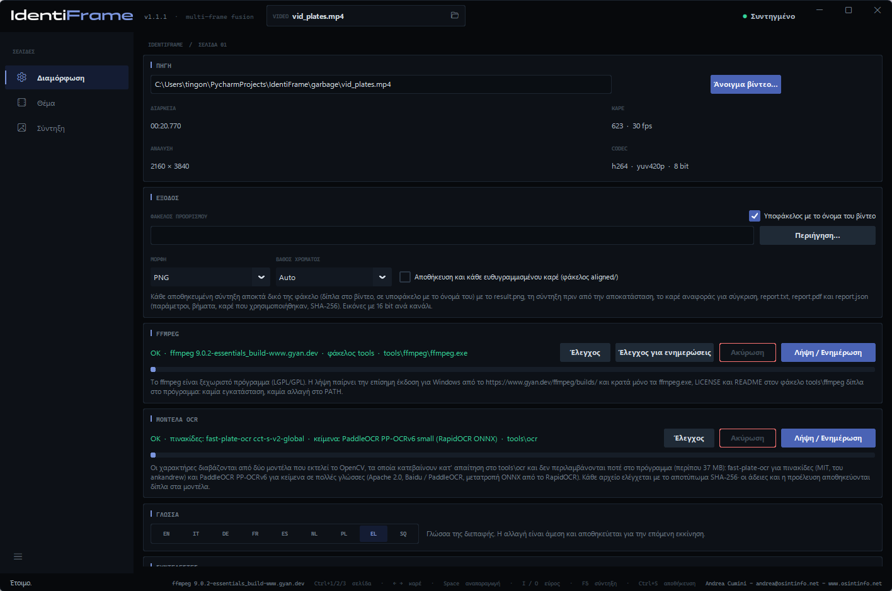
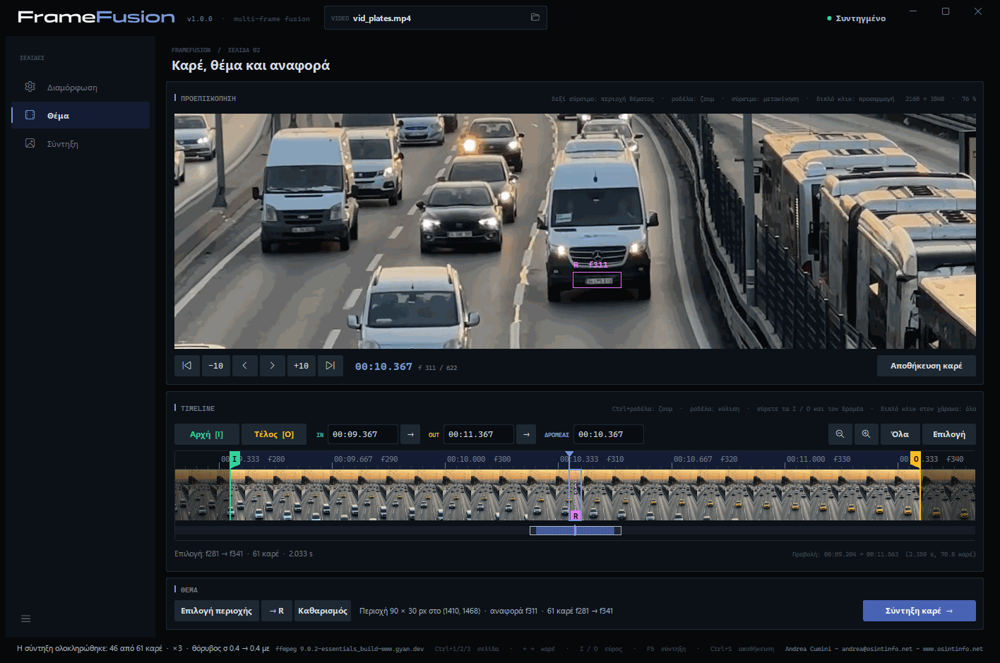
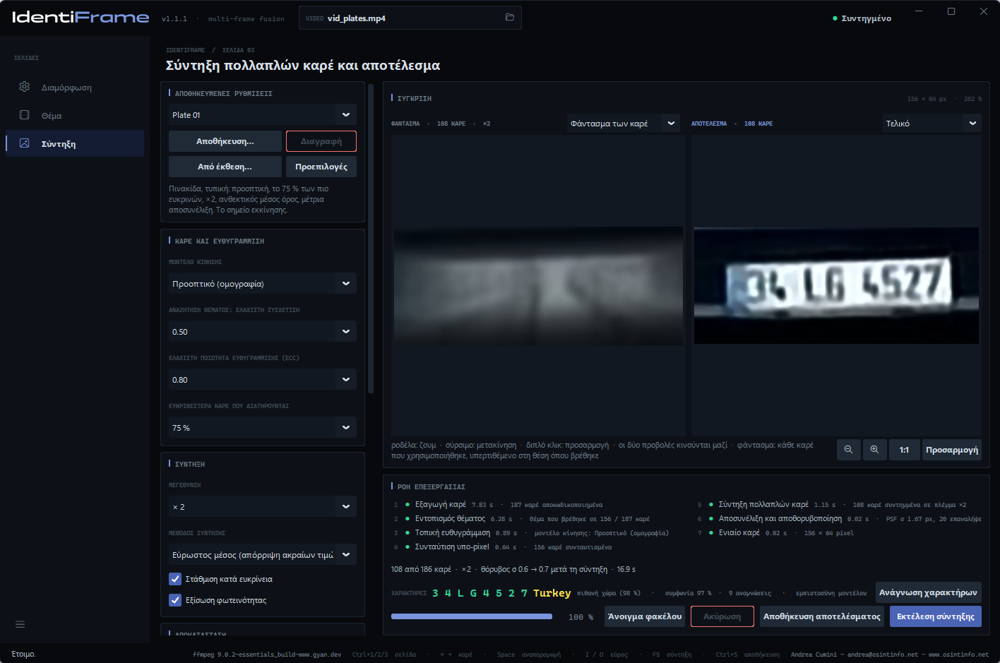
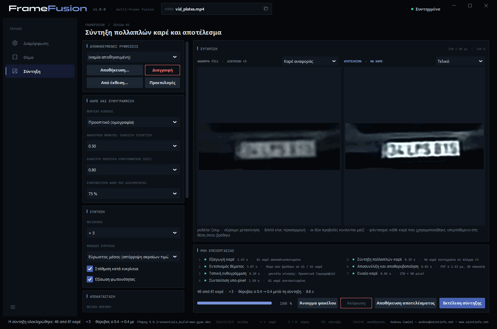
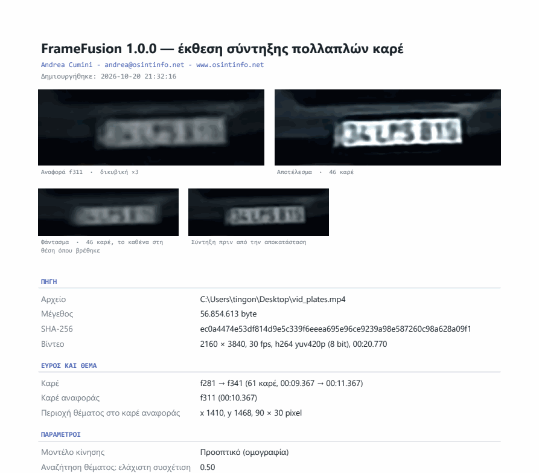

# FrameFusion — Εγχειρίδιο χρήσης

[English](manual.en.md) · [Italiano](manual.it.md) · [Deutsch](manual.de.md) · [Français](manual.fr.md) · [Español](manual.es.md) · [Nederlands](manual.nl.md) · [Polski](manual.pl.md) · **Ελληνικά** · [Shqip](manual.sq.md)

Το FrameFusion βελτιώνει την αναγνωσιμότητα μιας μικρής λεπτομέρειας — μιας
πινακίδας κυκλοφορίας, ενός προσώπου, μιας επιγραφής — που έχει καταγραφεί σε
πολλά καρέ ενός βίντεο. Ευθυγραμμίζει αυτά τα καρέ με ακρίβεια υπο-pixel, τα
συντήκει σε ένα λεπτότερο πλέγμα, μειώνει τον θόρυβο και τη θόλωση, και παράγει
**μία ενιαία εικόνα** μαζί με μια έκθεση που τεκμηριώνει κάθε παράμετρο και
κάθε βήμα.

*Andrea Cumini — www.osintinfo.net — andrea@osintinfo.net*

## Περιεχόμενα

1. [Πώς λειτουργεί](#1-πώς-λειτουργεί)
2. [Εγκατάσταση και πρώτη εκκίνηση](#2-εγκατάσταση-και-πρώτη-εκκίνηση)
3. [Σελίδα Διαμόρφωση](#3-σελίδα-διαμόρφωση)
4. [Σελίδα Θέμα: καρέ, θέμα και αναφορά](#4-σελίδα-θέμα-καρέ-θέμα-και-αναφορά)
5. [Σελίδα Σύντηξη](#5-σελίδα-σύντηξη)
6. [Αποθήκευση: εικόνες και έκθεση](#6-αποθήκευση-εικόνες-και-έκθεση)
7. [Το καλύτερο αποτέλεσμα από μια πινακίδα ή ένα πρόσωπο](#7-το-καλύτερο-αποτέλεσμα-από-μια-πινακίδα-ή-ένα-πρόσωπο)
8. [Όρια και σωστή χρήση](#8-όρια-και-σωστή-χρήση)
9. [Συντομεύσεις πληκτρολογίου](#9-συντομεύσεις-πληκτρολογίου)

## 1. Πώς λειτουργεί

Κάθε καρέ ενός βίντεο καταγράφει το θέμα σε ελαφρώς διαφορετική θέση σε σχέση
με το πλέγμα των pixel, και με τον δικό του τυχαίο θόρυβο. Το FrameFusion το
αξιοποιεί αυτό: εντοπίζει το θέμα σε κάθε καρέ, ευθυγραμμίζει όλα τα καρέ με
ένα **καρέ αναφοράς** με ακρίβεια υπο-pixel και τα συνδυάζει. Ο θόρυβος
μειώνεται και επανέρχεται μέρος της λεπτομέρειας που χάνει κάθε μεμονωμένο
καρέ. Τίποτα δεν επινοείται: το αποτέλεσμα περιέχει μόνο ό,τι τεκμηριώνουν τα
καρέ.

Η εργασία γίνεται σε επτά βήματα, που εμφανίζονται στο πλαίσιο *Ροή επεξεργασίας*:

| Βήμα | Τι συμβαίνει |
| --- | --- |
| 1. Εξαγωγή καρέ | Το επιλεγμένο εύρος αποκωδικοποιείται από το FFmpeg, με ακρίβεια καρέ. |
| 2. Εντοπισμός θέματος | Το θέμα παρακολουθείται καρέ προς καρέ, προς τα εμπρός και προς τα πίσω από την αναφορά. |
| 3. Τοπική ευθυγράμμιση | Κάθε καρέ ευθυγραμμίζεται με την αναφορά (αλγόριθμος ECC· μοντέλο μετατόπισης, περιστροφής, αφινικό ή προοπτικό). |
| 4. Συνταύτιση υπο-pixel | Η ευθυγράμμιση εκλεπτύνεται σε πλήρη ανάλυση· επιλέγονται τα ευκρινέστερα και καλύτερα ευθυγραμμισμένα καρέ. |
| 5. Σύντηξη πολλαπλών καρέ | Τα καρέ επαναδειγματοληπτούνται σε πλέγμα έως 4 φορές λεπτότερο και συνδυάζονται, με απόρριψη των ακραίων τιμών. |
| 6. Αποσυνέλιξη και αποθορυβοποίηση | Αυτόματα επίπεδα, προαιρετική μείωση θορύβου και αποσυνέλιξη Richardson-Lucy στη λαμπρότητα. |
| 7. Ενιαίο καρέ | Τελική εικόνα, φάντασμα των καρέ, σύγκριση με την αναφορά, δεδομένα για την έκθεση. |

## 2. Εγκατάσταση και πρώτη εκκίνηση

**Εκτελέσιμο (Windows 10/11, 64-bit).** Αποσυμπιέστε το `FrameFusion-<έκδοση>-windows-x64.zip`
σε οποιονδήποτε φάκελο και εκτελέστε το `FrameFusion.exe`. Δεν χρειάζεται
Python. Το εκτελέσιμο δεν είναι ψηφιακά υπογεγραμμένο: την πρώτη φορά, το
Windows SmartScreen ενδέχεται να ζητήσει επιβεβαίωση.

**Από τον πηγαίο κώδικα.** Με Python 3.10 ή νεότερη:

```bash
python -m pip install -r requirements.txt
python FrameFusion.py
```

**FFmpeg.** Το FrameFusion χρησιμοποιεί το FFmpeg για την ανάγνωση των βίντεο,
αλλά δεν το περιλαμβάνει. Στην πρώτη εκκίνηση, αν το FFmpeg λείπει, η σελίδα
**Διαμόρφωση** ανοίγει στο πλαίσιο *FFmpeg*: το **Λήψη / Ενημέρωση** κατεβάζει
την επίσημη έκδοση για Windows στον φάκελο `tools\ffmpeg` δίπλα στο πρόγραμμα.
Τίποτα δεν εγκαθίσταται στο σύστημα.

Ένα βίντεο μπορεί επίσης να ανοιχτεί από τη γραμμή εντολών:
`FrameFusion.exe video.mp4`.

## 3. Σελίδα Διαμόρφωση



- **Πηγή** — **Άνοιγμα βίντεο…** (ή Ctrl+O, ή το εικονίδιο φακέλου στο πλαίσιο
  *VIDEO* στο επάνω μέρος). Εδώ εμφανίζονται η διάρκεια, ο αριθμός των καρέ, η
  ανάλυση και το codec. Όταν ανοίγει ένα βίντεο, το πρόγραμμα μεταβαίνει στη
  σελίδα *Θέμα*.
- **Έξοδος** — *Φάκελος προορισμού* όπου αποθηκεύονται οι συντήξεις (κενό =
  δίπλα στο βίντεο), *Υποφάκελος με το όνομα του βίντεο*, *Μορφή* (PNG ή TIFF)
  και *Βάθος χρώματος* (*Auto* = 16 bit ανά κανάλι για τη σύντηξη). Η επιλογή
  *Αποθήκευση και κάθε ευθυγραμμισμένου καρέ (φάκελος aligned/)* προσθέτει έναν
  φάκελο `aligned/` με κάθε καρέ που χρησιμοποιήθηκε, ευθυγραμμισμένο με την
  αναφορά.
- **FFmpeg** — πού βρίσκεται το FFmpeg και ποια έκδοση: **Έλεγχος**,
  **Έλεγχος για ενημερώσεις**, **Λήψη / Ενημέρωση**.
- **Γλώσσα** — η διεπαφή και οι εκθέσεις είναι διαθέσιμες σε εννέα γλώσσες:
  EN, IT, DE, FR, ES, NL, PL, EL, SQ. Η αλλαγή είναι άμεση και αποθηκεύεται.
- **Συντελεστές** — δημιουργός και άδεια χρήσης.

## 4. Σελίδα Θέμα: καρέ, θέμα και αναφορά



Η *Προεπισκόπηση* δείχνει το καρέ στη θέση του δρομέα: η **ροδέλα** κάνει ζουμ
γύρω από το ποντίκι (έως τα πραγματικά pixel), το **σύρσιμο** μετακινεί την
εικόνα, ένα **διπλό κλικ** προσαρμόζει ξανά το καρέ στο παράθυρο. Από κάτω, τα
κουμπιά μετακινούν κατά ένα ή δέκα καρέ· τα **← →** και **Shift+← →** κάνουν
το ίδιο από το πληκτρολόγιο.

Η χρονογραμμή (πλαίσιο *Timeline*) δείχνει ολόκληρο το βίντεο σαν ταινία φιλμ.
Το **Ctrl+ροδέλα** κάνει ζουμ, η **ροδέλα** κάνει κύλιση· το κλικ ή το σύρσιμο
μετακινεί τον δρομέα. Τα *Όλα* και *Επιλογή* προσαρμόζουν την προβολή.

**1. Επιλέξτε το καρέ αναφοράς.** Μεταβείτε στο καρέ στο οποίο το θέμα είναι
**μεγαλύτερο και ευκρινέστερο** — για ένα όχημα που πλησιάζει, συνήθως ένα από
τα τελευταία καρέ στα οποία η πινακίδα φαίνεται ακόμη ολόκληρη.

**2. Επιλέξτε την περιοχή του θέματος.** Σύρετε με το
**δεξί κουμπί του ποντικιού** πάνω στην πινακίδα ή στο πρόσωπο, ή πατήστε
**Επιλογή περιοχής** και σύρετε με το αριστερό. Πλαισιώστε το θέμα με ένα μικρό περιθώριο. Το καρέ που
εμφανίζεται γίνεται η **αναφορά** (σήμανση **R** στη χρονογραμμή· το **→ R**
επαναφέρει τον δρομέα σε αυτό) και **η σύντηξη ξεκινά μόνη της**: το πρόγραμμα
μεταβαίνει στη σελίδα *Σύντηξη*. Αν σχεδιάσετε νέα περιοχή ενώ η σύντηξη
εκτελείται, αυτή ξεκινά από την αρχή. Το **Καθαρισμός** αφαιρεί την περιοχή.

**3. Επιλέξτε το εύρος.** Τα **Αρχή [I]** και **Τέλος [O]** (πλήκτρα I και O)
ορίζουν το πρώτο και το τελευταίο καρέ που θα χρησιμοποιηθούν: τα καρέ στα
οποία το θέμα είναι ορατό και δεν καλύπτεται. Οι σημαίες I και O μπορούν επίσης
να συρθούν, και τα πεδία IN / OUT δέχονται χρόνο (`1:23.456`) ή καρέ (`f2000`).
Κάθε φορά που σχεδιάζεται η περιοχή, το εύρος ορίζεται σε 150 καρέ πριν
και 150 μετά την αναφορά (εντός του βίντεο). Αφού αλλάξετε το εύρος, το
**Σύντηξη καρέ →** (ή F5) εκτελεί ξανά τη σύντηξη. Έως 301 καρέ ανά σύντηξη.

## 5. Σελίδα Σύντηξη



**Σύγκριση.** Αριστερά, το **Φάντασμα των καρέ**: όλα τα καρέ που
χρησιμοποιήθηκαν, υπερτιθέμενα στη θέση όπου βρέθηκε το καθένα, πριν από την
ευθυγράμμιση. Δείχνει τι εισέρχεται στη σύντηξη και πόσο μετακινείται το θέμα.
Με το μενού από πάνω, η αριστερή προβολή μπορεί να δείξει αντί γι' αυτό το
**Καρέ αναφοράς**, μεγεθυμένο με δικυβική παρεμβολή: αυτή είναι η έντιμη εικόνα
«πριν». Δεξιά, το αποτέλεσμα: **Τελικό** ή **Μόνο σύντηξη** (πριν από τη μείωση
θορύβου και την αποσυνέλιξη). Οι δύο προβολές κάνουν ζουμ και μετακινούνται
μαζί.



**Ροή επεξεργασίας.** Τα επτά βήματα με την έκβαση και τον χρόνο τους· από
κάτω, η σύνοψη (καρέ που χρησιμοποιήθηκαν, μεγέθυνση, θόρυβος πριν και μετά τη
σύντηξη), η γραμμή προόδου και τα κουμπιά **Άνοιγμα φακέλου**, **Ακύρωση**,
**Αποθήκευση αποτελέσματος**, **Εκτέλεση σύντηξης**. Τα βήματα 1–4 εξαρτώνται
μόνο από το βίντεο, το εύρος, την αναφορά, την περιοχή και το μοντέλο κίνησης:
όταν αλλάζουν μόνο οι παράμετροι σύντηξης ή αποκατάστασης, επαναχρησιμοποιούνται
και μια νέα σύντηξη διαρκεί κλάσμα του δευτερολέπτου (*επαναχρησιμοποιήθηκε*
στη λίστα των βημάτων).

### Παράμετροι

Η στήλη στα αριστερά ομαδοποιεί τις παραμέτρους ανά βήμα.

**Αποθηκευμένες ρυθμίσεις.** Ονομασμένα σύνολα παραμέτρων: το **Αποθήκευση…**
ζητά ένα όνομα και αποθηκεύει τις τρέχουσες παραμέτρους· η επιλογή ενός
ονόματος στο μενού τις φορτώνει· το **Διαγραφή** αφαιρεί το επιλεγμένο σύνολο·
το **Προεπιλογές** επαναφέρει κάθε παράμετρο στην προεπιλεγμένη τιμή της. Το
**Από έκθεση…** φορτώνει τις παραμέτρους από το `report.json` μιας σύντηξης που
αποθηκεύτηκε νωρίτερα, ώστε να επαναληφθεί ακριβώς. Οι παράμετροι σε χρήση
απομνημονεύονται επίσης όταν κλείνει το πρόγραμμα.

| Πλαίσιο | Παράμετρος | Επίδραση |
| --- | --- | --- |
| Καρέ και ευθυγράμμιση | Μοντέλο κίνησης | Μετατόπιση, περιστροφή + μετατόπιση, αφινικό, **Προοπτικό (ομογραφία)** — προεπιλογή· παρακολουθεί ένα θέμα που πλησιάζει, απομακρύνεται ή στρίβει. Αν ένα καρέ δεν συγκλίνει, δοκιμάζεται ένα απλούστερο μοντέλο. |
| | Αναζήτηση θέματος: ελάχιστη συσχέτιση | Κάτω από αυτή τη βαθμολογία το θέμα θεωρείται ότι δεν βρέθηκε σε ένα καρέ. |
| | Ελάχιστη ποιότητα ευθυγράμμισης (ECC) | Τα καρέ με χειρότερη ευθυγράμμιση εξαιρούνται (0.80 από προεπιλογή). |
| | Ευκρινέστερα καρέ που διατηρούνται | 75 % από προεπιλογή: εξαιρείται το λιγότερο ευκρινές τέταρτο (θόλωση κίνησης). |
| Σύντηξη | Μεγέθυνση | Από × 1 (μόνο μείωση θορύβου) έως × 4. Συνήθως η σωστή επιλογή είναι × 2 ή × 3. |
| | Μέθοδος σύντηξης | **Εύρωστος μέσος (απόρριψη ακραίων τιμών)** — προεπιλογή· διάμεσος· μετατόπιση και άθροιση με κανονικοποιημένη συνέλιξη. |
| | Στάθμιση κατά ευκρίνεια | Τα ευκρινέστερα καρέ μετρούν πολύ περισσότερο. |
| | Εξίσωση φωτεινότητας | Αντισταθμίζει τις μεταβολές της φωτογραφικής έκθεσης μεταξύ των καρέ. |
| Αποκατάσταση | Μείωση θορύβου | Καμία, ελαφριά, μέτρια, ισχυρή (διμερές φίλτρο). |
| | Επαναλήψεις αποσυνέλιξης | Richardson-Lucy: περισσότερες επαναλήψεις οξύνουν περισσότερο, αλλά ενισχύουν και τον θόρυβο και τα φωτοστέφανα. 20 από προεπιλογή. |
| | PSF σ (pixel εξόδου) | Το πλάτος της θόλωσης που αφαιρείται. Το *Αυτόματο* το μετρά στις ακμές της συντηγμένης εικόνας. |
| | Ομαλοποίηση (ολική κύμανση) | Συγκρατεί τον θόρυβο κατά την αποσυνέλιξη. Μέτρια από προεπιλογή. |
| Παρουσίαση | Αυτόματα επίπεδα | Μαύρο και λευκό στα εκατοστημόρια 0,5 και 99,5 της λαμπρότητας, πριν από την αποσυνέλιξη. |
| | Τοπική αντίθεση (CLAHE) | Εξίσωση κατά ζώνες: χρήσιμη σε πινακίδες στη σκιά ή κόντρα στο φως. |
| | Κλίμακα του γκρι | Αφαιρεί το χρώμα: συχνά πιο καθαρό για την ανάγνωση χαρακτήρων. |

## 6. Αποθήκευση: εικόνες και έκθεση

Το **Αποθήκευση αποτελέσματος** (Ctrl+S στη σελίδα *Σύντηξη*) δημιουργεί έναν
νέο φάκελο `fusion_f<αναφορά>_<ημερομηνία-ώρα>` στον φάκελο προορισμού, με:

| Αρχείο | Περιεχόμενο |
| --- | --- |
| `result.png` | η τελική εικόνα |
| `fused.png` | η σύντηξη πριν από τη μείωση θορύβου και την αποσυνέλιξη |
| `ghost.png` | το φάντασμα των καρέ που χρησιμοποιήθηκαν |
| `reference_x<k>.png` | η περιοχή αναφοράς μεγεθυμένη με δικυβική παρεμβολή, για σύγκριση |
| `reference_crop.png` | η ίδια περιοχή στην ανάλυση του βίντεο |
| `report.pdf` | η έκθεση σε σελίδες A4, με τις εικόνες |
| `report.txt` | η ίδια έκθεση ως απλό κείμενο |
| `report.json` | τα ίδια δεδομένα σε δομημένη μορφή, μαζί με τις ρυθμίσεις (το **Από έκθεση…** τις φορτώνει ξανά) |
| `aligned/` | κατ' επιλογή, κάθε καρέ που χρησιμοποιήθηκε, ευθυγραμμισμένο με την αναφορά |



Η έκθεση γράφεται στη γλώσσα της διεπαφής. Περιέχει την πηγή (διαδρομή,
μέγεθος, αποτύπωμα **SHA-256**, μορφή), το εύρος, το καρέ αναφοράς και την
περιοχή, όλες τις παραμέτρους, τα επτά βήματα με τις μεθόδους που
χρησιμοποιήθηκαν και τους χρόνους τους, τον πίνακα των καρέ (βαθμολογία
αναζήτησης, συντελεστές ευθυγράμμισης, μετατόπιση υπο-pixel, ευκρίνεια, βάρος,
λόγος εξαίρεσης), τις εκτιμήσεις θορύβου και το SHA-256 κάθε εικόνας που
γράφτηκε. Όποιος τη διαβάζει μπορεί να επαναλάβει την επεξεργασία και να ελέγξει
ότι τα αρχεία δεν έχουν αλλάξει.

Το *Αποθήκευση καρέ* στη σελίδα *Θέμα* αποθηκεύει αντίθετα μόνο το καρέ στη
θέση του δρομέα, σε πλήρη ανάλυση και χωρίς απώλειες.

## 7. Το καλύτερο αποτέλεσμα από μια πινακίδα ή ένα πρόσωπο

- **Αναφορά**: το καρέ στο οποίο το θέμα είναι μεγαλύτερο και ευκρινέστερο.
- **Εύρος**: μόνο τα καρέ στα οποία το θέμα είναι πλήρως ορατό. Τα καρέ μακριά
  από την αναφορά (πολύ μικρότερο θέμα, άλλη προοπτική) προσφέρουν λίγα και
  συχνά εξαιρούνται ούτως ή άλλως από το κατώφλι ποιότητας.
- **Περιοχή**: ολόκληρη η πινακίδα ή το πρόσωπο με ένα μικρό περιθώριο· όχι
  πολύ φόντο, που μπορεί να κινείται διαφορετικά.
- **Μεγέθυνση**: × 2 ή × 3. Το × 4 αξίζει μόνο με πολλά καρέ.
- **Οι χαρακτήρες είναι ακόμη θολοί;** Αυξήστε το *PSF σ* κατά ένα βήμα (π.χ.
  από Αυτόματο στην επόμενη τιμή πάνω από εκείνη που αναφέρεται στην έκθεση) ή
  τις *Επαναλήψεις αποσυνέλιξης*.
- **Φωτοστέφανα ή «κυματισμοί» (ringing) γύρω από τους χαρακτήρες;** Μειώστε το
  *PSF σ* ή τις επαναλήψεις, ή αυξήστε την *Ομαλοποίηση (ολική κύμανση)*.
- **Πινακίδα στη σκιά ή κόντρα στο φως**: *Τοπική αντίθεση (CLAHE)* σε
  *Ελαφριά* ή *Μέτρια*, συχνά μαζί με *Κλίμακα του γκρι*.
- **Συγκρίνετε** πάντα με την προβολή *Καρέ αναφοράς*, κάνοντας ζουμ στους
  χαρακτήρες: ό,τι δεν διαβάζεται εκεί και εμφανίζεται μόνο μετά από έντονη
  όξυνση πρέπει να αντιμετωπίζεται με επιφύλαξη.
- Αποθηκεύστε με το **Αποθήκευση…** ένα σύνολο παραμέτρων που αποδίδει καλά για
  μια κάμερα και χρησιμοποιήστε το ξανά.

## 8. Όρια και σωστή χρήση

- Το αποτέλεσμα είναι **βελτίωση** των καταγεγραμμένων καρέ, όχι ανασύσταση της
  πραγματικότητας: δεν μπορεί να ανακτήσει ό,τι δεν περιέχει κανένα καρέ.
- Οι λεπτές λεπτομέρειες στο όριο της ανάλυσης, και οι χαρακτήρες που μοιάζουν
  μεταξύ τους (8/B, 0/D, 1/7, 5/S), πρέπει να ελέγχονται στα αρχικά καρέ πριν
  από την εξαγωγή συμπερασμάτων.
- Το όφελος είναι μεγαλύτερο με πολλά καρέ, μικρές μετατοπίσεις μεταξύ τους,
  ανεξάρτητο θόρυβο και επαρκώς ευκρινή αναφορά. Η θόλωση κίνησης μέσα σε ένα
  μεμονωμένο καρέ δεν αφαιρείται.
- Η ισχυρή συμπίεση παράγει σφάλματα που είναι ίδια σε διαδοχικά καρέ: η
  σύντηξη τα μειώνει λιγότερο από ό,τι τον τυχαίο θόρυβο.
- Οι πινακίδες και τα πρόσωπα είναι προσωπικά δεδομένα: χρησιμοποιείτε το
  πρόγραμμα στο πλαίσιο των κανόνων που ισχύουν για εσάς.

## 9. Συντομεύσεις πληκτρολογίου

| Πλήκτρα | Ενέργεια |
| --- | --- |
| Ctrl+1 / Ctrl+2 / Ctrl+3 | Σελίδα Διαμόρφωση / Θέμα / Σύντηξη |
| Ctrl+O | Άνοιγμα βίντεο |
| ← / → | Προηγούμενο / επόμενο καρέ |
| Shift+← / Shift+→ | Πίσω / εμπρός 10 καρέ |
| Home / End | Πρώτο / τελευταίο καρέ |
| I / O | Αρχή / τέλος του εύρους στη θέση του δρομέα |
| + / − | Μεγέθυνση / σμίκρυνση της χρονογραμμής |
| F | Ολόκληρο το βίντεο στη χρονογραμμή |
| Δεξί σύρσιμο στην προεπισκόπηση | Επιλογή της περιοχής του θέματος (η σύντηξη ξεκινά) |
| Esc | Έξοδος από το *Επιλογή περιοχής* |
| F5 | Εκτέλεση της σύντηξης |
| Ctrl+S | Αποθήκευση του αποτελέσματος (σελίδα Σύντηξη) ή του καρέ (σελίδα Θέμα) |


*Στιγμιότυπα οθόνης: βίντεο «[Busy Highway Traffic at Sunset](https://www.pexels.com/video/busy-highway-traffic-at-sunset-31779728/)» του [Şeyhmus Kino](https://www.pexels.com/@seyhmuskino/), από το Pexels, που χρησιμοποιείται σύμφωνα με την [άδεια Pexels](https://www.pexels.com/license/). Οι πινακίδες που φαίνονται στα στιγμιότυπα προέρχονται από αυτό το βίντεο.*

---

Το FrameFusion είναι ελεύθερο λογισμικό υπό την GNU GPL v3 με απόδοση στον
δημιουργό: δείτε τα `LICENSE` και `NOTICE`. Andrea Cumini - andrea@osintinfo.net - www.osintinfo.net
