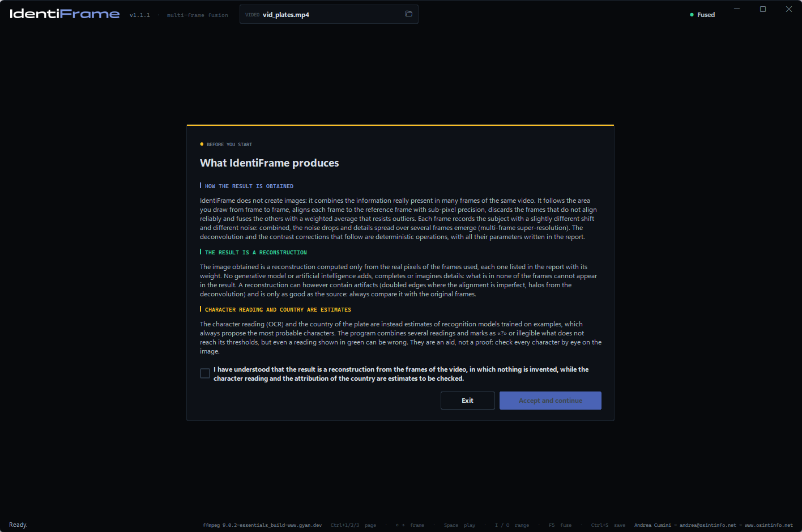
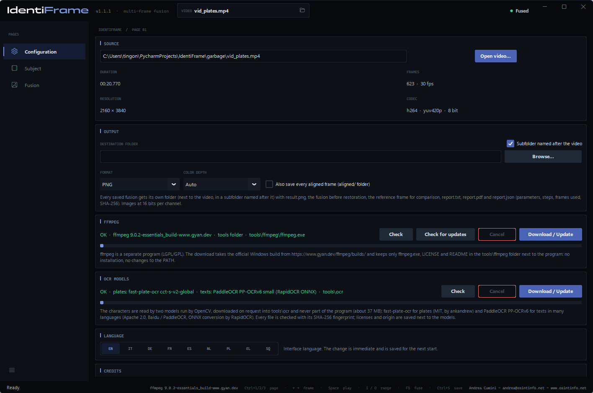
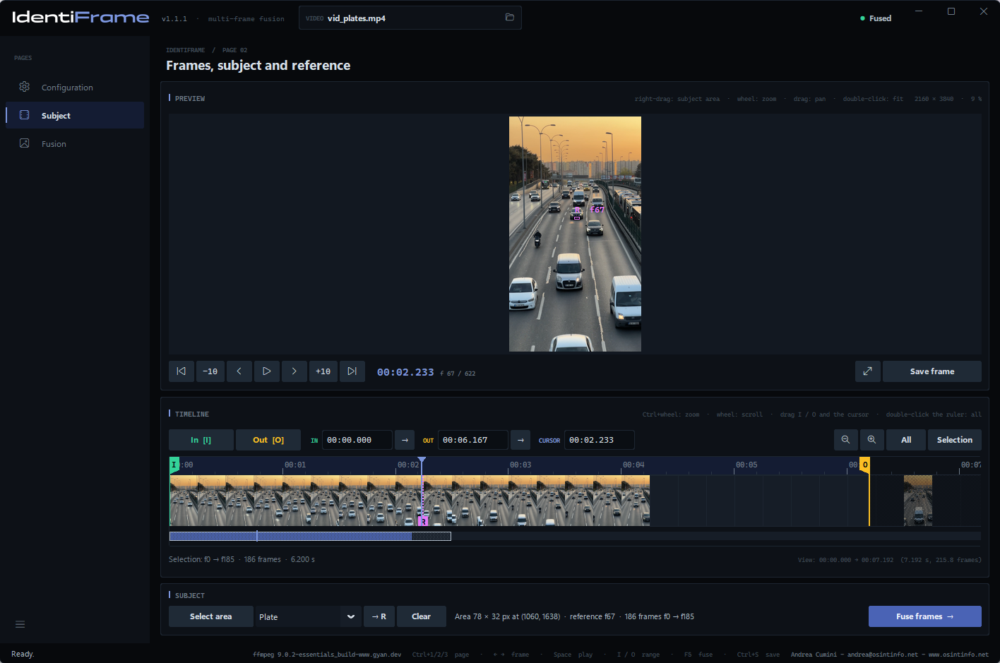
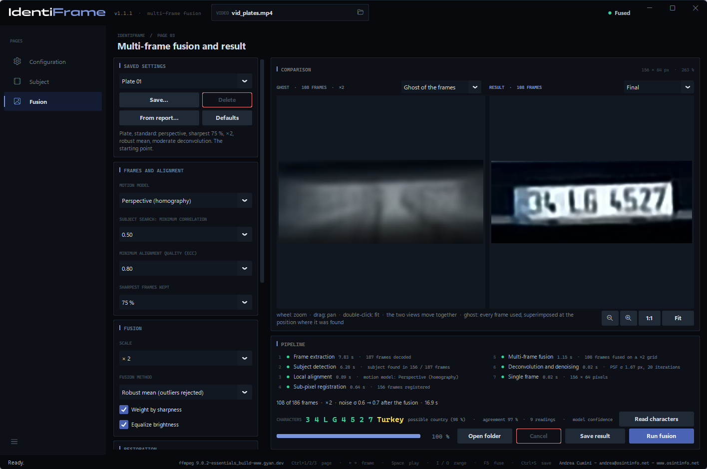
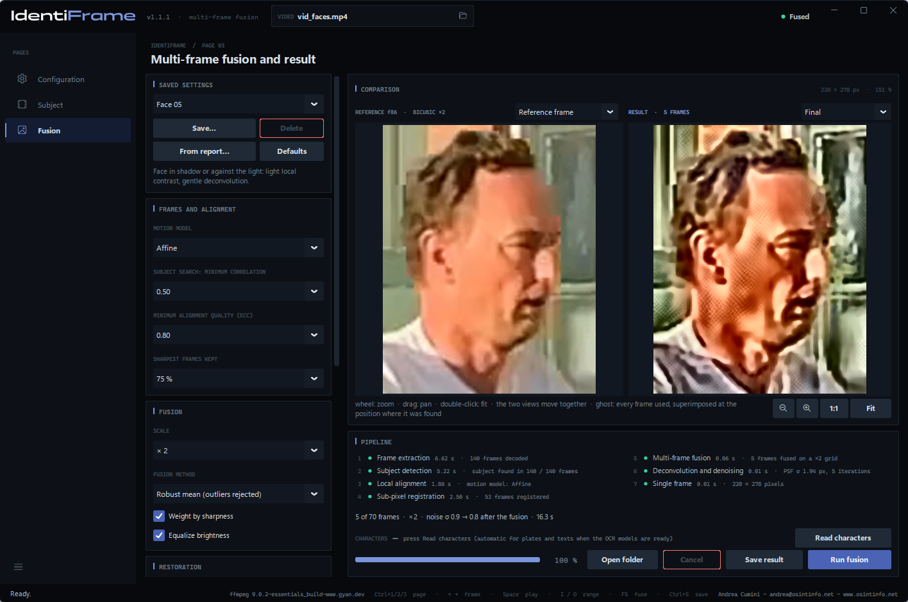
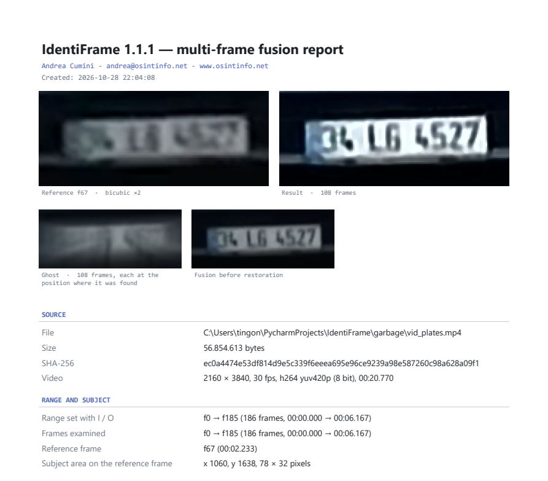
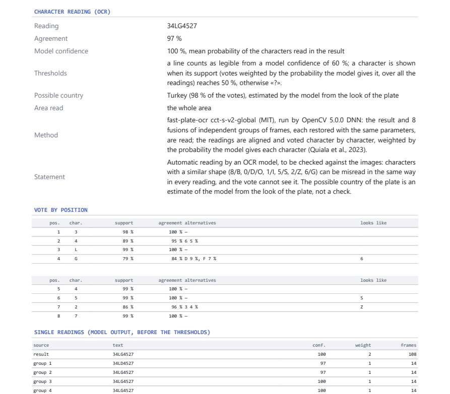

# IdentiFrame — User manual

**English** · [Italiano](manual.it.md) · [Deutsch](manual.de.md) · [Français](manual.fr.md) · [Español](manual.es.md) · [Nederlands](manual.nl.md) · [Polski](manual.pl.md) · [Ελληνικά](manual.el.md) · [Shqip](manual.sq.md)

IdentiFrame improves the legibility of a small detail — a license plate, a
face, a sign — filmed in several frames of a video. It aligns those frames
with sub-pixel precision, fuses them on a finer grid, reduces noise and blur,
and produces **one single image** with a report that documents every
parameter and every step.

*Andrea Cumini — www.osintinfo.net — andrea@osintinfo.net*

## Contents

1. [How it works](#1-how-it-works)
2. [Installation and first start](#2-installation-and-first-start)
3. [Configuration page](#3-configuration-page)
4. [Subject page: frames, subject and reference](#4-subject-page-frames-subject-and-reference)
5. [Fusion page](#5-fusion-page)
6. [Saving: images and report](#6-saving-images-and-report)
7. [Getting the most out of a plate or a face](#7-getting-the-most-out-of-a-plate-or-a-face)
8. [Limits and correct use](#8-limits-and-correct-use)
9. [Keyboard shortcuts](#9-keyboard-shortcuts)
10. [OCR models (optional)](#10-ocr-models-optional)

## 1. How it works

Every frame of a video records the subject at a slightly different position
with respect to the pixel grid, and with its own random noise. IdentiFrame
uses this: it finds the subject in each frame, aligns all frames to one
**reference frame** with sub-pixel precision, and combines them. Noise drops
and part of the detail lost by each single frame comes back. Nothing is
invented: the result only contains what the frames support.

The work is done in seven steps, shown in the *Pipeline* box:

| Step | What happens |
| --- | --- |
| 1. Frame extraction | The chosen range is decoded by FFmpeg, exact to the frame. |
| 2. Subject detection | The subject is followed frame by frame, forwards and backwards from the reference. |
| 3. Local alignment | Every frame is aligned to the reference (ECC algorithm; translation, rotation, affine or perspective model). |
| 4. Sub-pixel registration | The alignment is refined at full resolution; the sharpest, best aligned frames are chosen. |
| 5. Multi-frame fusion | The frames are resampled on a grid up to 4 times finer and combined, rejecting outliers. |
| 6. Deconvolution and denoising | Auto levels, optional noise reduction and Richardson-Lucy deconvolution on the luminance. |
| 7. Single frame | Final image, ghost of the frames, comparison with the reference, data for the report. |

## 2. Installation and first start

**Executable (Windows 10/11, 64-bit).** Unzip `IdentiFrame-<version>-windows-x64.zip`
anywhere and run `IdentiFrame.exe`. Python is not needed. The executable is
not signed: the first time, Windows SmartScreen may ask for confirmation.

**From the sources.** With Python 3.10 or later:

```bash
python -m pip install -r requirements.txt
python IdentiFrame.py
```

**Notice at start.** Every start opens with a notice to accept: it explains
that the result is a reconstruction computed only from the real pixels of
the frames, in which nothing is invented, while the character reading and
the country are estimates to be checked. *Accept and continue* becomes
active after ticking the declaration. On the very first start the language
is asked first, and the notice appears in the chosen language.



**FFmpeg.** IdentiFrame uses FFmpeg to read videos but does not include it.
On the first start, if FFmpeg is missing, the **Configuration** page opens
on the *FFmpeg* box: **Download / Update** fetches the official Windows build
into the `tools\ffmpeg` folder next to the program. Nothing is installed on
the system.

A video can also be opened from the command line:
`IdentiFrame.exe video.mp4`.

## 3. Configuration page



- **Source** — **Open video…** (or Ctrl+O, or the folder icon in the *VIDEO*
  box at the top). Duration, number of frames, resolution and codec are shown
  here. When a video is opened, the program moves to the *Subject* page.
- **Output** — *Destination folder* where the fusions are saved (empty = next
  to the video), *Subfolder named after the video*, *Format* (PNG or TIFF)
  and *Color depth* (*Auto* = 16 bits per channel for the fusion). *Also save
  every aligned frame* adds an `aligned/` folder with every frame used,
  aligned to the reference.
- **FFmpeg** — where FFmpeg is and which version: **Check**, **Check for
  updates**, **Download / Update**.
- **OCR models** — the two optional models that read the characters of plates and texts, downloaded on request into `tools\ocr` (about 37 MB): **Check** and **Download / Update**. Without them the program works, without the character reading. See [10. OCR models](#10-ocr-models-optional).
- **Language** — the interface and the reports are available in nine
  languages: EN, IT, DE, FR, ES, NL, PL, EL, SQ. The change is immediate and
  is remembered.
- **Credits** — author and license.

## 4. Subject page: frames, subject and reference



The *Preview* shows the frame under the cursor: the **wheel** zooms around
the mouse (up to the real pixels), **dragging** pans, a **double-click**
fits the frame again. Below, the buttons move by one or ten frames;
**← →** and **Shift+← →** do the same from the keyboard.

The **play** button in the middle plays the preview from the cursor and
becomes **pause** while it plays (Space does the same); the playhead and the
timeline follow, so a range can be marked with I and O while watching.
Clicking the timeline or moving by frames stops the playback.

The *Timeline* shows the whole video as a film strip. **Ctrl+wheel** zooms,
the **wheel** scrolls; clicking or dragging moves the cursor. *All* and
*Selection* adjust the view.

**1. Choose the reference frame.** Move to the frame in which the subject is
**largest and sharpest** — for a vehicle that approaches, usually one of the
last frames in which the whole plate is still visible.

**2. Select the area of the subject.** Drag with the **right mouse button**
over the plate or the face, or press **Select area** and drag with the left
one. Frame the subject with a small margin. The frame shown becomes the
**reference** (marker **R** on the timeline, **→ R** brings the cursor back to
it) and **the fusion starts by itself**: the program moves to the *Fusion*
page. Drawing a new area while it runs restarts it. **Clear** removes the
area.

**3. Choose the range.** **In [I]** and **Out [O]** (keys I and O) set the first
and last frame to use: the frames in which the subject is visible and not
covered. The I and O flags can also be dragged, and the IN / OUT fields accept a
time (`1:23.456`) or a frame (`f2000`). Every time the area is drawn, the range
is set to 30 seconds before and 30 after the reference (within the video): these
are only the limits of the search. The fusion follows the subject from the
reference outwards and stops, in each direction, after one second without it;
then the I and O flags close in on the frames where it was followed (the report
says so). A range moved by hand is left as it is. After changing the range,
**Fuse frames →** (or F5) runs the fusion again. At most 3601 frames in the
range.

## 5. Fusion page



**Comparison.** On the left, the **Ghost of the frames**: all the frames
used, superimposed at the position where each one was found, before the
alignment. It shows what goes into the fusion and how much the subject
moves. With the menu above it, the left view can show the **Reference
frame** instead, enlarged with bicubic interpolation: this is the fair
"before" image. On the right, the result: **Final**, or **Fusion only**
(before noise reduction and deconvolution). The two views zoom and pan
together. Besides the wheel, the buttons under the views zoom out (**−**,
also below the fitted size, to see the result small), zoom in (**+**), show
it at **1:1** or **Fit** it to the view; on the keyboard **−**, **+** and
**0**.



The second picture shows a face, with the preset **Face 05**, the reference
frame on the left.

**Characters.** With the OCR models downloaded, after every fusion of a *Plate* or a *Text* the **CHARACTERS** line of the *Pipeline* box shows the characters read (**Read characters** repeats it). The result and eight fusions of independent groups of frames are read and voted character by character. The recognition models always propose the most probable characters, even where nothing can be read: a line is shown only from a model confidence of 60 %, otherwise the program writes **illegible**, and a character that does not gather at least 50 % of the weighted votes is shown as **«?»**. For a plate, the **possible country** estimated by the model appears in yellow next to the characters only when the reading is legible and one country has the majority of the votes; otherwise it is among the details, with its share. The details also give the **agreement** between the readings, the **model confidence**, the **doubtful** positions and the characters to **check by eye** (8/B, 0/D/O, 1/I, 5/S, 2/Z, 6/G). A *Text* can have several lines, separated by «|», each voted on its own. In the first picture the plate is very small (characters about 12 pixels high in the video) and is read as 34LG4527, possible country Turkey. Reading and country are estimates: always compare with the image.

**Pipeline.** The seven steps with their outcome and time; below, the
summary (frames used, scale, noise before and after the fusion), the
progress bar and the buttons **Open folder**, **Cancel**, **Save result**,
**Run fusion**. Steps 1–4 depend only on video, range, reference, area and
motion model: when only the fusion or restoration parameters change, they
are reused and a new fusion takes a fraction of a second (*reused* in the
step list).

### Parameters

The column on the left groups the parameters by step.

**Subject type.** The menu next to *Select area*, in the *Subject* box of the *Subject* page, says what is being enhanced. **Plate** and **Text**: a flat, rigid subject, one motion model per frame; they differ in the character reading (a model made for plates, or one for texts on one or more lines, in many languages). **Face**: a head turns and an expression changes between frames, so after the rigid alignment every frame receives a local non-rigid refinement that follows these movements within a few pixels; the parts that still differ count less, frames with a different pose or expression are left out, the restoration is lighter and the auto levels are gentler on skin and shadows. Changing the type loads its defaults and runs the alignment again. Nothing is invented: the refinement only moves by a few pixels what the frames contain. For a face the motion model is affine by default, the alignment refuses deformations that are not a possible motion of the head, and outside the ellipse inscribed in the area the result shows the reference frame, because the background moves differently.

**Saved settings.** Named sets of parameters: **Save…** asks for a name and
stores the current parameters; choosing a name in the menu loads them;
**Delete** removes the chosen set; **Defaults** puts every parameter back.
**From report…** loads the parameters from the `report.json` of a fusion
saved earlier, to repeat it exactly. The parameters in use are also
remembered when the program closes.

**Built-in presets.** The *Saved settings* menu always starts with five presets for the subject type chosen on the Subject page: **Plate 01** standard, **02** night or noise, **03** distant small plate, **04** moving vehicle with motion blur, **05** shadow or backlight; **Text 01–05** the same five cases for texts; **Face 01** standard, **02** night or noise, **03** minimal processing, **04** distant small face, **05** shadow or backlight. A line under the menu describes the one chosen; they cannot be changed or deleted, and your own settings follow.

| Box | Parameter | Effect |
| --- | --- | --- |
| Subject page | Subject type | Plate (default) or Text for a flat, rigid subject (they differ in the character reading); Face adds the local non-rigid refinement and a lighter restoration. |
| Frames and alignment | Motion model | Translation, rotation + translation, affine, **perspective (homography)** — default; follows a subject that approaches, moves away or turns. If a frame does not converge, a simpler model is tried. |
| | Subject search: minimum correlation | Below this score the subject counts as not found in a frame. |
| | Minimum alignment quality (ECC) | Frames aligned worse than this are left out (0.80 by default). |
| | Sharpest frames kept | 75 % by default: the least sharp quarter (motion blur) is left out. |
| Fusion | Scale | × 1 (noise reduction only) to × 4. × 2 or × 3 is usually the right choice. |
| | Fusion method | **Robust mean (outliers rejected)** — default; median; shift-and-add with normalized convolution. |
| | Weight by sharpness | Sharper frames count much more. |
| | Equalize brightness | Compensates exposure changes between frames. |
| Restoration | Noise reduction | Off, light, medium, strong (bilateral filter). |
| | Deconvolution iterations | Richardson-Lucy: more iterations sharpen more, but also amplify noise and halos. 20 by default. |
| | PSF σ (output pixels) | Width of the blur to remove. *Automatic* measures it on the edges of the fused image. |
| | Regularization (total variation) | Holds the noise back during the deconvolution. Medium by default. |
| Presentation | Auto levels | Black and white at the 0.5 and 99.5 percentiles of the luminance, before the deconvolution. |
| | Local contrast (CLAHE) | Equalization by zones: useful on plates in shadow or against the light. |
| | Grayscale | Drops the color: often cleaner for reading characters. |

## 6. Saving: images and report

**Save result** (Ctrl+S on the *Fusion* page) creates a new folder
`fusion_f<reference>_<date-time>` in the destination folder, with:

| File | Content |
| --- | --- |
| `result.png` | the final image |
| `fused.png` | the fusion before noise reduction and deconvolution |
| `ghost.png` | the ghost of the frames used |
| `reference_x<k>.png` | the reference area enlarged with bicubic interpolation, for comparison |
| `reference_crop.png` | the same area at the video resolution |
| `report.pdf` | the report laid out on A4, with the images |
| `report.txt` | the same report as plain text |
| `report.json` | the same data in structured form, including the settings (**From report…** reloads them) |
| `aligned/` | on request, every frame used, aligned to the reference |



With a reading of the characters, the report has the section **Character reading (OCR)**: the reading, the agreement, the model confidence, for a plate the possible country and the area read, for a text the lines found, the method, the vote by position with the alternatives and the look-alike characters, and every single reading.



The report is written in the interface language. It contains the source
(path, size, **SHA-256** fingerprint, format), range, reference frame and
area, all parameters, the seven steps with the methods used and their
times, the table of the frames (search score, alignment coefficients,
sub-pixel shift, sharpness, weight, reason for exclusion), noise estimates
and the SHA-256 of every image written. Whoever reads it can repeat the
processing and check that the files have not changed.

*Save frame* on the *Subject* page saves instead the single frame under the
cursor, at full resolution and without loss.

## 7. Getting the most out of a plate or a face

- **Face**: choose the *Face* subject type first; frame the whole face with a small margin, on a frame where it looks at the camera if possible, and keep the range to the frames with the same pose. The report says how many frames were left out for a different pose or expression and how wide the face is in the video: below about 60 pixels, expect a cleaner overall appearance, not identifying features.
- **Reference**: the frame in which the subject is largest and sharpest.
- **Range**: only the frames in which the subject is fully visible. Frames
  far from the reference (much smaller, other perspective) bring little and
  are often left out by the quality threshold anyway.
- **Area**: the whole plate or face with a small margin; not much
  background, which may move differently.
- **Scale**: × 2 or × 3. × 4 is worth it only with many frames.
- **Characters still soft?** Raise *PSF σ* by one step (e.g. from Automatic
  to the next value above the one shown in the report), or the
  *Deconvolution iterations*.
- **Halos or "ringing" around the characters?** Lower *PSF σ* or the
  iterations, or raise the *Regularization*.
- **Plate in shadow or against the light**: *Local contrast (CLAHE)* light
  or medium, often together with *Grayscale*.
- **Compare** always with the *Reference frame* view, zooming in on the
  characters: what is not readable there and only appears after strong
  sharpening must be treated with caution.
- Save a set of parameters that works for a camera with **Save…** and reuse
  it.

## 8. Limits and correct use

- The result is an **enhancement** of the recorded frames, not a
  reconstruction of reality: it cannot recover what no frame contains.
- Fine details at the limit of the resolution, and characters that look
  alike (8/B, 0/D, 1/7, 5/S), must be checked against the source frames
  before drawing conclusions.
- The gain is greatest with many frames, small shifts between them,
  independent noise and a sharp-enough reference. Motion blur within a
  single frame is not removed.
- Heavy compression produces errors that are the same in consecutive frames:
  the fusion reduces them less than random noise.
- Plates and faces are personal data: use the program within the rules that
  apply to you.

## 9. Keyboard shortcuts

| Keys | Action |
| --- | --- |
| Ctrl+1 / Ctrl+2 / Ctrl+3 | Configuration / Subject / Fusion page |
| Ctrl+O | Open video |
| ← / → | Previous / next frame |
| Shift+← / Shift+→ | Back / forward 10 frames |
| Space | Play or pause the preview |
| Home / End | First / last frame |
| I / O | Start / end of the range at the cursor |
| + / − | Zoom the timeline in / out |
| F | Whole video on the timeline |
| Right-drag on the preview | Select the subject area (the fusion starts) |
| Esc | Leave *Select area* |
| − / + / 0 (Fusion page) | Zoom the result out / in / fit |
| F11 | Larger preview: hides or shows the timeline (Subject page) |
| F5 | Run the fusion |
| Ctrl+S | Save the result (Fusion page) or the frame (Subject page) |


## 10. OCR models (optional)

The character reading uses two neural network models, run by OpenCV, which is already part of the program. They are **not included** in IdentiFrame and are **optional**: without them everything else works as usual, and only the CHARACTERS line stays empty. To use them, press **Download / Update** in the **OCR models** box of the *Configuration* page: they go into the `tools\ocr` folder next to the program (about 37 MB), and the box shows which ones are present.

| Subject | Model | License |
| --- | --- | --- |
| Plate | [fast-plate-ocr](https://github.com/ankandrew/fast-plate-ocr) `cct-s-v2-global`, by ankandrew: reads the whole plate and estimates its possible country among 65 | MIT, code and weights ([confirmed by the author](https://github.com/ankandrew/fast-plate-ocr/issues/97)) |
| Text | [PaddleOCR](https://github.com/PaddlePaddle/PaddleOCR) PP-OCRv6 small, by Baidu / PaddleOCR, in the ONNX conversion of [RapidOCR](https://github.com/RapidAI/RapidOCR): finds the text lines and reads them in many languages | Apache 2.0 |

Every file is checked against its SHA-256 fingerprint before it is kept; the license texts and a `SOURCE.txt` file with the origin are saved next to the models. The country is an estimate from the look of the plate, not a check, and is shown with English country names.

*Test videos and screenshots, from Pexels, used under the [Pexels license](https://www.pexels.com/license/): “[Busy Highway Traffic at Sunset](https://www.pexels.com/it-it/video/traffico-autostradale-intenso-al-tramonto-31779728/)” by [Şeyhmus Kino](https://www.pexels.com/@seyhmuskino/) (vehicles and plates), street traffic in Taipei, Taiwan by [Levi Wedge](https://www.pexels.com/@levi-wedge-266970209/) ([video](https://www.pexels.com/it-it/video/citta-auto-traffico-veicoli-13271103/), texts) and “[Charming European Street with Cyclist](https://www.pexels.com/it-it/video/affascinante-strada-europea-con-ciclista-33476096/)” by [Tuba Din](https://www.pexels.com/@tubadinn/) (face). The plates, the texts and the face visible in the screenshots belong to that footage.*

---

IdentiFrame is free software under the GNU GPL v3 with author attribution:
see `LICENSE` and `NOTICE`. Andrea Cumini - andrea@osintinfo.net - www.osintinfo.net
