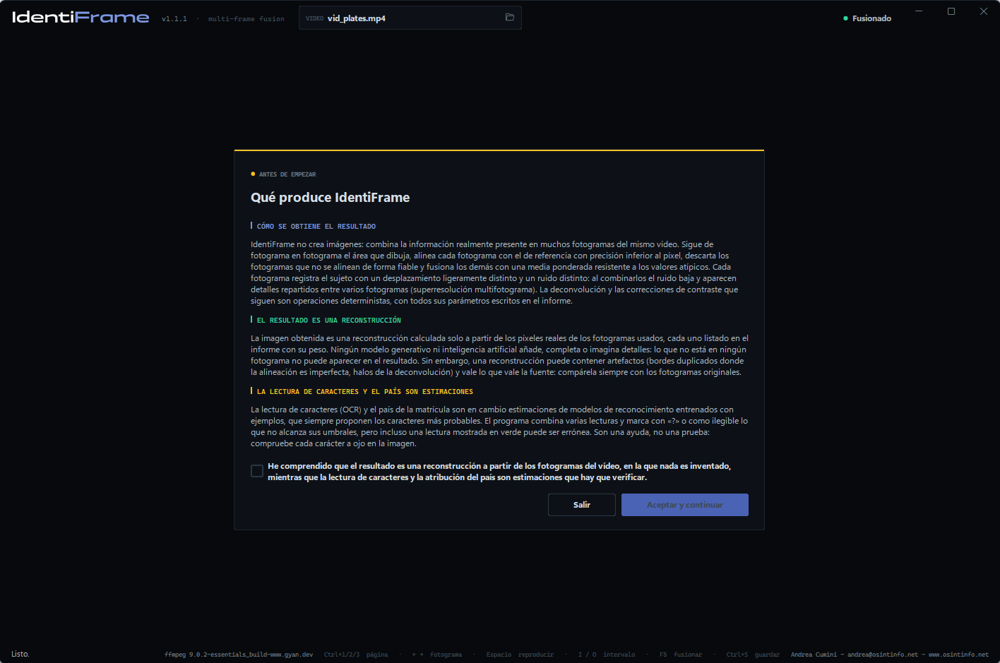
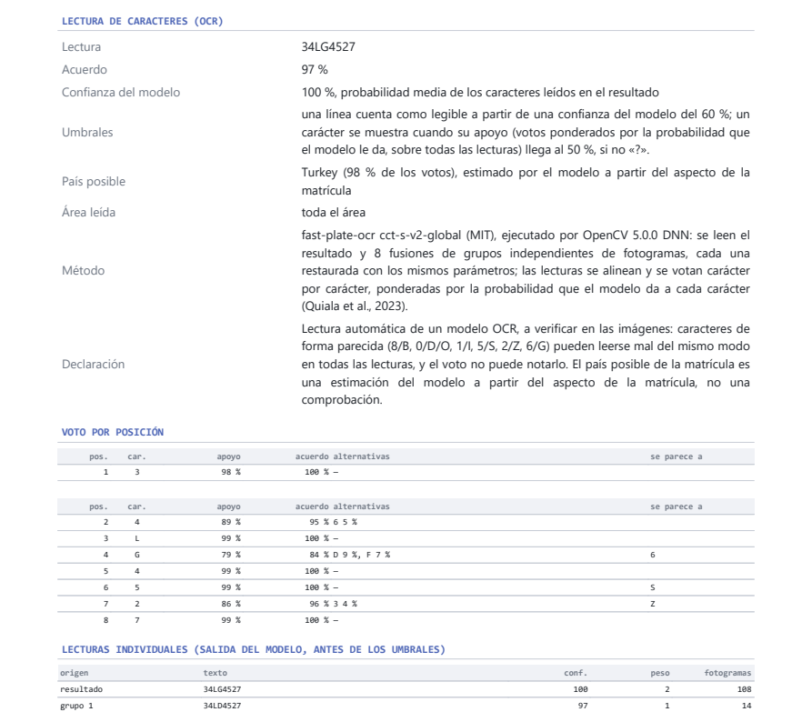

# IdentiFrame — Manual de usuario

[English](manual.en.md) · [Italiano](manual.it.md) · [Deutsch](manual.de.md) · [Français](manual.fr.md) · **Español** · [Nederlands](manual.nl.md) · [Polski](manual.pl.md) · [Ελληνικά](manual.el.md) · [Shqip](manual.sq.md)

IdentiFrame mejora la legibilidad de un detalle pequeño —una matrícula, un
rostro, un cartel— grabado en varios fotogramas de un vídeo. Alinea esos
fotogramas con precisión subpíxel, los fusiona en una cuadrícula más fina,
reduce el ruido y el desenfoque y produce **una sola imagen** con un informe
que documenta cada parámetro y cada paso.

*Andrea Cumini — www.osintinfo.net — andrea@osintinfo.net*

## Índice

1. [Cómo funciona](#1-cómo-funciona)
2. [Instalación y primer inicio](#2-instalación-y-primer-inicio)
3. [Página Configuración](#3-página-configuración)
4. [Página Sujeto: fotogramas, sujeto y referencia](#4-página-sujeto-fotogramas-sujeto-y-referencia)
5. [Página Fusión](#5-página-fusión)
6. [Guardado: imágenes e informe](#6-guardado-imágenes-e-informe)
7. [Sacar el máximo partido de una matrícula o un rostro](#7-sacar-el-máximo-partido-de-una-matrícula-o-un-rostro)
8. [Límites y uso correcto](#8-límites-y-uso-correcto)
9. [Atajos de teclado](#9-atajos-de-teclado)
10. [Modelos OCR (opcionales)](#10-modelos-ocr-opcionales)

## 1. Cómo funciona

Cada fotograma de un vídeo registra el sujeto en una posición ligeramente
distinta respecto a la cuadrícula de píxeles, y con su propio ruido aleatorio.
IdentiFrame aprovecha esto: encuentra el sujeto en cada fotograma, alinea
todos los fotogramas con un único **fotograma de referencia** con precisión
subpíxel y los combina. El ruido disminuye y vuelve parte del detalle que cada
fotograma perdía por separado. No se inventa nada: el resultado solo contiene
lo que los fotogramas respaldan.

El trabajo se realiza en siete pasos, que se muestran en el recuadro *Pipeline*:

| Paso | Qué ocurre |
| --- | --- |
| 1. Extracción de fotogramas | FFmpeg decodifica el intervalo elegido, con precisión de fotograma. |
| 2. Detección del sujeto | El sujeto se sigue fotograma a fotograma, hacia delante y hacia atrás desde la referencia. |
| 3. Alineación local | Cada fotograma se alinea con la referencia (algoritmo ECC; modelo de traslación, rotación, afín o perspectiva). |
| 4. Registro subpíxel | La alineación se refina a resolución completa; se eligen los fotogramas más nítidos y mejor alineados. |
| 5. Fusión multifotograma | Los fotogramas se remuestrean en una cuadrícula hasta 4 veces más fina y se combinan, descartando los valores atípicos. |
| 6. Deconvolución y reducción de ruido | Niveles automáticos, reducción de ruido opcional y deconvolución de Richardson-Lucy sobre la luminancia. |
| 7. Fotograma único | Imagen final, fantasma de los fotogramas, comparación con la referencia, datos para el informe. |

## 2. Instalación y primer inicio

**Ejecutable (Windows 10/11, 64 bits).** Descomprima `IdentiFrame-<versión>-windows-x64.zip`
en cualquier carpeta y ejecute `IdentiFrame.exe`. No necesita Python. El
ejecutable no está firmado: la primera vez, Windows SmartScreen puede pedir
confirmación.

**Desde el código fuente.** Con Python 3.10 o posterior:

```bash
python -m pip install -r requirements.txt
python IdentiFrame.py
```

**Aviso al iniciar.** En cada inicio aparece un aviso que hay que aceptar:
explica que el resultado es una reconstrucción calculada solo a partir de
los píxeles reales de los fotogramas, en la que nada es inventado, mientras
que la lectura de caracteres y el país son estimaciones que hay que
verificar. *Aceptar y continuar* se activa tras marcar la declaración. En el
primerísimo inicio se pregunta antes el idioma, y el aviso aparece en el
idioma elegido.



**FFmpeg.** IdentiFrame usa FFmpeg para leer los vídeos, pero no lo incluye.
En el primer inicio, si falta FFmpeg, la página **Configuración** se abre en
el recuadro *FFmpeg*: **Descargar / Actualizar** descarga la compilación
oficial para Windows en la carpeta `tools\ffmpeg`, junto al programa. No se
instala nada en el sistema.

También se puede abrir un vídeo desde la línea de comandos:
`IdentiFrame.exe video.mp4`.

## 3. Página Configuración


- **Origen** — **Abrir vídeo…** (o Ctrl+O, o el icono de carpeta del recuadro
  *VIDEO* de la parte superior). Aquí se muestran la duración, el número de
  fotogramas, la resolución y el códec. Al abrir un vídeo, el programa pasa a
  la página *Sujeto*.
- **Salida** — *Carpeta de destino* donde se guardan las fusiones (vacía =
  junto al vídeo), *Subcarpeta con el nombre del vídeo*, *Formato* (PNG o
  TIFF) y *Profundidad de color* (*Auto* = 16 bits por canal para la fusión).
  *Guardar también cada fotograma alineado (carpeta aligned/)* añade una
  carpeta `aligned/` con cada fotograma usado, alineado con la referencia.
- **FFmpeg** — dónde está FFmpeg y qué versión es: **Comprobar**, **Buscar
  actualizaciones**, **Descargar / Actualizar**.
- **Modelos OCR** — los dos modelos opcionales que leen los caracteres de matrículas y textos, descargados a petición en `tools\ocr` (unos 37 MB): **Comprobar** y **Descargar / Actualizar**. Sin ellos el programa funciona, sin la lectura de caracteres. Ver [10. Modelos OCR](#10-modelos-ocr-opcionales).
- **Idioma** — la interfaz y los informes están disponibles en nueve idiomas:
  EN, IT, DE, FR, ES, NL, PL, EL, SQ. El cambio es inmediato y se recuerda.
- **Créditos** — autor y licencia.

## 4. Página Sujeto: fotogramas, sujeto y referencia


La *Vista previa* muestra el fotograma bajo el cursor: la **rueda** hace zoom
alrededor del ratón (hasta los píxeles reales), **arrastrar** mueve la imagen
y un **doble clic** vuelve a ajustar el fotograma. Debajo, los botones avanzan
o retroceden uno o diez fotogramas; **← →** y **Mayús+← →** hacen lo mismo
desde el teclado.

El botón **reproducir** del centro reproduce la vista previa desde el cursor
y durante la reproducción se convierte en **pausa** (Espacio hace lo mismo);
el cursor y la línea de tiempo siguen, así que se puede marcar un intervalo
con I y O mientras se mira. Un clic en la línea de tiempo o un movimiento de
fotograma detienen la reproducción.

El recuadro *Timeline* (la línea de tiempo) muestra todo el vídeo como una
tira de película. **Ctrl+rueda** hace zoom, la **rueda** desplaza la vista;
hacer clic o arrastrar mueve el cursor. *Todo* y *Selección* ajustan la vista.

**1. Elija el fotograma de referencia.** Desplácese hasta el fotograma en el
que el sujeto es **más grande y más nítido**; en un vehículo que se acerca,
suele ser uno de los últimos fotogramas en los que la matrícula todavía se ve
entera.

**2. Seleccione el área del sujeto.** Arrastre con el **botón derecho del
ratón** sobre la matrícula o el rostro, o pulse **Seleccionar área** y
arrastre con el izquierdo. Encuadre el sujeto con un pequeño margen. El
fotograma mostrado se convierte en la **referencia** (marcador **R** en la
línea de tiempo; **→ R** devuelve el cursor a él) y **la fusión se inicia
sola**: el programa pasa a la página *Fusión*. Si dibuja un área nueva
mientras la fusión está en curso, esta se reinicia. **Borrar** elimina el
área.

**3. Elija el intervalo.** **Entrada [I]** y **Salida [O]** (teclas I y O)
establecen el primer y el último fotograma que se usarán: los fotogramas en los
que el sujeto es visible y no está tapado. Las marcas I y O también se pueden
arrastrar, y los campos IN / OUT aceptan un tiempo (`1:23.456`) o un fotograma
(`f2000`). Cada vez que se dibuja el área, el intervalo se establece en 30
segundos antes y 30 después de la referencia (dentro del vídeo): son solo los
límites de la búsqueda. La fusión sigue al sujeto desde la referencia hacia
fuera y se detiene, en cada sentido, tras un segundo sin verlo; después las
marcas I y O se ajustan a los fotogramas en los que se siguió (el informe lo
indica). Un intervalo movido a mano se queda como está. Después de cambiar el
intervalo, **Fusionar fotogramas →** (o F5) vuelve a ejecutar la fusión. Como
máximo, 3601 fotogramas en el intervalo.

## 5. Página Fusión


**Comparación.** A la izquierda, el **Fantasma de los fotogramas**: todos
los fotogramas usados, superpuestos en la posición donde se encontró cada
uno, antes de la alineación. Muestra lo que entra en la fusión y cuánto se
mueve el sujeto. Con el menú situado encima, la vista izquierda puede
mostrar en su lugar el **Fotograma de referencia**, ampliado con
interpolación bicúbica: es la imagen «antes» con la que la comparación
resulta justa. A la derecha, el resultado: **Final**, o **Solo fusión**
(antes de la reducción de ruido y la deconvolución). Las dos vistas hacen
zoom y se mueven juntas. Además de con la rueda, los botones bajo las vistas
reducen (**−**, también por debajo del tamaño ajustado, para ver el
resultado pequeño), amplían (**+**), muestran a **1:1** o **ajustan** a la
vista; con el teclado **−**, **+** y **0**.


La segunda imagen muestra un rostro, con el ajuste **Face 05** y el fotograma
de referencia a la izquierda.

**Caracteres.** Con los modelos OCR descargados, tras cada fusión de una *Matrícula* o de un *Texto* la línea **CARACTERES** del recuadro *Pipeline* muestra los caracteres leídos (**Leer caracteres** la repite). Se leen el resultado y ocho fusiones de grupos independientes de fotogramas, y las lecturas se votan carácter por carácter. Los modelos de reconocimiento proponen siempre los caracteres más probables, incluso donde no se lee nada: una línea solo se muestra a partir de una confianza del modelo del 60 %, si no el programa escribe **ilegible**, y un carácter que no reúne al menos el 50 % de los votos ponderados aparece como **«?»**. En una matrícula, el **país posible** estimado por el modelo aparece en amarillo junto a los caracteres solo cuando la lectura es legible y un país tiene la mayoría de los votos; si no, figura entre los detalles, con su cuota. Los detalles indican también el **acuerdo** entre las lecturas, la **confianza del modelo**, las posiciones **dudosas** y los caracteres que hay que **comprobar a ojo** (8/B, 0/D/O, 1/I, 5/S, 2/Z, 6/G). Un *Texto* puede tener varias líneas, separadas por «|», votadas cada una por separado. En la primera imagen la matrícula es muy pequeña (caracteres de unos 12 píxeles de alto en el vídeo) y se lee 34LG4527, país posible Turkey. Lectura y país son estimaciones: compare siempre con la imagen.

**Pipeline.** Los siete pasos con su resultado y su tiempo; debajo, el resumen
(fotogramas usados, escala, ruido antes y después de la fusión), la barra de
progreso y los botones **Abrir carpeta**, **Cancelar**, **Guardar resultado**,
**Ejecutar fusión**. Los pasos 1–4 dependen solo del vídeo, el intervalo, la
referencia, el área y el modelo de movimiento: cuando solo cambian los
parámetros de fusión o de restauración, se reutilizan y una nueva fusión
tarda una fracción de segundo (*reutilizado* en la lista de pasos).

### Parámetros

La columna de la izquierda agrupa los parámetros por paso.

**Tipo de sujeto.** El menú junto a *Seleccionar área*, en el recuadro *Sujeto* de la página *Sujeto*, indica qué se está mejorando. **Matrícula** y **Texto**: un sujeto plano y rígido, un modelo de movimiento por fotograma; se diferencian en la lectura de caracteres (un modelo hecho para matrículas, o uno para textos en una o varias líneas, en muchos idiomas). **Rostro**: entre fotogramas la cabeza gira y la expresión cambia, así que tras la alineación rígida cada fotograma recibe un refinamiento local no rígido que sigue esos movimientos a pocos píxeles; las partes que siguen siendo distintas cuentan menos, los fotogramas con otra pose o expresión se descartan, la restauración es más ligera y los niveles automáticos son más suaves con la piel y las sombras. Cambiar el tipo carga sus valores predeterminados y repite la alineación. No se inventa nada: el refinamiento solo desplaza unos pocos píxeles lo que contienen los fotogramas. Para un rostro el modelo de movimiento es afín por defecto, la alineación rechaza las deformaciones que no son un movimiento posible de la cabeza y, fuera de la elipse inscrita en el área, el resultado muestra el fotograma de referencia, porque el fondo se mueve de otra manera.

**Ajustes guardados.** Conjuntos de parámetros con nombre: **Guardar…** pide
un nombre y guarda los parámetros actuales; al elegir un nombre en el menú, se
cargan; **Eliminar** quita el conjunto elegido; **Predeterminados** devuelve
cada parámetro a su valor predeterminado. **Desde informe…** carga los
parámetros del `report.json` de una fusión guardada anteriormente, para
repetirla exactamente. Los parámetros en uso también se recuerdan al cerrar el
programa.

**Ajustes de serie.** El menú *Ajustes guardados* empieza siempre con cinco ajustes para el tipo de sujeto elegido en la página Sujeto: **Plate 01** estándar, **02** noche o ruido, **03** matrícula lejana y pequeña, **04** vehículo en movimiento con desenfoque, **05** sombra o contraluz; **Text 01–05** los mismos cinco casos para textos; **Face 01** estándar, **02** noche o ruido, **03** procesado mínimo, **04** rostro lejano y pequeño, **05** sombra o contraluz. Una línea bajo el menú describe el elegido; no se pueden modificar ni borrar, y después vienen tus ajustes.

| Recuadro | Parámetro | Efecto |
| --- | --- | --- |
| Página Sujeto | Tipo de sujeto | Matrícula (predeterminado) o Texto para un sujeto plano y rígido (se diferencian en la lectura de caracteres); Rostro añade el refinamiento local no rígido y una restauración más ligera. |
| Fotogramas y alineación | Modelo de movimiento | Traslación, Rotación + traslación, Afín, **Perspectiva (homografía)** — predeterminado; sigue a un sujeto que se acerca, se aleja o gira. Si un fotograma no converge, se prueba un modelo más simple. |
| | Búsqueda del sujeto: correlación mínima | Por debajo de esta puntuación, se considera que el sujeto no se ha encontrado en un fotograma. |
| | Calidad mínima de alineación (ECC) | Los fotogramas alineados peor que este valor quedan excluidos (predeterminado: 0,80). |
| | Fotogramas más nítidos conservados | Predeterminado: 75 %; se excluye la cuarta parte menos nítida (desenfoque de movimiento). |
| Fusión | Escala | De × 1 (solo reducción de ruido) a × 4. × 2 o × 3 suele ser la elección adecuada. |
| | Método de fusión | **Media robusta (valores atípicos descartados)** — predeterminado; Mediana; Suma con desplazamiento (convolución normalizada). |
| | Ponderar por nitidez | Los fotogramas más nítidos cuentan mucho más. |
| | Igualar el brillo | Compensa los cambios de exposición entre fotogramas. |
| Restauración | Reducción de ruido | Ninguna, Ligera, Media, Fuerte (filtro bilateral). |
| | Iteraciones de deconvolución | Richardson-Lucy: más iteraciones aumentan la nitidez, pero también amplifican el ruido y los halos. Predeterminado: 20. |
| | PSF σ (píxeles de salida) | Anchura del desenfoque que se debe eliminar. *Automática* la mide en los bordes de la imagen fusionada. |
| | Regularización (variación total) | Contiene el ruido durante la deconvolución. Predeterminado: Media. |
| Presentación | Niveles automáticos | Negro y blanco en los percentiles 0,5 y 99,5 de la luminancia, antes de la deconvolución. |
| | Contraste local (CLAHE) | Ecualización por zonas: útil con matrículas en sombra o a contraluz. |
| | Escala de grises | Elimina el color: a menudo resulta más limpio para leer los caracteres. |

## 6. Guardado: imágenes e informe

**Guardar resultado** (Ctrl+S en la página *Fusión*) crea una carpeta nueva
`fusion_f<referencia>_<fecha-hora>` en la carpeta de destino, con:

| Archivo | Contenido |
| --- | --- |
| `result.png` | la imagen final |
| `fused.png` | la fusión antes de la reducción de ruido y la deconvolución |
| `ghost.png` | el fantasma de los fotogramas usados |
| `reference_x<k>.png` | el área de referencia ampliada con interpolación bicúbica, para la comparación |
| `reference_crop.png` | la misma área a la resolución del vídeo |
| `report.pdf` | el informe maquetado en A4, con las imágenes |
| `report.txt` | el mismo informe como texto plano |
| `report.json` | los mismos datos en forma estructurada, incluidos los ajustes (**Desde informe…** los vuelve a cargar) |
| `aligned/` | si se solicita, cada fotograma usado, alineado con la referencia |


Con una lectura de caracteres, el informe tiene la sección **Lectura de caracteres (OCR)**: la lectura, el acuerdo, la confianza del modelo, para una matrícula el país posible y el área leída, para un texto las líneas encontradas, el método, el voto por posición con las alternativas y los caracteres parecidos, y cada lectura individual.



El informe se escribe en el idioma de la interfaz. Contiene el origen (ruta,
tamaño, huella **SHA-256**, formato), el intervalo, el fotograma de referencia
y el área, todos los parámetros, los siete pasos con los métodos usados y sus
tiempos, la tabla de los fotogramas (puntuación de búsqueda, coeficientes de
alineación, desplazamiento subpíxel, nitidez, peso, motivo de exclusión), las
estimaciones de ruido y el SHA-256 de cada imagen escrita. Quien lo lea puede
repetir el procesamiento y comprobar que los archivos no han cambiado.

*Guardar fotograma*, en la página *Sujeto*, guarda en cambio solo el fotograma
bajo el cursor, a resolución completa y sin pérdida.

## 7. Sacar el máximo partido de una matrícula o un rostro

- **Rostro**: elija primero el tipo de sujeto *Rostro*; encuadre todo el rostro con un pequeño margen, a ser posible en un fotograma en el que mire a la cámara, y limite el rango a los fotogramas con la misma pose. El informe indica cuántos fotogramas se descartaron por otra pose o expresión y cuánto mide el rostro en el vídeo: por debajo de unos 60 píxeles, espere un aspecto general más limpio, no rasgos identificativos.
- **Referencia**: el fotograma en el que el sujeto es más grande y más nítido.
- **Intervalo**: solo los fotogramas en los que el sujeto es totalmente
  visible. Los fotogramas alejados de la referencia (mucho más pequeños, otra
  perspectiva) aportan poco y, de todos modos, el umbral de calidad suele
  excluirlos.
- **Área**: toda la matrícula o todo el rostro con un pequeño margen; poco
  fondo, que puede moverse de otra manera.
- **Escala**: × 2 o × 3. × 4 solo compensa con muchos fotogramas.
- **¿Caracteres todavía poco nítidos?** Suba *PSF σ* un paso (p. ej., de
  Automática al valor inmediatamente superior al indicado en el informe), o
  las *Iteraciones de deconvolución*.
- **¿Halos o «ringing» alrededor de los caracteres?** Baje *PSF σ* o las
  iteraciones, o suba la *Regularización (variación total)*.
- **Matrícula en sombra o a contraluz**: *Contraste local (CLAHE)* en *Ligera*
  o *Media*, a menudo junto con *Escala de grises*.
- **Compare** siempre con la vista *Fotograma de referencia*, haciendo zoom
  sobre los caracteres: lo que ahí no se lee y solo aparece tras un realce
  fuerte de la nitidez debe tratarse con cautela.
- Guarde con **Guardar…** un conjunto de parámetros que funcione para una
  cámara y reutilícelo.

## 8. Límites y uso correcto

- El resultado es una **mejora** de los fotogramas grabados, no una
  reconstrucción de la realidad: no puede recuperar lo que ningún fotograma
  contiene.
- Los detalles finos en el límite de la resolución, y los caracteres que se
  parecen entre sí (8/B, 0/D, 1/7, 5/S), deben comprobarse en los fotogramas
  originales antes de sacar conclusiones.
- La ganancia es mayor con muchos fotogramas, pequeños desplazamientos entre
  ellos, ruido independiente y una referencia suficientemente nítida. El
  desenfoque de movimiento dentro de un mismo fotograma no se elimina.
- Una compresión fuerte produce errores que son iguales en fotogramas
  consecutivos: la fusión los reduce menos que el ruido aleatorio.
- Las matrículas y los rostros son datos personales: utilice el programa
  dentro de las normas que le sean aplicables.

## 9. Atajos de teclado

| Teclas | Acción |
| --- | --- |
| Ctrl+1 / Ctrl+2 / Ctrl+3 | Página Configuración / Sujeto / Fusión |
| Ctrl+O | Abrir vídeo |
| ← / → | Fotograma anterior / siguiente |
| Mayús+← / Mayús+→ | Retroceder / avanzar 10 fotogramas |
| Espacio | Reproduce o pausa la vista previa |
| Inicio / Fin | Primer / último fotograma |
| I / O | Establecer el inicio / el final del intervalo en el cursor |
| + / − | Acercar / alejar la línea de tiempo |
| F | Todo el vídeo en la línea de tiempo |
| Arrastrar con el botón derecho en la vista previa | Seleccionar el área del sujeto (la fusión se inicia) |
| Esc | Salir de *Seleccionar área* |
| − / + / 0 (página Fusión) | Reducir / ampliar / ajustar el resultado |
| F11 | Vista previa más grande: oculta o muestra la línea de tiempo (página Sujeto) |
| F5 | Ejecutar la fusión |
| Ctrl+S | Guardar el resultado (página Fusión) o el fotograma (página Sujeto) |


## 10. Modelos OCR (opcionales)

La lectura de caracteres usa dos modelos de red neuronal, ejecutados por OpenCV, que ya forma parte del programa. **No están incluidos** en IdentiFrame y son **opcionales**: sin ellos todo lo demás funciona como siempre, y solo queda vacía la línea CARACTERES. Para usarlos, pulsa **Descargar / Actualizar** en el recuadro **Modelos OCR** de la página *Configuración*: van a la carpeta `tools\ocr` junto al programa (unos 37 MB), y el recuadro muestra cuáles están presentes.

| Sujeto | Modelo | Licencia |
| --- | --- | --- |
| Matrícula | [fast-plate-ocr](https://github.com/ankandrew/fast-plate-ocr) `cct-s-v2-global`, de ankandrew: lee la matrícula entera y estima su país posible entre 65 | MIT, código y pesos ([confirmado por el autor](https://github.com/ankandrew/fast-plate-ocr/issues/97)) |
| Texto | [PaddleOCR](https://github.com/PaddlePaddle/PaddleOCR) PP-OCRv6 small, de Baidu / PaddleOCR, en la conversión ONNX de [RapidOCR](https://github.com/RapidAI/RapidOCR): encuentra las líneas de texto y las lee en muchos idiomas | Apache 2.0 |

Cada archivo se comprueba con su huella SHA-256 antes de guardarse; junto a los modelos se guardan los textos de licencia y un archivo `SOURCE.txt` con la procedencia. El país es una estimación a partir del aspecto de la matrícula, no una comprobación, y se muestra con su nombre en inglés.

*Vídeos de prueba y capturas de pantalla, de Pexels, usados según la [licencia Pexels](https://www.pexels.com/license/): «[Busy Highway Traffic at Sunset](https://www.pexels.com/it-it/video/traffico-autostradale-intenso-al-tramonto-31779728/)» de [Şeyhmus Kino](https://www.pexels.com/@seyhmuskino/) (vehículos y matrículas), tráfico en una calle de Taipéi, Taiwán, de [Levi Wedge](https://www.pexels.com/@levi-wedge-266970209/) ([vídeo](https://www.pexels.com/it-it/video/citta-auto-traffico-veicoli-13271103/), textos) y «[Charming European Street with Cyclist](https://www.pexels.com/it-it/video/affascinante-strada-europea-con-ciclista-33476096/)» de [Tuba Din](https://www.pexels.com/@tubadinn/) (rostro). Las matrículas, los textos y el rostro visibles en las capturas son los de esas grabaciones.*

---

IdentiFrame es software libre bajo la GNU GPL v3 con atribución del autor:
consulte `LICENSE` y `NOTICE`. Andrea Cumini - andrea@osintinfo.net - www.osintinfo.net
