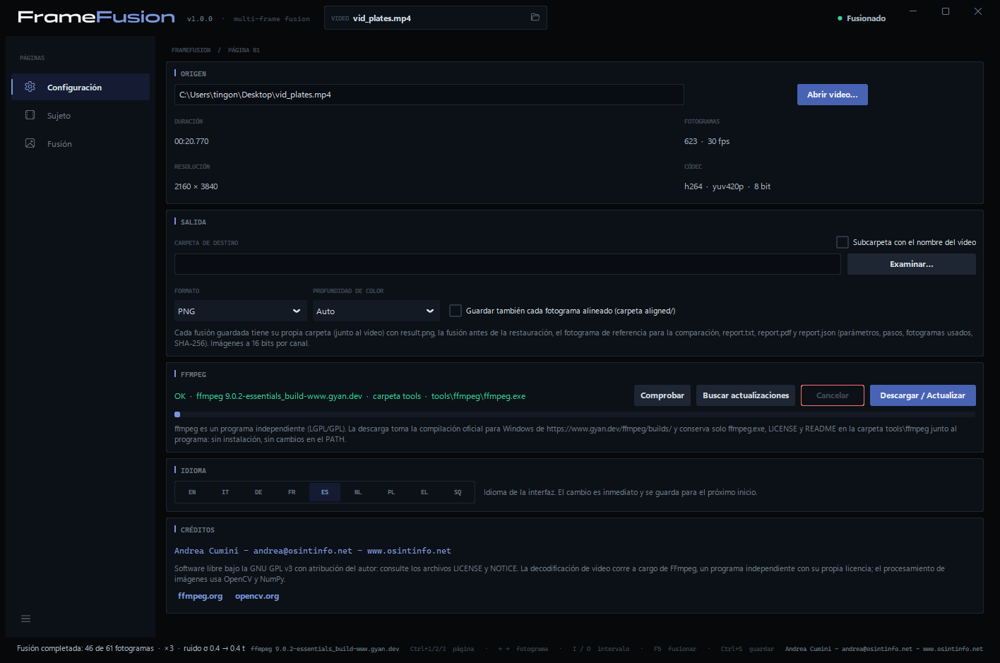
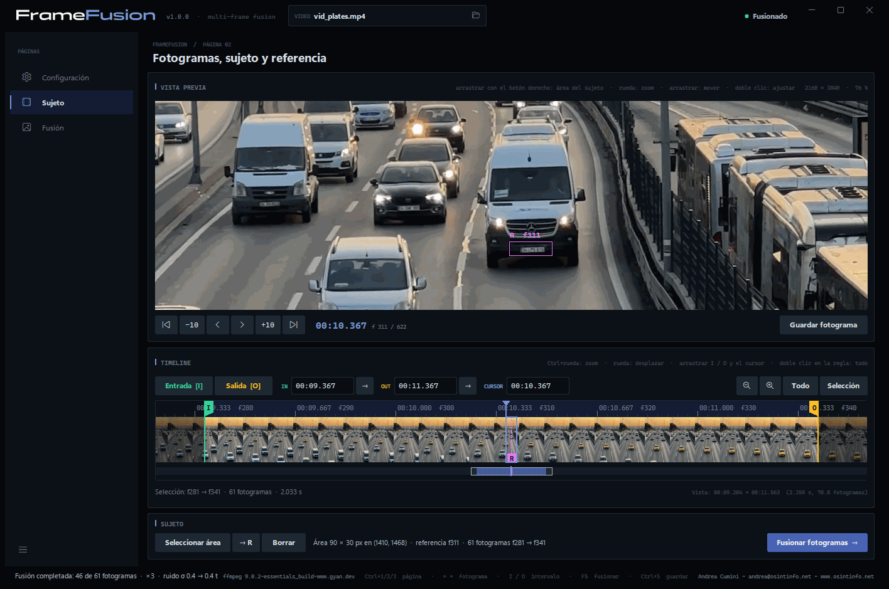
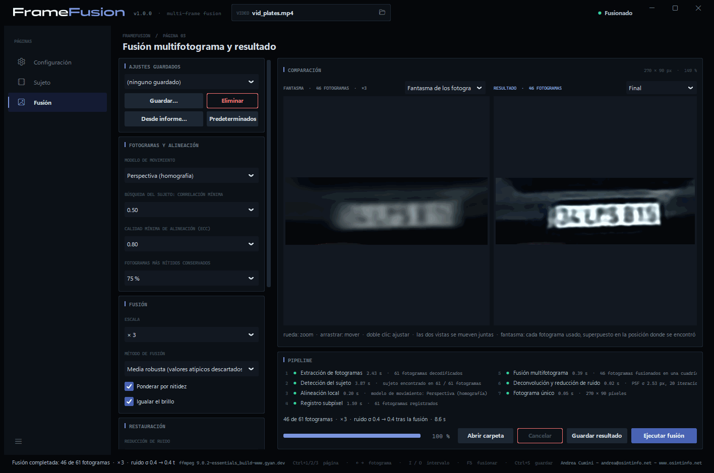
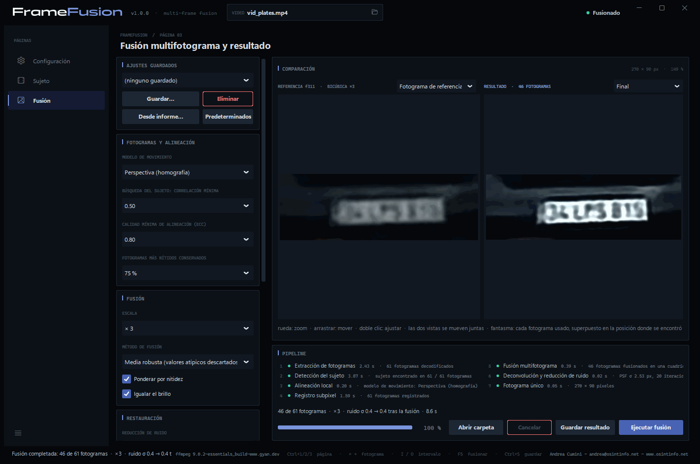
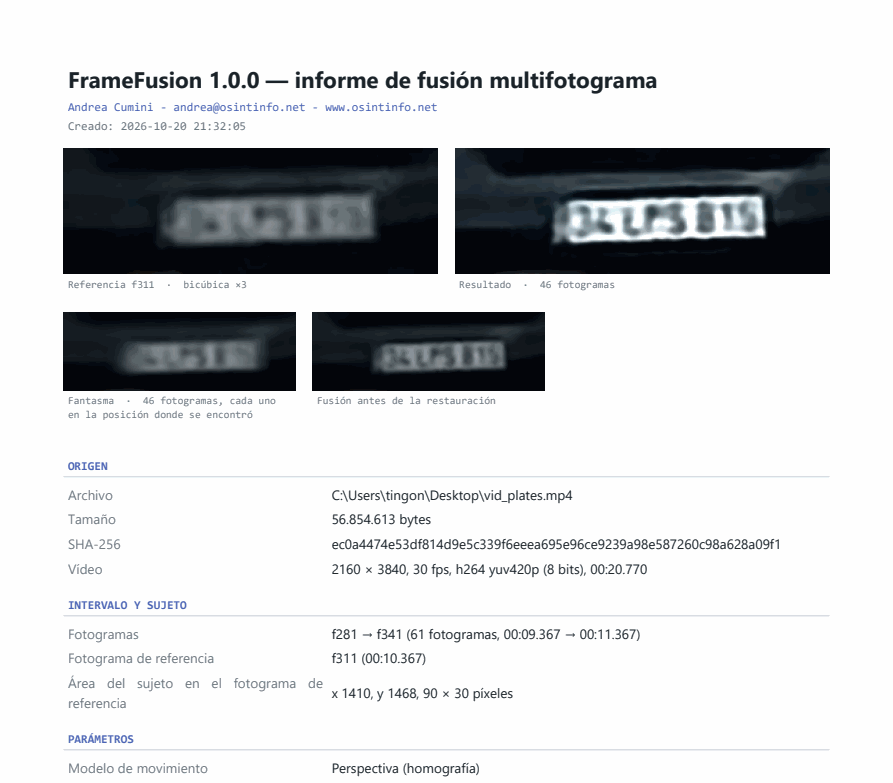

# FrameFusion — Manual de usuario

[English](manual.en.md) · [Italiano](manual.it.md) · [Deutsch](manual.de.md) · [Français](manual.fr.md) · **Español** · [Nederlands](manual.nl.md) · [Polski](manual.pl.md) · [Ελληνικά](manual.el.md) · [Shqip](manual.sq.md)

FrameFusion mejora la legibilidad de un detalle pequeño —una matrícula, un
rostro, un cartel— grabado en varios fotogramas de un vídeo. Alinea esos
fotogramas con precisión subpíxel, los fusiona en una cuadrícula más fina,
reduce el ruido y el desenfoque y produce **una sola imagen** con un informe
que documenta cada parámetro y cada paso.

*Andrea Cumini — www.osintinfo.net — andrea@osintinfo.net*

## Índice

1. [Cómo funciona](#1-cómo-funciona)
2. [Instalación y primer inicio](#2-instalación-y-primer-inicio)
3. [Página Configuración](#3-página-configuración)
4. [Página Sujeto: fotogramas, sujeto y referencia](#4-página-sujeto-fotogramas-sujeto-y-referencia)
5. [Página Fusión](#5-página-fusión)
6. [Guardado: imágenes e informe](#6-guardado-imágenes-e-informe)
7. [Sacar el máximo partido de una matrícula o un rostro](#7-sacar-el-máximo-partido-de-una-matrícula-o-un-rostro)
8. [Límites y uso correcto](#8-límites-y-uso-correcto)
9. [Atajos de teclado](#9-atajos-de-teclado)

## 1. Cómo funciona

Cada fotograma de un vídeo registra el sujeto en una posición ligeramente
distinta respecto a la cuadrícula de píxeles, y con su propio ruido aleatorio.
FrameFusion aprovecha esto: encuentra el sujeto en cada fotograma, alinea
todos los fotogramas con un único **fotograma de referencia** con precisión
subpíxel y los combina. El ruido disminuye y vuelve parte del detalle que cada
fotograma perdía por separado. No se inventa nada: el resultado solo contiene
lo que los fotogramas respaldan.

El trabajo se realiza en siete pasos, que se muestran en el recuadro *Pipeline*:

| Paso | Qué ocurre |
| --- | --- |
| 1. Extracción de fotogramas | FFmpeg decodifica el intervalo elegido, con precisión de fotograma. |
| 2. Detección del sujeto | El sujeto se sigue fotograma a fotograma, hacia delante y hacia atrás desde la referencia. |
| 3. Alineación local | Cada fotograma se alinea con la referencia (algoritmo ECC; modelo de traslación, rotación, afín o perspectiva). |
| 4. Registro subpíxel | La alineación se refina a resolución completa; se eligen los fotogramas más nítidos y mejor alineados. |
| 5. Fusión multifotograma | Los fotogramas se remuestrean en una cuadrícula hasta 4 veces más fina y se combinan, descartando los valores atípicos. |
| 6. Deconvolución y reducción de ruido | Niveles automáticos, reducción de ruido opcional y deconvolución de Richardson-Lucy sobre la luminancia. |
| 7. Fotograma único | Imagen final, fantasma de los fotogramas, comparación con la referencia, datos para el informe. |

## 2. Instalación y primer inicio

**Ejecutable (Windows 10/11, 64 bits).** Descomprima `FrameFusion-<versión>-windows-x64.zip`
en cualquier carpeta y ejecute `FrameFusion.exe`. No necesita Python. El
ejecutable no está firmado: la primera vez, Windows SmartScreen puede pedir
confirmación.

**Desde el código fuente.** Con Python 3.10 o posterior:

```bash
python -m pip install -r requirements.txt
python FrameFusion.py
```

**FFmpeg.** FrameFusion usa FFmpeg para leer los vídeos, pero no lo incluye.
En el primer inicio, si falta FFmpeg, la página **Configuración** se abre en
el recuadro *FFmpeg*: **Descargar / Actualizar** descarga la compilación
oficial para Windows en la carpeta `tools\ffmpeg`, junto al programa. No se
instala nada en el sistema.

También se puede abrir un vídeo desde la línea de comandos:
`FrameFusion.exe video.mp4`.

## 3. Página Configuración



- **Origen** — **Abrir vídeo…** (o Ctrl+O, o el icono de carpeta del recuadro
  *VIDEO* de la parte superior). Aquí se muestran la duración, el número de
  fotogramas, la resolución y el códec. Al abrir un vídeo, el programa pasa a
  la página *Sujeto*.
- **Salida** — *Carpeta de destino* donde se guardan las fusiones (vacía =
  junto al vídeo), *Subcarpeta con el nombre del vídeo*, *Formato* (PNG o
  TIFF) y *Profundidad de color* (*Auto* = 16 bits por canal para la fusión).
  *Guardar también cada fotograma alineado (carpeta aligned/)* añade una
  carpeta `aligned/` con cada fotograma usado, alineado con la referencia.
- **FFmpeg** — dónde está FFmpeg y qué versión es: **Comprobar**, **Buscar
  actualizaciones**, **Descargar / Actualizar**.
- **Idioma** — la interfaz y los informes están disponibles en nueve idiomas:
  EN, IT, DE, FR, ES, NL, PL, EL, SQ. El cambio es inmediato y se recuerda.
- **Créditos** — autor y licencia.

## 4. Página Sujeto: fotogramas, sujeto y referencia



La *Vista previa* muestra el fotograma bajo el cursor: la **rueda** hace zoom
alrededor del ratón (hasta los píxeles reales), **arrastrar** mueve la imagen
y un **doble clic** vuelve a ajustar el fotograma. Debajo, los botones avanzan
o retroceden uno o diez fotogramas; **← →** y **Mayús+← →** hacen lo mismo
desde el teclado.

El recuadro *Timeline* (la línea de tiempo) muestra todo el vídeo como una
tira de película. **Ctrl+rueda** hace zoom, la **rueda** desplaza la vista;
hacer clic o arrastrar mueve el cursor. *Todo* y *Selección* ajustan la vista.

**1. Elija el fotograma de referencia.** Desplácese hasta el fotograma en el
que el sujeto es **más grande y más nítido**; en un vehículo que se acerca,
suele ser uno de los últimos fotogramas en los que la matrícula todavía se ve
entera.

**2. Seleccione el área del sujeto.** Arrastre con el **botón derecho del
ratón** sobre la matrícula o el rostro, o pulse **Seleccionar área** y
arrastre con el izquierdo. Encuadre el sujeto con un pequeño margen. El
fotograma mostrado se convierte en la **referencia** (marcador **R** en la
línea de tiempo; **→ R** devuelve el cursor a él) y **la fusión se inicia
sola**: el programa pasa a la página *Fusión*. Si dibuja un área nueva
mientras la fusión está en curso, esta se reinicia. **Borrar** elimina el
área.

**3. Elija el intervalo.** **Entrada [I]** y **Salida [O]** (teclas I y O)
establecen el primer y el último fotograma que se usarán: los fotogramas en
los que el sujeto es visible y no está tapado. Las marcas I y O también se
pueden arrastrar, y los campos IN / OUT aceptan un tiempo (`1:23.456`) o un
fotograma (`f2000`). Si, al dibujar el área, el intervalo sigue siendo todo el
vídeo, se establece en 30 fotogramas antes y 30 después de la referencia.
Después de cambiar el intervalo, **Fusionar fotogramas →** (o F5) vuelve a
ejecutar la fusión. Como máximo, 300 fotogramas por fusión.

## 5. Página Fusión



**Comparación.** A la izquierda, el **Fantasma de los fotogramas**: todos los
fotogramas usados, superpuestos en la posición donde se encontró cada uno,
antes de la alineación. Muestra lo que entra en la fusión y cuánto se mueve
el sujeto. Con el menú situado encima, la vista izquierda puede mostrar en su
lugar el **Fotograma de referencia**, ampliado con interpolación bicúbica: es
la imagen «antes» con la que la comparación resulta justa. A la derecha, el
resultado: **Final**, o **Solo fusión** (antes de la reducción de ruido y la
deconvolución). Las dos vistas hacen zoom y se mueven juntas.



**Pipeline.** Los siete pasos con su resultado y su tiempo; debajo, el resumen
(fotogramas usados, escala, ruido antes y después de la fusión), la barra de
progreso y los botones **Abrir carpeta**, **Cancelar**, **Guardar resultado**,
**Ejecutar fusión**. Los pasos 1–4 dependen solo del vídeo, el intervalo, la
referencia, el área y el modelo de movimiento: cuando solo cambian los
parámetros de fusión o de restauración, se reutilizan y una nueva fusión
tarda una fracción de segundo (*reutilizado* en la lista de pasos).

### Parámetros

La columna de la izquierda agrupa los parámetros por paso.

**Ajustes guardados.** Conjuntos de parámetros con nombre: **Guardar…** pide
un nombre y guarda los parámetros actuales; al elegir un nombre en el menú, se
cargan; **Eliminar** quita el conjunto elegido; **Predeterminados** devuelve
cada parámetro a su valor predeterminado. **Desde informe…** carga los
parámetros del `report.json` de una fusión guardada anteriormente, para
repetirla exactamente. Los parámetros en uso también se recuerdan al cerrar el
programa.

| Recuadro | Parámetro | Efecto |
| --- | --- | --- |
| Fotogramas y alineación | Modelo de movimiento | Traslación, Rotación + traslación, Afín, **Perspectiva (homografía)** — predeterminado; sigue a un sujeto que se acerca, se aleja o gira. Si un fotograma no converge, se prueba un modelo más simple. |
| | Búsqueda del sujeto: correlación mínima | Por debajo de esta puntuación, se considera que el sujeto no se ha encontrado en un fotograma. |
| | Calidad mínima de alineación (ECC) | Los fotogramas alineados peor que este valor quedan excluidos (predeterminado: 0,80). |
| | Fotogramas más nítidos conservados | Predeterminado: 75 %; se excluye la cuarta parte menos nítida (desenfoque de movimiento). |
| Fusión | Escala | De × 1 (solo reducción de ruido) a × 4. × 2 o × 3 suele ser la elección adecuada. |
| | Método de fusión | **Media robusta (valores atípicos descartados)** — predeterminado; Mediana; Suma con desplazamiento (convolución normalizada). |
| | Ponderar por nitidez | Los fotogramas más nítidos cuentan mucho más. |
| | Igualar el brillo | Compensa los cambios de exposición entre fotogramas. |
| Restauración | Reducción de ruido | Ninguna, Ligera, Media, Fuerte (filtro bilateral). |
| | Iteraciones de deconvolución | Richardson-Lucy: más iteraciones aumentan la nitidez, pero también amplifican el ruido y los halos. Predeterminado: 20. |
| | PSF σ (píxeles de salida) | Anchura del desenfoque que se debe eliminar. *Automática* la mide en los bordes de la imagen fusionada. |
| | Regularización (variación total) | Contiene el ruido durante la deconvolución. Predeterminado: Media. |
| Presentación | Niveles automáticos | Negro y blanco en los percentiles 0,5 y 99,5 de la luminancia, antes de la deconvolución. |
| | Contraste local (CLAHE) | Ecualización por zonas: útil con matrículas en sombra o a contraluz. |
| | Escala de grises | Elimina el color: a menudo resulta más limpio para leer los caracteres. |

## 6. Guardado: imágenes e informe

**Guardar resultado** (Ctrl+S en la página *Fusión*) crea una carpeta nueva
`fusion_f<referencia>_<fecha-hora>` en la carpeta de destino, con:

| Archivo | Contenido |
| --- | --- |
| `result.png` | la imagen final |
| `fused.png` | la fusión antes de la reducción de ruido y la deconvolución |
| `ghost.png` | el fantasma de los fotogramas usados |
| `reference_x<k>.png` | el área de referencia ampliada con interpolación bicúbica, para la comparación |
| `reference_crop.png` | la misma área a la resolución del vídeo |
| `report.pdf` | el informe maquetado en A4, con las imágenes |
| `report.txt` | el mismo informe como texto plano |
| `report.json` | los mismos datos en forma estructurada, incluidos los ajustes (**Desde informe…** los vuelve a cargar) |
| `aligned/` | si se solicita, cada fotograma usado, alineado con la referencia |



El informe se escribe en el idioma de la interfaz. Contiene el origen (ruta,
tamaño, huella **SHA-256**, formato), el intervalo, el fotograma de referencia
y el área, todos los parámetros, los siete pasos con los métodos usados y sus
tiempos, la tabla de los fotogramas (puntuación de búsqueda, coeficientes de
alineación, desplazamiento subpíxel, nitidez, peso, motivo de exclusión), las
estimaciones de ruido y el SHA-256 de cada imagen escrita. Quien lo lea puede
repetir el procesamiento y comprobar que los archivos no han cambiado.

*Guardar fotograma*, en la página *Sujeto*, guarda en cambio solo el fotograma
bajo el cursor, a resolución completa y sin pérdida.

## 7. Sacar el máximo partido de una matrícula o un rostro

- **Referencia**: el fotograma en el que el sujeto es más grande y más nítido.
- **Intervalo**: solo los fotogramas en los que el sujeto es totalmente
  visible. Los fotogramas alejados de la referencia (mucho más pequeños, otra
  perspectiva) aportan poco y, de todos modos, el umbral de calidad suele
  excluirlos.
- **Área**: toda la matrícula o todo el rostro con un pequeño margen; poco
  fondo, que puede moverse de otra manera.
- **Escala**: × 2 o × 3. × 4 solo compensa con muchos fotogramas.
- **¿Caracteres todavía poco nítidos?** Suba *PSF σ* un paso (p. ej., de
  Automática al valor inmediatamente superior al indicado en el informe), o
  las *Iteraciones de deconvolución*.
- **¿Halos o «ringing» alrededor de los caracteres?** Baje *PSF σ* o las
  iteraciones, o suba la *Regularización (variación total)*.
- **Matrícula en sombra o a contraluz**: *Contraste local (CLAHE)* en *Ligera*
  o *Media*, a menudo junto con *Escala de grises*.
- **Compare** siempre con la vista *Fotograma de referencia*, haciendo zoom
  sobre los caracteres: lo que ahí no se lee y solo aparece tras un realce
  fuerte de la nitidez debe tratarse con cautela.
- Guarde con **Guardar…** un conjunto de parámetros que funcione para una
  cámara y reutilícelo.

## 8. Límites y uso correcto

- El resultado es una **mejora** de los fotogramas grabados, no una
  reconstrucción de la realidad: no puede recuperar lo que ningún fotograma
  contiene.
- Los detalles finos en el límite de la resolución, y los caracteres que se
  parecen entre sí (8/B, 0/D, 1/7, 5/S), deben comprobarse en los fotogramas
  originales antes de sacar conclusiones.
- La ganancia es mayor con muchos fotogramas, pequeños desplazamientos entre
  ellos, ruido independiente y una referencia suficientemente nítida. El
  desenfoque de movimiento dentro de un mismo fotograma no se elimina.
- Una compresión fuerte produce errores que son iguales en fotogramas
  consecutivos: la fusión los reduce menos que el ruido aleatorio.
- Las matrículas y los rostros son datos personales: utilice el programa
  dentro de las normas que le sean aplicables.

## 9. Atajos de teclado

| Teclas | Acción |
| --- | --- |
| Ctrl+1 / Ctrl+2 / Ctrl+3 | Página Configuración / Sujeto / Fusión |
| Ctrl+O | Abrir vídeo |
| ← / → | Fotograma anterior / siguiente |
| Mayús+← / Mayús+→ | Retroceder / avanzar 10 fotogramas |
| Inicio / Fin | Primer / último fotograma |
| I / O | Establecer el inicio / el final del intervalo en el cursor |
| + / − | Acercar / alejar la línea de tiempo |
| F | Todo el vídeo en la línea de tiempo |
| Arrastrar con el botón derecho en la vista previa | Seleccionar el área del sujeto (la fusión se inicia) |
| Esc | Salir de *Seleccionar área* |
| F5 | Ejecutar la fusión |
| Ctrl+S | Guardar el resultado (página Fusión) o el fotograma (página Sujeto) |


*Capturas de pantalla: vídeo «[Busy Highway Traffic at Sunset](https://www.pexels.com/video/busy-highway-traffic-at-sunset-31779728/)» de [Şeyhmus Kino](https://www.pexels.com/@seyhmuskino/), de Pexels, utilizado según la [licencia de Pexels](https://www.pexels.com/license/). Las matrículas visibles en las capturas pertenecen a ese vídeo.*

---

FrameFusion es software libre bajo la GNU GPL v3 con atribución del autor:
consulte `LICENSE` y `NOTICE`. Andrea Cumini - andrea@osintinfo.net - www.osintinfo.net
