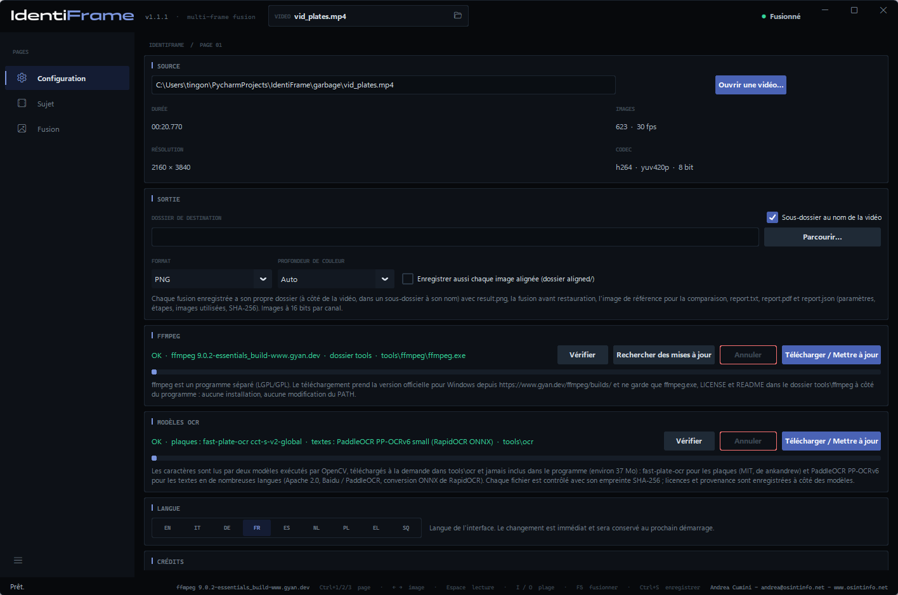
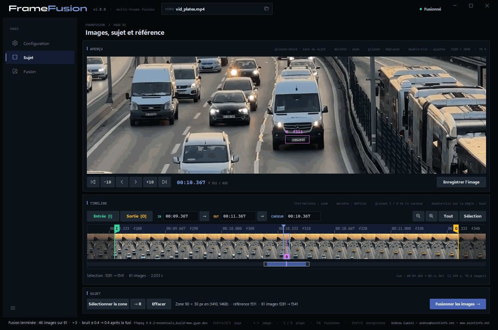
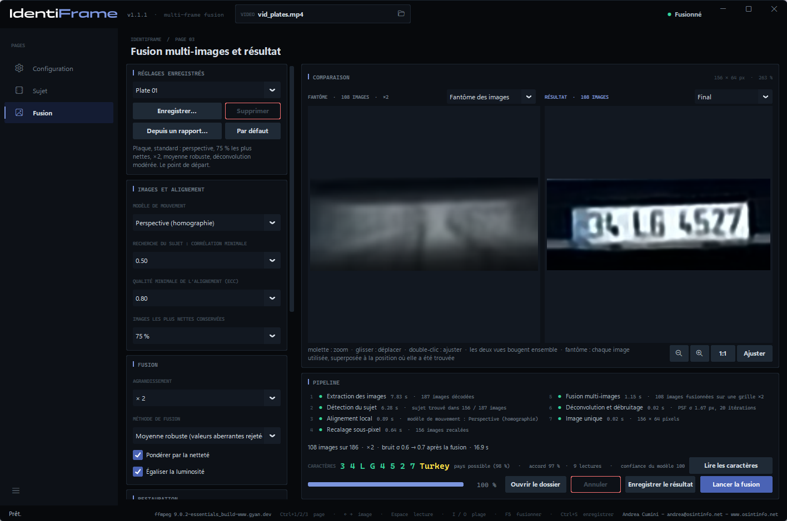
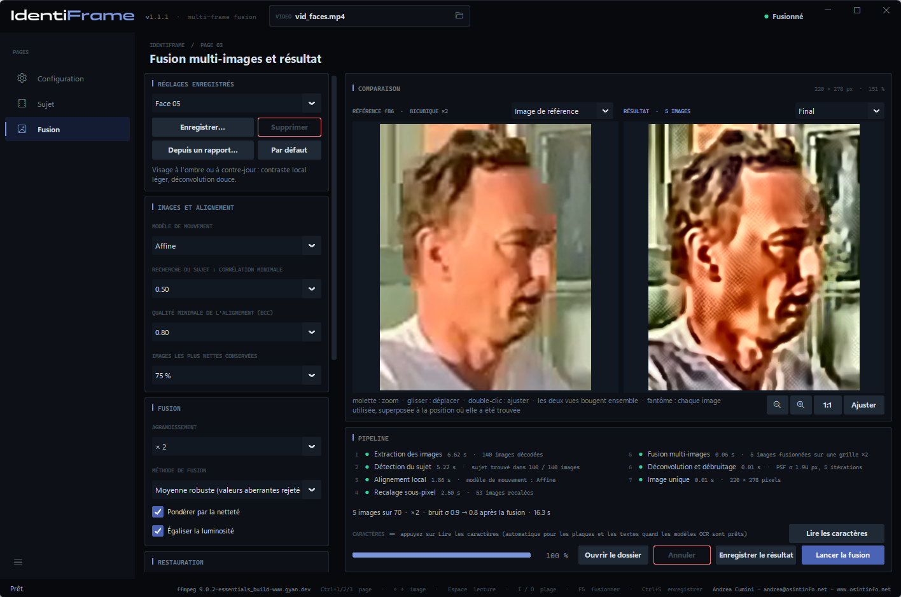
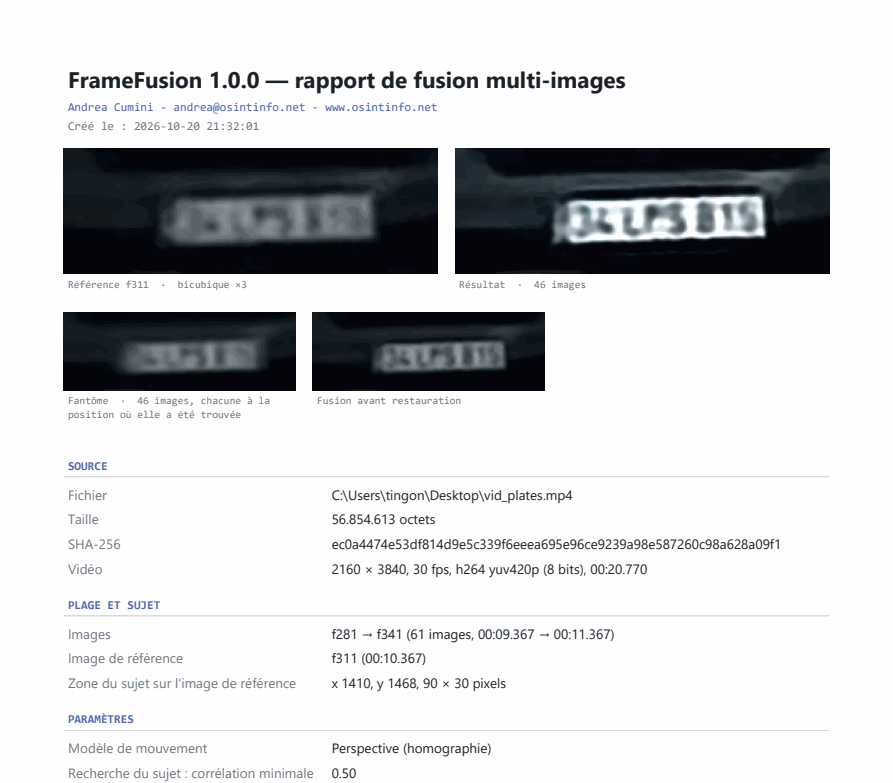

# FrameFusion — Manuel d'utilisation

[English](manual.en.md) · [Italiano](manual.it.md) · [Deutsch](manual.de.md) · **Français** · [Español](manual.es.md) · [Nederlands](manual.nl.md) · [Polski](manual.pl.md) · [Ελληνικά](manual.el.md) · [Shqip](manual.sq.md)

FrameFusion améliore la lisibilité d'un petit détail — une plaque
d'immatriculation, un visage, une enseigne — filmé sur plusieurs images d'une
vidéo. Il aligne ces images avec une précision sous-pixel, les fusionne sur une
grille plus fine, réduit le bruit et le flou, et produit **une image unique**
accompagnée d'un rapport qui documente chaque paramètre et chaque étape.

*Andrea Cumini — www.osintinfo.net — andrea@osintinfo.net*

## Sommaire

1. [Principe de fonctionnement](#1-principe-de-fonctionnement)
2. [Installation et premier démarrage](#2-installation-et-premier-démarrage)
3. [Page Configuration](#3-page-configuration)
4. [Page Sujet : images, sujet et référence](#4-page-sujet--images-sujet-et-référence)
5. [Page Fusion](#5-page-fusion)
6. [Enregistrement : images et rapport](#6-enregistrement--images-et-rapport)
7. [Tirer le meilleur parti d'une plaque ou d'un visage](#7-tirer-le-meilleur-parti-dune-plaque-ou-dun-visage)
8. [Limites et bon usage](#8-limites-et-bon-usage)
9. [Raccourcis clavier](#9-raccourcis-clavier)

## 1. Principe de fonctionnement

Chaque image d'une vidéo enregistre le sujet à une position légèrement
différente par rapport à la grille des pixels, avec son propre bruit aléatoire.
FrameFusion en tire parti : il retrouve le sujet dans chaque image, aligne
toutes les images sur une même **image de référence** avec une précision
sous-pixel, puis les combine. Le bruit diminue et une partie du détail perdu
dans chaque image isolée réapparaît. Rien n'est inventé : le résultat ne
contient que ce que les images permettent d'établir.

Le travail se déroule en sept étapes, affichées dans le cadre *Pipeline* :

| Étape | Ce qui se passe |
| --- | --- |
| 1. Extraction des images | La plage choisie est décodée par FFmpeg, à l'image près. |
| 2. Détection du sujet | Le sujet est suivi image par image, vers l'avant et vers l'arrière à partir de la référence. |
| 3. Alignement local | Chaque image est alignée sur la référence (algorithme ECC ; modèle translation, rotation, affine ou perspective). |
| 4. Recalage sous-pixel | L'alignement est affiné en pleine résolution ; les images les plus nettes et les mieux alignées sont retenues. |
| 5. Fusion multi-images | Les images sont rééchantillonnées sur une grille jusqu'à 4 fois plus fine et combinées, en rejetant les valeurs aberrantes. |
| 6. Déconvolution et débruitage | Niveaux automatiques, réduction du bruit facultative et déconvolution de Richardson-Lucy sur la luminance. |
| 7. Image unique | Image finale, fantôme des images, comparaison avec la référence, données pour le rapport. |

## 2. Installation et premier démarrage

**Exécutable (Windows 10/11, 64 bits).** Décompressez `FrameFusion-<version>-windows-x64.zip`
à l'emplacement de votre choix et lancez `FrameFusion.exe`. Python n'est pas
nécessaire. L'exécutable n'est pas signé : la première fois, Windows SmartScreen
peut demander une confirmation.

**Depuis les sources.** Avec Python 3.10 ou ultérieur :

```bash
python -m pip install -r requirements.txt
python FrameFusion.py
```

**FFmpeg.** FrameFusion utilise FFmpeg pour lire les vidéos, mais ne l'inclut
pas. Au premier démarrage, si FFmpeg est absent, la page **Configuration**
s'ouvre sur le cadre *FFmpeg* : **Télécharger / Mettre à jour** récupère la
version officielle pour Windows dans le dossier `tools\ffmpeg` à côté du
programme. Rien n'est installé sur le système.

Une vidéo peut aussi être ouverte depuis la ligne de commande :
`FrameFusion.exe video.mp4`.

## 3. Page Configuration



- **Source** — **Ouvrir une vidéo…** (ou Ctrl+O, ou l'icône de dossier dans le
  cadre *VIDEO* en haut). La durée, le nombre d'images, la résolution et le
  codec s'affichent ici. Lorsqu'une vidéo est ouverte, le programme passe à la
  page *Sujet*.
- **Sortie** — *Dossier de destination* où les fusions sont enregistrées (vide =
  à côté de la vidéo), *Sous-dossier au nom de la vidéo*, *Format* (PNG ou TIFF)
  et *Profondeur de couleur* (*Auto* = 16 bits par canal pour la fusion).
  *Enregistrer aussi chaque image alignée (dossier aligned/)* ajoute un dossier
  `aligned/` contenant chaque image utilisée, alignée sur la référence.
- **FFmpeg** — emplacement et version de FFmpeg : **Vérifier**, **Rechercher
  des mises à jour**, **Télécharger / Mettre à jour**.
- **Langue** — l'interface et les rapports sont disponibles en neuf langues :
  EN, IT, DE, FR, ES, NL, PL, EL, SQ. Le changement est immédiat et mémorisé.
- **Crédits** — auteur et licence.

## 4. Page Sujet : images, sujet et référence



L'*Aperçu* affiche l'image sous le curseur : la **molette** zoome autour de la
souris (jusqu'aux pixels réels), **glisser** déplace la vue, un **double-clic**
ajuste de nouveau l'image à la fenêtre. En dessous, les boutons font avancer ou
reculer d'une ou de dix images ; **← →** et **Maj+← →** font de même au clavier.

La *Timeline* (chronologie) montre toute la vidéo sous forme de pellicule.
**Ctrl+molette** zoome, la **molette** fait défiler ; un clic ou un glissement
déplace le curseur. *Tout* et *Sélection* ajustent la vue.

**1. Choisissez l'image de référence.** Placez-vous sur l'image où le sujet est
**le plus grand et le plus net** — pour un véhicule qui s'approche, en général
l'une des dernières images où la plaque est encore entièrement visible.

**2. Sélectionnez la zone du sujet.** Glissez avec le **bouton droit de la
souris** sur la plaque ou le visage, ou appuyez sur **Sélectionner la zone** et
glissez avec le bouton gauche. Cadrez le sujet avec une petite marge. L'image
affichée devient la **référence** (repère **R** sur la chronologie ; **→ R** y
ramène le curseur) et **la fusion démarre d'elle-même** : le programme passe à
la page *Fusion*. Si vous dessinez une nouvelle zone pendant le calcul, la
fusion redémarre. **Effacer** supprime la zone.

**3. Choisissez la plage.** **Entrée [I]** et **Sortie [O]** (touches I et O)
fixent la première et la dernière image à utiliser : celles où le sujet est
visible et non masqué. Les drapeaux I et O peuvent aussi être déplacés à la
souris, et les champs IN / OUT acceptent un temps (`1:23.456`) ou une image
(`f2000`). Chaque fois que la zone est dessinée, la plage est fixée à
150 images avant et 150 après la référence (dans les limites de la vidéo). Après avoir
modifié la plage, **Fusionner les images →** (ou F5) relance la fusion.
301 images au maximum par fusion.

## 5. Page Fusion



**Comparaison.** À gauche, le **Fantôme des images** : toutes les images
utilisées, superposées à la position où chacune a été trouvée, avant
l'alignement. Il montre ce qui entre dans la fusion et à quel point le sujet se
déplace. Avec le menu situé au-dessus, la vue de gauche peut afficher à la place
l'**Image de référence**, agrandie par interpolation bicubique : c'est l'image
« avant » qui permet une comparaison honnête. À droite, le résultat : **Final**,
ou **Fusion seule** (avant la réduction du bruit et la déconvolution). Les deux
vues zooment et se déplacent ensemble.



**Pipeline.** Les sept étapes avec leur résultat et leur durée ; en dessous, le
résumé (images utilisées, agrandissement, bruit avant et après la fusion), la
barre de progression et les boutons **Ouvrir le dossier**, **Annuler**,
**Enregistrer le résultat**, **Lancer la fusion**. Les étapes 1 à 4 ne dépendent
que de la vidéo, de la plage, de la référence, de la zone et du modèle de
mouvement : lorsque seuls les paramètres de fusion ou de restauration changent,
elles sont réutilisées et une nouvelle fusion ne prend qu'une fraction de
seconde (*réutilisé* dans la liste des étapes).

### Paramètres

La colonne de gauche regroupe les paramètres par étape.

**Réglages enregistrés.** Jeux de paramètres nommés : **Enregistrer…** demande
un nom et mémorise les paramètres actuels ; choisir un nom dans le menu les
charge ; **Supprimer** efface le jeu choisi ; **Par défaut** rétablit chaque
paramètre. **Depuis un rapport…** charge les paramètres depuis le `report.json`
d'une fusion enregistrée auparavant, pour la reproduire à l'identique. Les
paramètres en cours sont également mémorisés à la fermeture du programme.

| Cadre | Paramètre | Effet |
| --- | --- | --- |
| Images et alignement | Modèle de mouvement | Translation, rotation + translation, affine, **perspective (homographie)** — par défaut ; suit un sujet qui s'approche, s'éloigne ou tourne. Si une image ne converge pas, un modèle plus simple est essayé. |
| | Recherche du sujet : corrélation minimale | En dessous de ce score, le sujet est considéré comme non trouvé dans une image. |
| | Qualité minimale de l'alignement (ECC) | Les images moins bien alignées que ce seuil sont écartées (0.80 par défaut). |
| | Images les plus nettes conservées | 75 % par défaut : le quart le moins net (flou de bougé) est écarté. |
| Fusion | Agrandissement | × 1 (réduction du bruit seulement) à × 4. × 2 ou × 3 est généralement le bon choix. |
| | Méthode de fusion | **Moyenne robuste (valeurs aberrantes rejetées)** — par défaut ; médiane ; décalage et addition avec convolution normalisée. |
| | Pondérer par la netteté | Les images plus nettes comptent beaucoup plus. |
| | Égaliser la luminosité | Compense les variations d'exposition entre les images. |
| Restauration | Réduction du bruit | Désactivé, Faible, Moyen, Fort (filtre bilatéral). |
| | Itérations de déconvolution | Richardson-Lucy : plus d'itérations accentuent davantage la netteté, mais amplifient aussi le bruit et les halos. 20 par défaut. |
| | PSF σ (pixels de sortie) | Largeur du flou à supprimer. *Automatique* la mesure sur les contours de l'image fusionnée. |
| | Régularisation (variation totale) | Retient le bruit pendant la déconvolution. Moyen par défaut. |
| Présentation | Niveaux automatiques | Noir et blanc aux centiles 0,5 et 99,5 de la luminance, avant la déconvolution. |
| | Contraste local (CLAHE) | Égalisation par zones : utile sur les plaques à l'ombre ou à contre-jour. |
| | Niveaux de gris | Supprime la couleur : souvent plus propre pour lire les caractères. |

## 6. Enregistrement : images et rapport

**Enregistrer le résultat** (Ctrl+S sur la page *Fusion*) crée un nouveau dossier
`fusion_f<référence>_<date-heure>` dans le dossier de destination, contenant :

| Fichier | Contenu |
| --- | --- |
| `result.png` | l'image finale |
| `fused.png` | la fusion avant la réduction du bruit et la déconvolution |
| `ghost.png` | le fantôme des images utilisées |
| `reference_x<k>.png` | la zone de référence agrandie par interpolation bicubique, pour la comparaison |
| `reference_crop.png` | la même zone à la résolution de la vidéo |
| `report.pdf` | le rapport mis en page au format A4, avec les images |
| `report.txt` | le même rapport en texte brut |
| `report.json` | les mêmes données sous forme structurée, réglages compris (**Depuis un rapport…** les recharge) |
| `aligned/` | sur demande, chaque image utilisée, alignée sur la référence |



Le rapport est rédigé dans la langue de l'interface. Il contient la source
(chemin, taille, empreinte **SHA-256**, format), la plage, l'image de référence
et la zone, tous les paramètres, les sept étapes avec les méthodes employées et
leurs durées, le tableau des images (score de recherche, coefficients
d'alignement, décalage sous-pixel, netteté, poids, motif d'exclusion), les
estimations du bruit et le SHA-256 de chaque image écrite. Quiconque le lit peut
refaire le traitement et vérifier que les fichiers n'ont pas été modifiés.

*Enregistrer l'image* sur la page *Sujet* enregistre en revanche uniquement
l'image sous le curseur, en pleine résolution et sans perte.

## 7. Tirer le meilleur parti d'une plaque ou d'un visage

- **Référence** : l'image où le sujet est le plus grand et le plus net.
- **Plage** : uniquement les images où le sujet est entièrement visible. Les
  images éloignées de la référence (sujet beaucoup plus petit, autre
  perspective) apportent peu et sont de toute façon souvent écartées par le
  seuil de qualité.
- **Zone** : toute la plaque ou tout le visage avec une petite marge ; peu
  d'arrière-plan, qui peut se déplacer différemment.
- **Agrandissement** : × 2 ou × 3. × 4 n'en vaut la peine qu'avec de nombreuses
  images.
- **Caractères encore flous ?** Augmentez *PSF σ* d'un cran (par ex. passez
  d'Automatique à la valeur immédiatement supérieure à celle indiquée dans le
  rapport), ou les *Itérations de déconvolution*.
- **Halos ou « ringing » autour des caractères ?** Diminuez *PSF σ* ou les
  itérations, ou augmentez la *Régularisation (variation totale)*.
- **Plaque à l'ombre ou à contre-jour** : *Contraste local (CLAHE)* sur Faible
  ou Moyen, souvent associé à *Niveaux de gris*.
- **Comparez** toujours avec la vue *Image de référence*, en zoomant sur les
  caractères : ce qui n'y est pas lisible et n'apparaît qu'après une forte
  accentuation de la netteté doit être considéré avec prudence.
- Enregistrez avec **Enregistrer…** un jeu de paramètres qui fonctionne pour une
  caméra donnée, et réutilisez-le.

## 8. Limites et bon usage

- Le résultat est une **amélioration** des images enregistrées, et non une
  reconstruction de la réalité : il ne peut pas restituer ce qu'aucune image ne
  contient.
- Les détails fins à la limite de la résolution, et les caractères qui se
  ressemblent (8/B, 0/D, 1/7, 5/S), doivent être vérifiés sur les images
  sources avant d'en tirer des conclusions.
- Le gain est maximal avec de nombreuses images, de petits décalages entre
  elles, un bruit indépendant et une référence suffisamment nette. Le flou de
  bougé à l'intérieur d'une même image n'est pas supprimé.
- Une forte compression produit des erreurs identiques d'une image à l'autre :
  la fusion les réduit moins que le bruit aléatoire.
- Les plaques d'immatriculation et les visages sont des données à caractère
  personnel : utilisez le programme dans le respect des règles qui vous sont
  applicables.

## 9. Raccourcis clavier

| Touches | Action |
| --- | --- |
| Ctrl+1 / Ctrl+2 / Ctrl+3 | Page Configuration / Sujet / Fusion |
| Ctrl+O | Ouvrir une vidéo |
| ← / → | Image précédente / suivante |
| Maj+← / Maj+→ | Reculer / avancer de 10 images |
| Début / Fin | Première / dernière image |
| I / O | Début / fin de la plage au curseur |
| + / − | Zoom avant / arrière sur la chronologie |
| F | Toute la vidéo sur la chronologie |
| Glisser-droit sur l'aperçu | Sélectionner la zone du sujet (la fusion démarre) |
| Échap | Quitter *Sélectionner la zone* |
| F5 | Lancer la fusion |
| Ctrl+S | Enregistrer le résultat (page Fusion) ou l'image (page Sujet) |


*Captures d’écran : vidéo « [Busy Highway Traffic at Sunset](https://www.pexels.com/video/busy-highway-traffic-at-sunset-31779728/) » de [Şeyhmus Kino](https://www.pexels.com/@seyhmuskino/), sur Pexels, utilisée selon la [licence Pexels](https://www.pexels.com/license/). Les plaques visibles dans les captures proviennent de cette vidéo.*

---

FrameFusion est un logiciel libre sous GNU GPL v3 avec attribution de l'auteur :
voir `LICENSE` et `NOTICE`. Andrea Cumini - andrea@osintinfo.net - www.osintinfo.net
