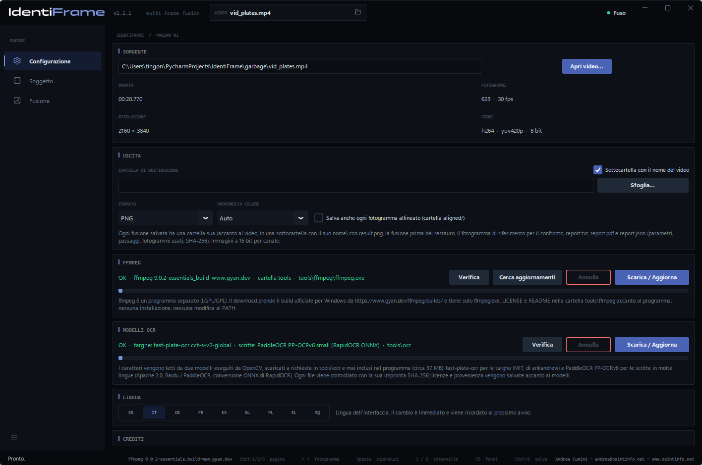
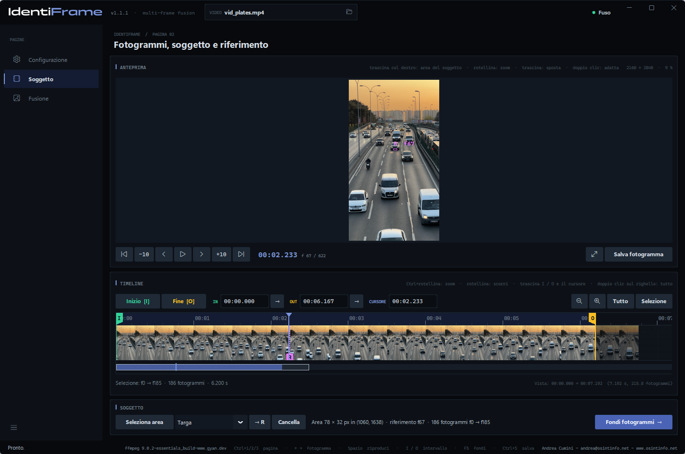
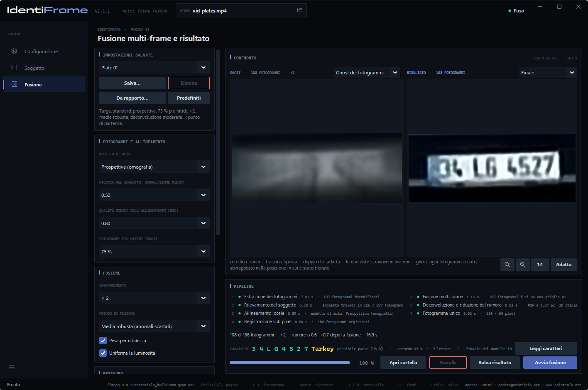
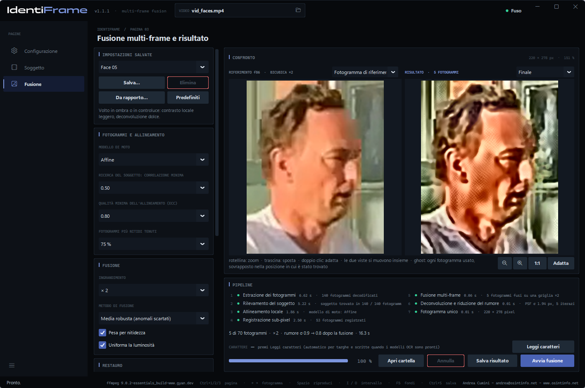
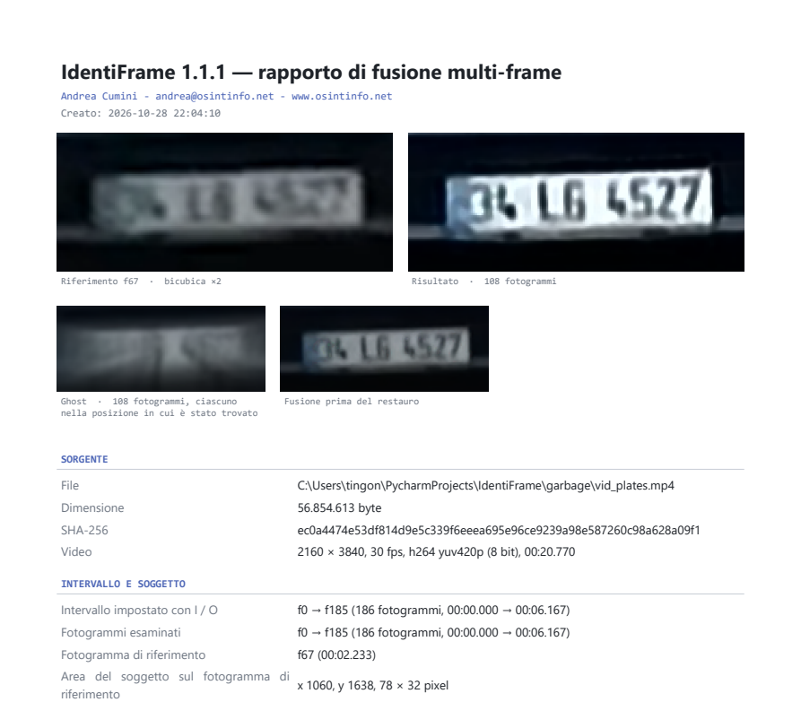
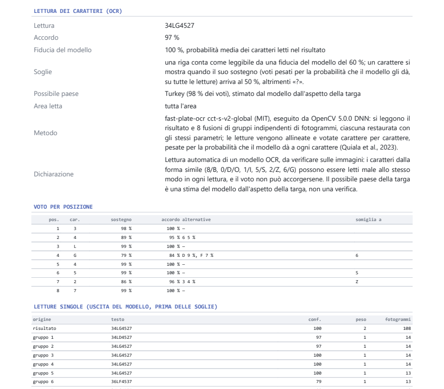

# IdentiFrame — Manuale d'uso

[English](manual.en.md) · **Italiano** · [Deutsch](manual.de.md) · [Français](manual.fr.md) · [Español](manual.es.md) · [Nederlands](manual.nl.md) · [Polski](manual.pl.md) · [Ελληνικά](manual.el.md) · [Shqip](manual.sq.md)

IdentiFrame migliora la leggibilità di un dettaglio piccolo — una targa, un
volto, una scritta — ripreso in più fotogrammi di un video. Allinea quei
fotogrammi con precisione sub-pixel, li fonde su una griglia più fine, riduce
rumore e sfocatura e produce **un'unica immagine**, con un rapporto che
documenta ogni parametro e ogni passaggio.

*Andrea Cumini — www.osintinfo.net — andrea@osintinfo.net*

## Indice

1. [Come funziona](#1-come-funziona)
2. [Installazione e primo avvio](#2-installazione-e-primo-avvio)
3. [Pagina Configurazione](#3-pagina-configurazione)
4. [Pagina Soggetto: fotogrammi, soggetto e riferimento](#4-pagina-soggetto-fotogrammi-soggetto-e-riferimento)
5. [Pagina Fusione](#5-pagina-fusione)
6. [Salvataggio: immagini e rapporto](#6-salvataggio-immagini-e-rapporto)
7. [Ottenere il massimo da una targa o da un volto](#7-ottenere-il-massimo-da-una-targa-o-da-un-volto)
8. [Limiti e uso corretto](#8-limiti-e-uso-corretto)
9. [Scorciatoie da tastiera](#9-scorciatoie-da-tastiera)
10. [Modelli OCR (facoltativi)](#10-modelli-ocr-facoltativi)

## 1. Come funziona

Ogni fotogramma di un video registra il soggetto in una posizione leggermente
diversa rispetto alla griglia dei pixel, e con un suo rumore casuale.
IdentiFrame sfrutta proprio questo: trova il soggetto in ogni fotogramma,
allinea tutti i fotogrammi a un **fotogramma di riferimento** con precisione
sub-pixel e li combina. Il rumore cala e torna una parte del dettaglio che ogni
singolo fotogramma aveva perso. Nulla viene inventato: il risultato contiene
solo ciò che i fotogrammi sostengono.

Il lavoro si svolge in sette passaggi, mostrati nel riquadro *Pipeline*:

| Passaggio | Che cosa succede |
| --- | --- |
| 1. Estrazione dei fotogrammi | L'intervallo scelto viene decodificato da FFmpeg, esatto al fotogramma. |
| 2. Rilevamento del soggetto | Il soggetto viene seguito fotogramma per fotogramma, in avanti e all'indietro dal riferimento. |
| 3. Allineamento locale | Ogni fotogramma viene allineato al riferimento (algoritmo ECC; modello a traslazione, rotazione, affine o prospettico). |
| 4. Registrazione sub-pixel | L'allineamento viene raffinato a piena risoluzione; si scelgono i fotogrammi più nitidi e meglio allineati. |
| 5. Fusione multi-frame | I fotogrammi vengono ricampionati su una griglia fino a 4 volte più fine e combinati, scartando i valori anomali. |
| 6. Deconvoluzione e riduzione del rumore | Livelli automatici, riduzione del rumore facoltativa e deconvoluzione di Richardson-Lucy sulla luminanza. |
| 7. Fotogramma unico | Immagine finale, ghost dei fotogrammi, confronto con il riferimento, dati per il rapporto. |

## 2. Installazione e primo avvio

**Eseguibile (Windows 10/11, 64 bit).** Estrai `IdentiFrame-<versione>-windows-x64.zip`
dove vuoi e avvia `IdentiFrame.exe`. Python non serve. L'eseguibile non è
firmato: la prima volta Windows SmartScreen può chiedere una conferma.

**Dai sorgenti.** Con Python 3.10 o successivo:

```bash
python -m pip install -r requirements.txt
python IdentiFrame.py
```

**Avviso all'avvio.** A ogni avvio compare un avviso da accettare: spiega
che il risultato è una ricostruzione calcolata solo dai pixel reali dei
fotogrammi, in cui nulla è inventato, mentre la lettura dei caratteri e il
paese sono stime da verificare. *Accetta e continua* si attiva dopo aver
spuntato la dichiarazione. Al primissimo avvio viene chiesta prima la
lingua, e l'avviso compare nella lingua scelta.


**FFmpeg.** IdentiFrame usa FFmpeg per leggere i video ma non lo include. Al
primo avvio, se FFmpeg manca, si apre la pagina **Configurazione** sul
riquadro *FFmpeg*: **Scarica / Aggiorna** prende il build ufficiale per
Windows e lo mette nella cartella `tools\ffmpeg` accanto al programma. Nulla
viene installato nel sistema.

Un video si può aprire anche dalla riga di comando:
`IdentiFrame.exe video.mp4`.

## 3. Pagina Configurazione



- **Sorgente** — **Apri video…** (oppure Ctrl+O, o l'icona della cartella nel
  riquadro *VIDEO* in alto). Qui si vedono durata, numero di fotogrammi,
  risoluzione e codec. Aperto un video, il programma passa alla pagina
  *Soggetto*.
- **Uscita** — *Cartella di destinazione* in cui salvare le fusioni (vuota =
  accanto al video), *Sottocartella con il nome del video*, *Formato* (PNG o
  TIFF) e *Profondità colore* (*Auto* = 16 bit per canale per la fusione).
  *Salva anche ogni fotogramma allineato* aggiunge una cartella `aligned/` con
  ogni fotogramma usato, allineato al riferimento.
- **FFmpeg** — dove si trova FFmpeg e quale versione: **Verifica**, **Cerca
  aggiornamenti**, **Scarica / Aggiorna**.
- **Modelli OCR** — i due modelli facoltativi che leggono i caratteri di targhe e scritte, scaricati a richiesta in `tools\ocr` (circa 37 MB): **Verifica** e **Scarica / Aggiorna**. Senza di loro il programma funziona, senza la lettura dei caratteri. Vedi [10. Modelli OCR](#10-modelli-ocr-facoltativi).
- **Lingua** — interfaccia e rapporti sono disponibili in nove lingue: EN,
  IT, DE, FR, ES, NL, PL, EL, SQ. Il cambio è immediato e viene ricordato.
- **Crediti** — autore e licenza.

## 4. Pagina Soggetto: fotogrammi, soggetto e riferimento



L'*Anteprima* mostra il fotogramma sotto il cursore: la **rotellina**
ingrandisce attorno al mouse (fino ai pixel reali), **trascinando** si sposta
la vista, il **doppio clic** riadatta il fotogramma. Sotto, i pulsanti
avanzano di uno o di dieci fotogrammi; **← →** e **Shift+← →** fanno lo stesso
da tastiera.

Il pulsante **riproduci** al centro riproduce l'anteprima dal cursore e
durante la riproduzione diventa **pausa** (Spazio fa lo stesso); il cursore
e la timeline seguono, così si può segnare un intervallo con I e O mentre si
guarda. Un clic sulla timeline o uno spostamento di fotogramma fermano la
riproduzione.

La *Timeline* mostra tutto il video come una pellicola. **Ctrl+rotellina**
ingrandisce, la **rotellina** scorre; cliccando o trascinando si sposta il
cursore. *Tutto* e *Selezione* regolano la vista.

**1. Scegli il fotogramma di riferimento.** Porta il cursore sul fotogramma in
cui il soggetto è **più grande e più nitido** — per un veicolo che si
avvicina, di solito uno degli ultimi in cui la targa è ancora intera.

**2. Seleziona l'area del soggetto.** Trascina col **tasto destro** sopra la
targa o il volto, oppure premi **Seleziona area** e trascina col sinistro.
Inquadra il soggetto con un piccolo margine. Il fotogramma mostrato diventa il
**riferimento** (segnaposto **R** sulla timeline; **→ R** riporta lì il
cursore) e **la fusione parte da sola**: il programma passa alla pagina
*Fusione*. Se disegni un'area nuova mentre la fusione gira, questa riparte.
**Cancella** toglie l'area.

**3. Scegli l'intervallo.** **Inizio [I]** e **Fine [O]** (tasti I e O) fissano
il primo e l'ultimo fotogramma da usare: quelli in cui il soggetto è visibile e
non coperto. Le bandierine I e O si possono anche trascinare, e i campi IN / OUT
accettano un tempo (`1:23.456`) o un fotogramma (`f2000`). Ogni volta che
disegni l'area, l'intervallo viene impostato a 30 secondi prima e 30 dopo il
riferimento (dentro il video): sono solo i limiti della ricerca. La fusione
segue il soggetto dal riferimento verso l'esterno e, in ciascun verso, si ferma
dopo un secondo senza vederlo; poi le bandierine I e O si stringono sui
fotogrammi in cui è stato seguito (il rapporto lo indica). Un intervallo
spostato a mano resta com'è. Dopo aver cambiato l'intervallo, **Fondi fotogrammi
→** (o F5) rifà la fusione. Al massimo 3601 fotogrammi nell'intervallo.

## 5. Pagina Fusione



**Confronto.** A sinistra il **Ghost dei fotogrammi**: tutti i fotogrammi
usati, sovrapposti ciascuno nella posizione in cui è stato trovato, prima
dell'allineamento. Mostra che cosa entra nella fusione e quanto si muove il
soggetto. Con il menu sopra, la vista di sinistra può mostrare invece il
**Fotogramma di riferimento**, ingrandito con interpolazione bicubica: è il
«prima» corretto. A destra il risultato: **Finale**, oppure **Solo fusione**
(prima di riduzione del rumore e deconvoluzione). Le due viste si
ingrandiscono e si spostano insieme. Oltre che con la rotellina, i pulsanti
sotto le viste rimpiccioliscono (**−**, anche sotto la misura adattata, per
vedere il risultato piccolo), ingrandiscono (**+**), mostrano a **1:1** o
**adattano** alla vista; da tastiera **−**, **+** e **0**.



La seconda immagine mostra un volto, con il preset **Face 05** e il fotogramma
di riferimento a sinistra.

**Caratteri.** Con i modelli OCR scaricati, dopo ogni fusione di una *Targa* o di un *Testo* la riga **CARATTERI** del riquadro *Pipeline* mostra i caratteri letti (**Leggi caratteri** la ripete). Si leggono il risultato e otto fusioni di gruppi indipendenti di fotogrammi, e le letture vengono votate carattere per carattere. I modelli di riconoscimento propongono sempre i caratteri più probabili, anche dove non si legge nulla: una riga si mostra solo da una fiducia del modello del 60 %, altrimenti il programma scrive **illeggibile**, e un carattere che non raccoglie almeno il 50 % dei voti pesati compare come **«?»**. Per una targa il **possibile paese** stimato dal modello compare in giallo accanto ai caratteri solo quando la lettura è leggibile e un paese ha la maggioranza dei voti; altrimenti è tra i dettagli, con la sua quota. I dettagli indicano anche l'**accordo** tra le letture, la **fiducia del modello**, le posizioni **dubbie** e i caratteri da **verificare a occhio** (8/B, 0/D/O, 1/I, 5/S, 2/Z, 6/G). Un *Testo* può avere più righe, separate da «|», votate ognuna per conto suo. Nella prima immagine la targa è molto piccola (caratteri alti circa 12 pixel nel video) e viene letta 34LG4527, possibile paese Turkey. Lettura e paese sono stime: confronta sempre con l'immagine.

**Pipeline.** I sette passaggi con esito e tempi; sotto, il riepilogo
(fotogrammi usati, ingrandimento, rumore prima e dopo la fusione), la barra di
avanzamento e i pulsanti **Apri cartella**, **Annulla**, **Salva risultato**,
**Avvia fusione**. I passaggi 1–4 dipendono solo da video, intervallo,
riferimento, area e modello di moto: se cambiano soltanto i parametri di
fusione o di restauro vengono riusati, e una nuova fusione richiede una
frazione di secondo (*riusato* nell'elenco dei passaggi).

### Parametri

La colonna di sinistra raggruppa i parametri per passaggio.

**Tipo di soggetto.** Il menu accanto a *Seleziona area*, nel riquadro *Soggetto* della pagina *Soggetto*, dice che cosa si sta migliorando. **Targa** e **Testo**: un soggetto piano e rigido, un modello di moto per fotogramma; cambia la lettura dei caratteri (un modello fatto per le targhe, oppure uno per le scritte su una o più righe, in molte lingue). **Volto**: tra un fotogramma e l'altro la testa gira e l'espressione cambia, quindi dopo l'allineamento rigido ogni fotogramma riceve un raffinamento locale non rigido che segue questi movimenti entro pochi pixel; le parti che restano diverse contano meno, i fotogrammi con una posa o un'espressione diversa vengono esclusi, il restauro è più leggero e i livelli automatici sono più delicati su pelle e ombre. Cambiare tipo carica i suoi predefiniti e rifà l'allineamento. Nulla viene inventato: il raffinamento sposta solo di pochi pixel ciò che i fotogrammi contengono. Per un volto il modello di moto è affine di base, l'allineamento rifiuta le deformazioni che non sono un movimento possibile della testa e, fuori dall'ellisse inscritta nell'area, il risultato mostra il fotogramma di riferimento, perché lo sfondo si muove in modo diverso.

**Impostazioni salvate.** Insiemi di parametri con un nome: **Salva…** chiede
un nome e memorizza i parametri correnti; scegliendo un nome nel menu si
caricano; **Elimina** toglie l'insieme scelto; **Predefiniti** riporta ogni
parametro al suo valore di base. **Da rapporto…** carica i parametri dal
`report.json` di una fusione salvata in precedenza, per ripeterla esattamente.
I parametri in uso vengono comunque ricordati alla chiusura del programma.

**Preset di serie.** Il menu *Impostazioni salvate* comincia sempre con cinque preset per il tipo di soggetto scelto nella pagina Soggetto: **Plate 01** standard, **02** notte o rumore, **03** targa lontana e piccola, **04** veicolo in movimento con mosso, **05** ombra o controluce; **Text 01–05** gli stessi cinque casi per le scritte; **Face 01** standard, **02** notte o rumore, **03** elaborazione minima, **04** volto lontano e piccolo, **05** ombra o controluce. Una riga sotto il menu descrive quello scelto; non si possono modificare né eliminare, e seguono le tue impostazioni.

| Riquadro | Parametro | Effetto |
| --- | --- | --- |
| Pagina Soggetto | Tipo di soggetto | Targa (predefinito) o Testo per un soggetto piano e rigido (cambia la lettura dei caratteri); Volto aggiunge il raffinamento locale non rigido e un restauro più leggero. |
| Fotogrammi e allineamento | Modello di moto | Traslazione, rotazione + traslazione, affine, **prospettiva (omografia)** — predefinito; segue un soggetto che si avvicina, si allontana o gira. Se un fotogramma non converge, si prova un modello più semplice. |
| | Ricerca del soggetto: correlazione minima | Sotto questo punteggio il soggetto conta come non trovato in quel fotogramma. |
| | Qualità minima dell'allineamento (ECC) | I fotogrammi allineati peggio di così restano fuori (0,80 di base). |
| | Fotogrammi più nitidi tenuti | 75 % di base: il quarto meno nitido (mosso) resta fuori. |
| Fusione | Ingrandimento | Da × 1 (solo riduzione del rumore) a × 4. Di solito × 2 o × 3 è la scelta giusta. |
| | Metodo di fusione | **Media robusta (anomali scartati)** — predefinito; mediana; somma con spostamento con convoluzione normalizzata. |
| | Pesa per nitidezza | I fotogrammi più nitidi contano molto di più. |
| | Uniforma la luminosità | Compensa i cambi di esposizione tra i fotogrammi. |
| Restauro | Riduzione del rumore | Nessuna, leggera, media, forte (filtro bilaterale). |
| | Iterazioni di deconvoluzione | Richardson-Lucy: più iterazioni rendono più nitido, ma amplificano anche rumore e aloni. 20 di base. |
| | PSF σ (pixel dell'uscita) | Ampiezza della sfocatura da togliere. *Automatica* la misura sui bordi dell'immagine fusa. |
| | Regolarizzazione (variazione totale) | Frena il rumore durante la deconvoluzione. Media di base. |
| Presentazione | Livelli automatici | Nero e bianco ai percentili 0,5 e 99,5 della luminanza, prima della deconvoluzione. |
| | Contrasto locale (CLAHE) | Equalizzazione a zone: utile su targhe in ombra o in controluce. |
| | Scala di grigi | Toglie il colore: spesso più pulito per leggere i caratteri. |

## 6. Salvataggio: immagini e rapporto

**Salva risultato** (Ctrl+S nella pagina *Fusione*) crea una cartella nuova
`fusion_f<riferimento>_<data-ora>` nella cartella di destinazione, con:

| File | Contenuto |
| --- | --- |
| `result.png` | l'immagine finale |
| `fused.png` | la fusione prima di riduzione del rumore e deconvoluzione |
| `ghost.png` | il ghost dei fotogrammi usati |
| `reference_x<k>.png` | l'area del riferimento ingrandita con interpolazione bicubica, per il confronto |
| `reference_crop.png` | la stessa area alla risoluzione del video |
| `report.pdf` | il rapporto impaginato in A4, con le immagini |
| `report.txt` | lo stesso rapporto in testo semplice |
| `report.json` | gli stessi dati in forma strutturata, comprese le impostazioni (**Da rapporto…** le ricarica) |
| `aligned/` | a richiesta, ogni fotogramma usato, allineato al riferimento |



Con una lettura dei caratteri, il rapporto ha la sezione **Lettura dei caratteri (OCR)**: la lettura, l'accordo, la fiducia del modello, per una targa il possibile paese e l'area letta, per un testo le righe trovate, il metodo, il voto per posizione con le alternative e i caratteri simili, e ogni lettura singola.



Il rapporto è scritto nella lingua dell'interfaccia. Contiene la sorgente
(percorso, dimensione, impronta **SHA-256**, formato), intervallo, fotogramma
di riferimento e area, tutti i parametri, i sette passaggi con i metodi usati
e i tempi, la tabella dei fotogrammi (punteggio della ricerca, coefficienti di
allineamento, spostamento sub-pixel, nitidezza, peso, motivo dell'esclusione),
le stime del rumore e lo SHA-256 di ogni immagine scritta. Chi lo legge può
ripetere l'elaborazione e controllare che i file non siano cambiati.

*Salva fotogramma* nella pagina *Soggetto* salva invece il singolo fotogramma
sotto il cursore, a piena risoluzione e senza perdita.

## 7. Ottenere il massimo da una targa o da un volto

- **Volto**: scegli prima il tipo di soggetto *Volto*; inquadra tutto il volto con un piccolo margine, su un fotogramma in cui guarda la camera se possibile, e tieni l'intervallo sui fotogrammi con la stessa posa. Il rapporto dice quanti fotogrammi sono rimasti fuori per posa o espressione diverse e quanto è largo il volto nel video: sotto circa 60 pixel aspettati un aspetto complessivo più pulito, non tratti identificativi.
- **Riferimento**: il fotogramma in cui il soggetto è più grande e più nitido.
- **Intervallo**: solo i fotogrammi in cui il soggetto è interamente visibile.
  I fotogrammi lontani dal riferimento (molto più piccoli, con un'altra
  prospettiva) portano poco e spesso vengono comunque esclusi dalla soglia di
  qualità.
- **Area**: tutta la targa o tutto il volto con un piccolo margine; poco
  sfondo, che può muoversi in modo diverso.
- **Ingrandimento**: × 2 o × 3. × 4 conviene solo con molti fotogrammi.
- **Caratteri ancora morbidi?** Alza *PSF σ* di un passo (per esempio da
  Automatica al valore subito sopra quello scritto nel rapporto), oppure le
  *Iterazioni di deconvoluzione*.
- **Aloni attorno ai caratteri?** Abbassa *PSF σ* o le iterazioni, oppure alza
  la *Regolarizzazione*.
- **Targa in ombra o in controluce**: *Contrasto locale (CLAHE)* leggero o
  medio, spesso insieme a *Scala di grigi*.
- **Confronta** sempre con la vista *Fotogramma di riferimento*, ingrandendo
  sui caratteri: ciò che lì non si legge e compare solo dopo una nitidezza
  forte va trattato con cautela.
- Salva con **Salva…** un insieme di parametri che funziona per una telecamera
  e riusalo.

## 8. Limiti e uso corretto

- Il risultato è un **miglioramento** dei fotogrammi registrati, non una
  ricostruzione della realtà: non può recuperare ciò che nessun fotogramma
  contiene.
- I dettagli fini al limite della risoluzione, e i caratteri che si somigliano
  (8/B, 0/D, 1/7, 5/S), vanno verificati sui fotogrammi originali prima di trarre
  conclusioni.
- Il guadagno è maggiore con molti fotogrammi, piccoli spostamenti tra loro,
  rumore indipendente e un riferimento abbastanza nitido. Il mosso dentro il
  singolo fotogramma non viene tolto.
- Una compressione forte produce errori uguali in fotogrammi consecutivi: la
  fusione li riduce meno del rumore casuale.
- Targhe e volti sono dati personali: usa il programma nel rispetto delle
  regole che si applicano al tuo caso.

## 9. Scorciatoie da tastiera

| Tasti | Azione |
| --- | --- |
| Ctrl+1 / Ctrl+2 / Ctrl+3 | Pagina Configurazione / Soggetto / Fusione |
| Ctrl+O | Apri video |
| ← / → | Fotogramma precedente / successivo |
| Shift+← / Shift+→ | Indietro / avanti di 10 fotogrammi |
| Spazio | Riproduce o mette in pausa l'anteprima |
| Home / Fine | Primo / ultimo fotogramma |
| I / O | Inizio / fine dell'intervallo sul cursore |
| + / − | Ingrandisce / riduce la timeline |
| F | Tutto il video sulla timeline |
| Trascinare col destro sull'anteprima | Seleziona l'area del soggetto (la fusione parte) |
| Esc | Esce da *Seleziona area* |
| − / + / 0 (pagina Fusione) | Rimpicciolisce / ingrandisce / adatta il risultato |
| F11 | Anteprima più grande: nasconde o rimette la timeline (pagina Soggetto) |
| F5 | Avvia la fusione |
| Ctrl+S | Salva il risultato (pagina Fusione) o il fotogramma (pagina Soggetto) |


## 10. Modelli OCR (facoltativi)

La lettura dei caratteri usa due modelli di rete neurale, eseguiti da OpenCV, che fa già parte del programma. **Non sono inclusi** in IdentiFrame e sono **facoltativi**: senza di loro tutto il resto funziona come sempre, e resta vuota solo la riga CARATTERI. Per usarli premi **Scarica / Aggiorna** nel riquadro **Modelli OCR** della pagina *Configurazione*: vanno nella cartella `tools\ocr` accanto al programma (circa 37 MB), e il riquadro mostra quali sono presenti.

| Soggetto | Modello | Licenza |
| --- | --- | --- |
| Targa | [fast-plate-ocr](https://github.com/ankandrew/fast-plate-ocr) `cct-s-v2-global`, di ankandrew: legge la targa intera e ne stima il possibile paese tra 65 | MIT, codice e pesi ([confermato dall'autore](https://github.com/ankandrew/fast-plate-ocr/issues/97)) |
| Testo | [PaddleOCR](https://github.com/PaddlePaddle/PaddleOCR) PP-OCRv6 small, di Baidu / PaddleOCR, nella conversione ONNX di [RapidOCR](https://github.com/RapidAI/RapidOCR): trova le righe di testo e le legge in molte lingue | Apache 2.0 |

Ogni file viene controllato con la sua impronta SHA-256 prima di essere tenuto; accanto ai modelli vengono salvati i testi di licenza e un file `SOURCE.txt` con la provenienza. Il paese è una stima dall'aspetto della targa, non una verifica, ed è mostrato con il nome inglese.

*Video di prova e screenshot, da Pexels, usati secondo la [licenza Pexels](https://www.pexels.com/license/): «[Traffico Autostradale Intenso Al Tramonto](https://www.pexels.com/it-it/video/traffico-autostradale-intenso-al-tramonto-31779728/)» di [Şeyhmus Kino](https://www.pexels.com/@seyhmuskino/) (veicoli e targhe), «[Traffico Sulla Strada nella Città di Taipei, Taiwan](https://www.pexels.com/it-it/video/citta-auto-traffico-veicoli-13271103/)» di [Levi Wedge](https://www.pexels.com/@levi-wedge-266970209/) (scritte) e «[Affascinante Strada Europea Con Ciclista](https://www.pexels.com/it-it/video/affascinante-strada-europea-con-ciclista-33476096/)» di [Tuba Din](https://www.pexels.com/@tubadinn/) (volto). Le targhe, le scritte e il volto visibili negli screenshot sono quelli di quei filmati.*

---

IdentiFrame è software libero sotto GNU GPL v3 con attribuzione dell'autore:
vedi `LICENSE` e `NOTICE`. Andrea Cumini - andrea@osintinfo.net - www.osintinfo.net
