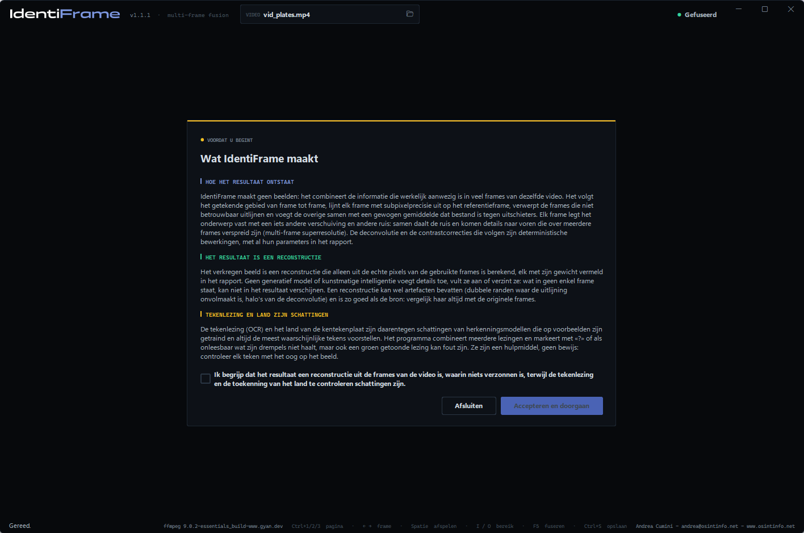
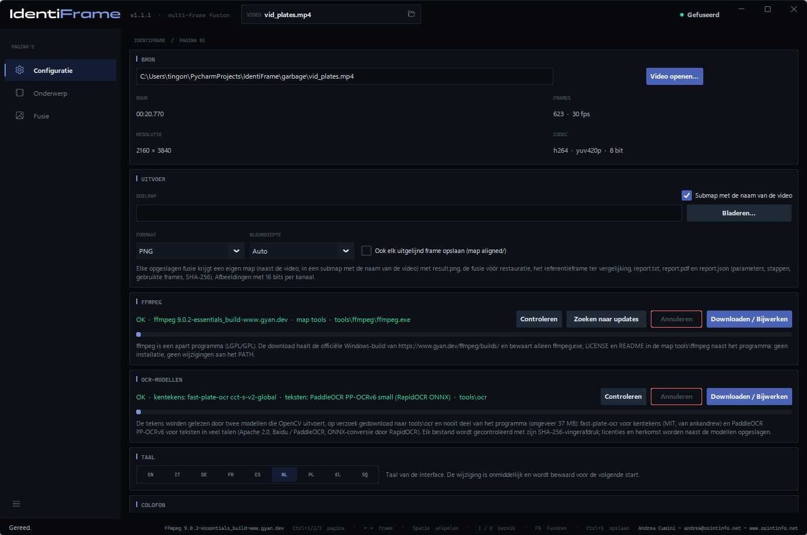
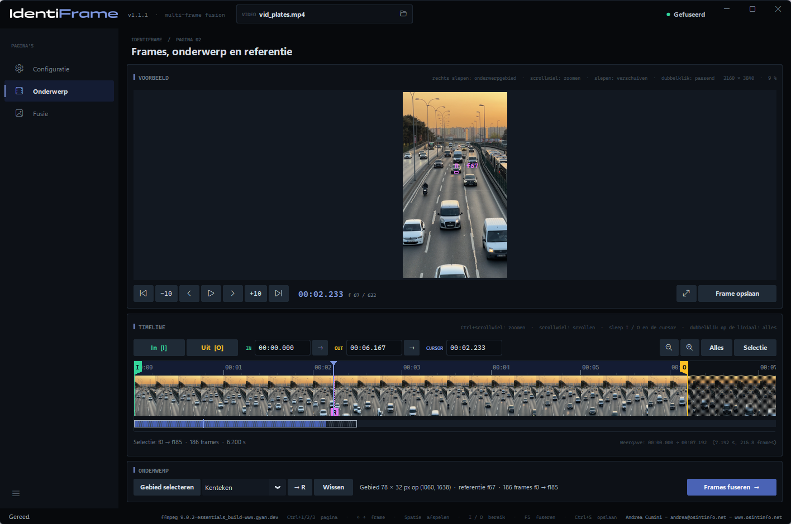
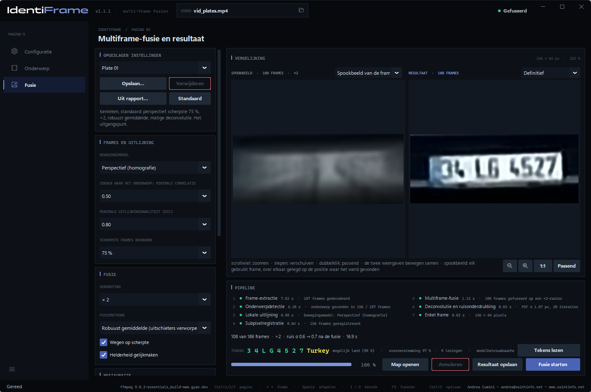
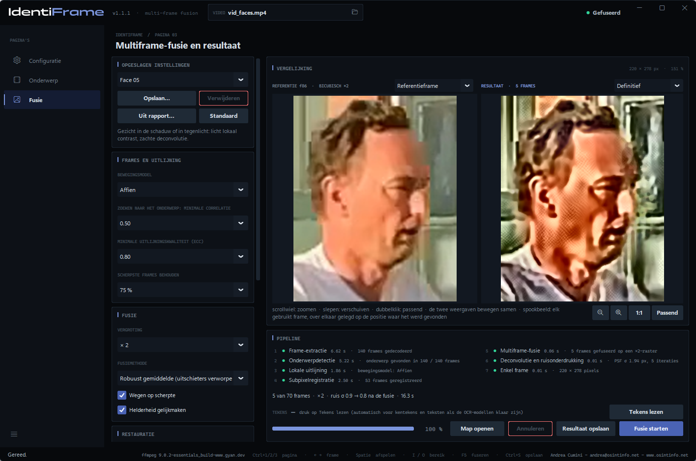
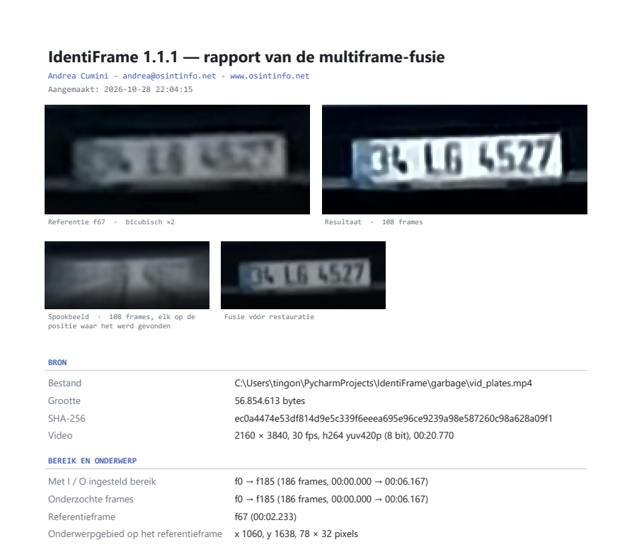
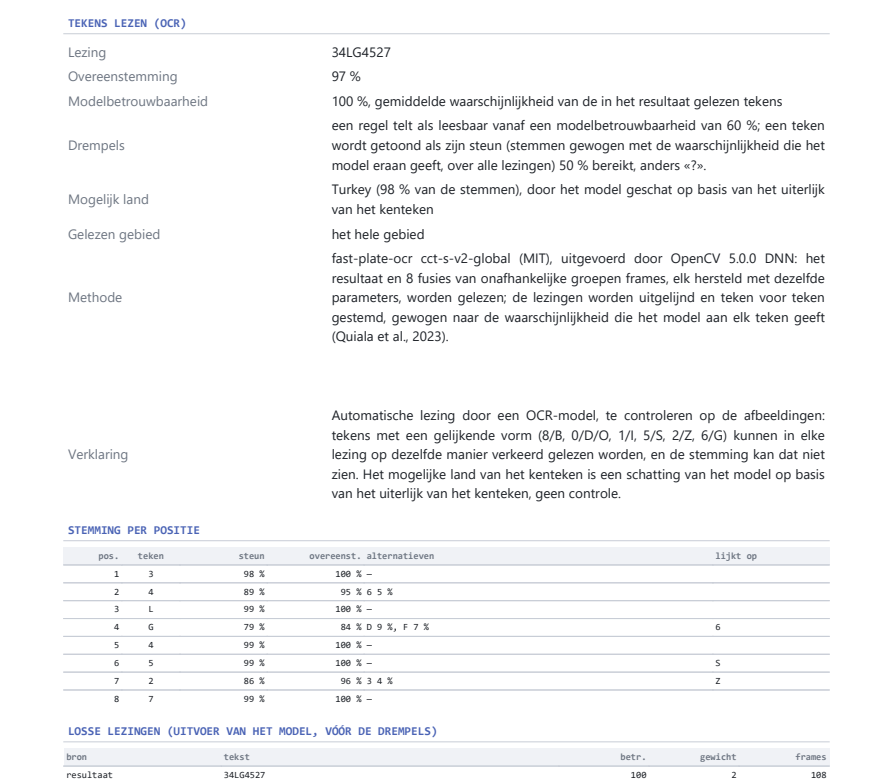

# IdentiFrame — Gebruikershandleiding

[English](manual.en.md) · [Italiano](manual.it.md) · [Deutsch](manual.de.md) · [Français](manual.fr.md) · [Español](manual.es.md) · **Nederlands** · [Polski](manual.pl.md) · [Ελληνικά](manual.el.md) · [Shqip](manual.sq.md)

IdentiFrame verbetert de leesbaarheid van een klein detail — een kenteken,
een gezicht, een bord — dat in meerdere frames van een video is gefilmd. Het
lijnt die frames met subpixelprecisie uit, fuseert ze op een fijner raster,
vermindert ruis en onscherpte, en levert **één enkel beeld** op, met een
rapport dat elke parameter en elke stap documenteert.

*Andrea Cumini — www.osintinfo.net — andrea@osintinfo.net*

## Inhoud

1. [Hoe het werkt](#1-hoe-het-werkt)
2. [Installatie en eerste start](#2-installatie-en-eerste-start)
3. [Pagina Configuratie](#3-pagina-configuratie)
4. [Pagina Onderwerp: frames, onderwerp en referentie](#4-pagina-onderwerp-frames-onderwerp-en-referentie)
5. [Pagina Fusie](#5-pagina-fusie)
6. [Opslaan: afbeeldingen en rapport](#6-opslaan-afbeeldingen-en-rapport)
7. [Het beste halen uit een kenteken of een gezicht](#7-het-beste-halen-uit-een-kenteken-of-een-gezicht)
8. [Grenzen en correct gebruik](#8-grenzen-en-correct-gebruik)
9. [Sneltoetsen](#9-sneltoetsen)
10. [OCR-modellen (optioneel)](#10-ocr-modellen-optioneel)

## 1. Hoe het werkt

Elk frame van een video legt het onderwerp vast op een iets andere positie
ten opzichte van het pixelraster, en met een eigen willekeurige ruis.
IdentiFrame maakt daar gebruik van: het zoekt het onderwerp in elk frame,
lijnt alle frames met subpixelprecisie uit op één **referentieframe** en
combineert ze. De ruis neemt af en een deel van het detail dat elk afzonderlijk
frame verliest, komt terug. Er wordt niets verzonnen: het resultaat bevat
alleen wat de frames ondersteunen.

Het werk gebeurt in zeven stappen, die in het vak *Pipeline* worden getoond:

| Stap | Wat er gebeurt |
| --- | --- |
| 1. Frame-extractie | Het gekozen bereik wordt door FFmpeg gedecodeerd, exact op het frame. |
| 2. Onderwerpdetectie | Het onderwerp wordt frame voor frame gevolgd, vanaf de referentie voorwaarts en achterwaarts. |
| 3. Lokale uitlijning | Elk frame wordt uitgelijnd op de referentie (ECC-algoritme; model: translatie, rotatie, affien of perspectief). |
| 4. Subpixelregistratie | De uitlijning wordt verfijnd op volledige resolutie; de scherpste en best uitgelijnde frames worden gekozen. |
| 5. Multiframe-fusie | De frames worden herbemonsterd op een tot 4 keer fijner raster en gecombineerd, waarbij uitschieters worden verworpen. |
| 6. Deconvolutie en ruisonderdrukking | Automatische niveaus, optionele ruisonderdrukking en Richardson-Lucy-deconvolutie op de luminantie. |
| 7. Enkel frame | Definitief beeld, spookbeeld van de frames, vergelijking met de referentie, gegevens voor het rapport. |

## 2. Installatie en eerste start

**Uitvoerbaar bestand (Windows 10/11, 64-bit).** Pak `IdentiFrame-<versie>-windows-x64.zip`
uit op een willekeurige plek en start `IdentiFrame.exe`. Python is niet nodig.
Het uitvoerbare bestand is niet ondertekend: de eerste keer kan Windows
SmartScreen om bevestiging vragen.

**Vanuit de broncode.** Met Python 3.10 of nieuwer:

```bash
python -m pip install -r requirements.txt
python IdentiFrame.py
```

**Melding bij het starten.** Bij elke start verschijnt een melding die
geaccepteerd moet worden: die legt uit dat het resultaat een reconstructie
is die alleen uit de echte pixels van de frames is berekend, waarin niets
verzonnen is, terwijl de tekenlezing en het land te controleren schattingen
zijn. *Accepteren en doorgaan* wordt actief na het aanvinken van de
verklaring. Bij de allereerste start wordt eerst de taal gevraagd, en de
melding verschijnt in de gekozen taal.



**FFmpeg.** IdentiFrame gebruikt FFmpeg om video's te lezen, maar bevat het
niet. Als FFmpeg bij de eerste start ontbreekt, opent de pagina
**Configuratie** op het vak *FFmpeg*: **Downloaden / Bijwerken** haalt de
officiële Windows-build op in de map `tools\ffmpeg` naast het programma. Er
wordt niets op het systeem geïnstalleerd.

Een video kan ook vanaf de opdrachtregel worden geopend:
`IdentiFrame.exe video.mp4`.

## 3. Pagina Configuratie



- **Bron** — **Video openen…** (of Ctrl+O, of het mappictogram in het vak
  *VIDEO* bovenaan). Hier worden duur, aantal frames, resolutie en codec
  getoond. Wanneer een video wordt geopend, gaat het programma naar de pagina
  *Onderwerp*.
- **Uitvoer** — *Doelmap* waar de fusies worden opgeslagen (leeg = naast de
  video), *Submap met de naam van de video*, *Formaat* (PNG of TIFF) en
  *Kleurdiepte* (*Auto* = 16 bits per kanaal voor de fusie). *Ook elk
  uitgelijnd frame opslaan (map aligned/)* bewaart bovendien elk gebruikt
  frame, uitgelijnd op de referentie.
- **FFmpeg** — waar FFmpeg staat en welke versie: **Controleren**, **Zoeken
  naar updates**, **Downloaden / Bijwerken**.
- **OCR-modellen** — de twee optionele modellen die de tekens van kentekens en teksten lezen, op verzoek gedownload naar `tools\ocr` (ongeveer 37 MB): **Controleren** en **Downloaden / Bijwerken**. Zonder werkt het programma, alleen zonder het lezen van tekens. Zie [10. OCR-modellen](#10-ocr-modellen-optioneel).
- **Taal** — de interface en de rapporten zijn beschikbaar in negen talen:
  EN, IT, DE, FR, ES, NL, PL, EL, SQ. De wijziging is onmiddellijk en wordt
  onthouden.
- **Colofon** — auteur en licentie.

## 4. Pagina Onderwerp: frames, onderwerp en referentie



Het *Voorbeeld* toont het frame onder de cursor: het **scrollwiel** zoomt
rond de muis (tot op de echte pixels), **slepen** verschuift het beeld, een
**dubbelklik** maakt het frame weer passend. Daaronder verplaatsen de knoppen
de cursor één of tien frames; **← →** en **Shift+← →** doen hetzelfde met het
toetsenbord.

De knop **afspelen** in het midden speelt het voorbeeld af vanaf de cursor
en wordt tijdens het afspelen **pauze** (spatie doet hetzelfde); cursor en
tijdlijn volgen, zodat u tijdens het kijken een bereik kunt markeren met I
en O. Een klik op de tijdlijn of een framestap stopt het afspelen.

De tijdlijn (het vak *Timeline*) toont de hele video als een filmstrook.
**Ctrl+scrollwiel** zoomt, het **scrollwiel** scrolt; klikken of slepen
verplaatst de cursor. *Alles* en *Selectie* passen de weergave aan.

**1. Kies het referentieframe.** Ga naar het frame waarin het onderwerp **het
grootst en het scherpst** is — bij een voertuig dat nadert meestal een van de
laatste frames waarin het hele kenteken nog zichtbaar is.

**2. Selecteer het gebied van het onderwerp.** Sleep met de
**rechtermuisknop** over het kenteken of het gezicht, of druk op **Gebied
selecteren** en sleep met de linkermuisknop. Omkader het onderwerp met een
kleine marge. Het getoonde frame wordt de **referentie** (markering **R** op
de tijdlijn; **→ R** brengt de cursor ernaar terug) en **de fusie start
vanzelf**: het programma gaat naar de pagina *Fusie*. Als u een nieuw gebied
tekent terwijl de fusie loopt, wordt die opnieuw gestart. **Wissen**
verwijdert het gebied.

**3. Kies het bereik.** **In [I]** en **Uit [O]** (toetsen I en O) bepalen het
eerste en het laatste frame dat wordt gebruikt: de frames waarin het onderwerp
zichtbaar is en niet bedekt. De markeringen I en O kunnen ook worden versleept,
en de velden IN / OUT accepteren een tijd (`1:23.456`) of een frame (`f2000`).
Telkens wanneer het gebied wordt getekend, wordt het bereik ingesteld op 30
seconden vóór en 30 na de referentie (binnen de video): dat zijn alleen de
grenzen van het zoeken. De fusie volgt het onderwerp vanaf de referentie naar
buiten en stopt in elke richting na één seconde zonder het onderwerp; daarna
schuiven de markeringen I en O naar de frames waarin het werd gevolgd (het
rapport vermeldt het). Een met de hand verplaatst bereik blijft zoals het is.
Start na een wijziging van het bereik de fusie opnieuw met **Frames fuseren →**
(of F5). Hoogstens 3601 frames in het bereik.

## 5. Pagina Fusie



**Vergelijking.** Links het **Spookbeeld van de frames**: alle gebruikte
frames, over elkaar gelegd op de positie waar elk ervan werd gevonden, vóór
de uitlijning. Het laat zien wat er in de fusie gaat en hoeveel het
onderwerp beweegt. Met het menu erboven kan de linkerweergave in plaats
daarvan het **Referentieframe** tonen, vergroot met bicubische interpolatie:
dat is het eerlijke ‘vóór’-beeld. Rechts het resultaat: **Definitief**, of
**Alleen fusie** (vóór ruisonderdrukking en deconvolutie). De twee weergaven
zoomen en verschuiven samen. Naast het muiswiel verkleinen de knoppen onder
de weergaven (**−**, ook onder de passende grootte, om het resultaat klein
te zien), vergroten (**+**), tonen het op **1:1** of maken het **passend**
in de weergave; met het toetsenbord **−**, **+** en **0**.



De tweede afbeelding toont een gezicht, met de voorinstelling **Face 05** en
het referentieframe links.

**Tekens.** Met de OCR-modellen gedownload toont na elke fusie van een *Kenteken* of een *Tekst* de regel **TEKENS** in het vak *Pipeline* de gelezen tekens (**Tekens lezen** herhaalt de lezing). Het resultaat en acht fusies van onafhankelijke groepen frames worden gelezen, en de lezingen worden teken voor teken gestemd. De herkenningsmodellen stellen altijd de meest waarschijnlijke tekens voor, ook waar niets te lezen is: een regel wordt pas getoond vanaf een modelbetrouwbaarheid van 60 %, anders schrijft het programma **onleesbaar**, en een teken dat niet minstens 50 % van de gewogen stemmen krijgt, verschijnt als **«?»**. Bij een kenteken verschijnt het door het model geschatte **mogelijke land** alleen in geel naast de tekens als de lezing leesbaar is en één land de meerderheid van de stemmen heeft; anders staat het bij de details, met zijn aandeel. De details geven ook de **overeenstemming** tussen de lezingen, de **modelbetrouwbaarheid**, de **twijfelachtige** posities en de tekens om **met het oog te controleren** (8/B, 0/D/O, 1/I, 5/S, 2/Z, 6/G). Een *Tekst* kan meerdere regels hebben, gescheiden door «|», elk apart gestemd. Op de eerste afbeelding is het kenteken erg klein (tekens van ongeveer 12 pixels hoog in de video) en wordt het gelezen als 34LG4527, mogelijk land Turkey. Lezing en land zijn schattingen: vergelijk altijd met het beeld.

**Pipeline.** De zeven stappen met hun uitkomst en tijd; daaronder de
samenvatting (gebruikte frames, vergroting, ruis vóór en na de fusie), de
voortgangsbalk en de knoppen **Map openen**, **Annuleren**, **Resultaat
opslaan**, **Fusie starten**. Stappen 1–4 hangen alleen af van video, bereik,
referentie, gebied en bewegingsmodel: als alleen de parameters van fusie of
restauratie veranderen, worden ze hergebruikt en duurt een nieuwe fusie een
fractie van een seconde (*hergebruikt* in de lijst van stappen).

### Parameters

De kolom links groepeert de parameters per stap.

**Onderwerptype.** Het menu naast *Gebied selecteren*, in het vak *Onderwerp* van de pagina *Onderwerp*, zegt wat er verbeterd wordt. **Kenteken** en **Tekst**: een vlak, star onderwerp, één bewegingsmodel per frame; ze verschillen in het lezen van tekens (een model voor kentekens, of een voor teksten op één of meer regels, in veel talen). **Gezicht**: tussen frames draait het hoofd en verandert de uitdrukking, dus na de starre uitlijning krijgt elk frame een lokale niet-starre verfijning die deze bewegingen op enkele pixels volgt; wat nog verschilt telt minder, frames met een andere pose of uitdrukking worden weggelaten, het herstel is lichter en de automatische niveaus zijn zachter voor huid en schaduwen. Het type wijzigen laadt de standaardwaarden en voert de uitlijning opnieuw uit. Er wordt niets verzonnen: de verfijning verschuift alleen met enkele pixels wat de frames bevatten. Voor een gezicht is het bewegingsmodel standaard affien, de uitlijning weigert vervormingen die geen mogelijke hoofdbeweging zijn en buiten de ellips in het gebied toont het resultaat het referentieframe, omdat de achtergrond anders beweegt.

**Opgeslagen instellingen.** Sets parameters met een naam: **Opslaan…** vraagt
om een naam en bewaart de huidige parameters; een naam kiezen in het menu
laadt ze; **Verwijderen** verwijdert de gekozen set; **Standaard** zet elke
parameter terug. **Uit rapport…** laadt de parameters uit de `report.json`
van een eerder opgeslagen fusie, om die exact te herhalen. De gebruikte
parameters worden ook onthouden wanneer het programma wordt afgesloten.

**Ingebouwde voorinstellingen.** Het menu *Opgeslagen instellingen* begint altijd met vijf voorinstellingen voor het onderwerptype dat op de pagina Onderwerp is gekozen: **Plate 01** standaard, **02** nacht of ruis, **03** ver en klein kenteken, **04** rijdend voertuig met bewegingsonscherpte, **05** schaduw of tegenlicht; **Text 01–05** dezelfde vijf gevallen voor teksten; **Face 01** standaard, **02** nacht of ruis, **03** minimale bewerking, **04** ver en klein gezicht, **05** schaduw of tegenlicht. Een regel onder het menu beschrijft de gekozen; ze kunnen niet gewijzigd of verwijderd worden, en je eigen instellingen volgen.

| Vak | Parameter | Effect |
| --- | --- | --- |
| Pagina Onderwerp | Soort onderwerp | Kenteken (standaard) of Tekst voor een vlak, star onderwerp (ze verschillen in het lezen van tekens); Gezicht voegt de lokale niet-starre verfijning en een lichter herstel toe. |
| Frames en uitlijning | Bewegingsmodel | Translatie, Rotatie + translatie, Affien, **Perspectief (homografie)** — standaard; volgt een onderwerp dat nadert, zich verwijdert of draait. Als een frame niet convergeert, wordt een eenvoudiger model geprobeerd. |
| | Zoeken naar het onderwerp: minimale correlatie | Onder deze score geldt het onderwerp in een frame als niet gevonden. |
| | Minimale uitlijningskwaliteit (ECC) | Frames die slechter zijn uitgelijnd, worden weggelaten (standaard 0.80). |
| | Scherpste frames behouden | Standaard 75 %: het minst scherpe kwart (bewegingsonscherpte) wordt weggelaten. |
| Fusie | Vergroting | × 1 (alleen ruisonderdrukking) tot × 4. × 2 of × 3 is meestal de juiste keuze. |
| | Fusiemethode | **Robuust gemiddelde (uitschieters verworpen)** — standaard; Mediaan; Shift-and-add (genormaliseerde convolutie). |
| | Wegen op scherpte | Scherpere frames tellen veel zwaarder. |
| | Helderheid gelijkmaken | Compenseert belichtingsverschillen tussen frames. |
| Restauratie | Ruisonderdrukking | Uit, Licht, Gemiddeld, Sterk (bilateraal filter). |
| | Deconvolutie-iteraties | Richardson-Lucy: meer iteraties verscherpen meer, maar versterken ook ruis en halo's. Standaard 20. |
| | PSF σ (uitvoerpixels) | Breedte van de onscherpte die moet worden verwijderd. *Automatisch* meet die op de randen van het gefuseerde beeld. |
| | Regularisatie (totale variatie) | Houdt de ruis in toom tijdens de deconvolutie. Standaard Gemiddeld. |
| Presentatie | Automatische niveaus | Zwart en wit op de percentielen 0,5 en 99,5 van de luminantie, vóór de deconvolutie. |
| | Lokaal contrast (CLAHE) | Egalisatie per zone: nuttig bij kentekens in de schaduw of in tegenlicht. |
| | Grijstinten | Laat de kleur weg: vaak schoner om tekens te lezen. |

## 6. Opslaan: afbeeldingen en rapport

**Resultaat opslaan** (Ctrl+S op de pagina *Fusie*) maakt in de doelmap een
nieuwe map `fusion_f<referentie>_<datum-tijd>` aan, met:

| Bestand | Inhoud |
| --- | --- |
| `result.png` | het definitieve beeld |
| `fused.png` | de fusie vóór ruisonderdrukking en deconvolutie |
| `ghost.png` | het spookbeeld van de gebruikte frames |
| `reference_x<k>.png` | het referentiegebied, vergroot met bicubische interpolatie, ter vergelijking |
| `reference_crop.png` | hetzelfde gebied op de resolutie van de video |
| `report.pdf` | het rapport, opgemaakt op A4, met de afbeeldingen |
| `report.txt` | hetzelfde rapport als platte tekst |
| `report.json` | dezelfde gegevens in gestructureerde vorm, inclusief de instellingen (**Uit rapport…** laadt ze opnieuw) |
| `aligned/` | op verzoek elk gebruikt frame, uitgelijnd op de referentie |



Met een lezing van de tekens heeft het rapport de sectie **Tekens lezen (OCR)**: de lezing, de overeenstemming, de modelbetrouwbaarheid, bij een kenteken het mogelijke land en het gelezen gebied, bij een tekst de gevonden regels, de methode, de stemming per positie met de alternatieven en de gelijkende tekens, en elke afzonderlijke lezing.



Het rapport wordt geschreven in de taal van de interface. Het bevat de bron
(pad, grootte, **SHA-256**-vingerafdruk, formaat), het bereik, het
referentieframe en het gebied, alle parameters, de zeven stappen met de
gebruikte methoden en hun tijden, de tabel van de frames (zoekscore,
uitlijningscoëfficiënten, subpixelverschuiving, scherpte, gewicht, reden van
uitsluiting), ruisschattingen en de SHA-256 van elke geschreven afbeelding.
Wie het leest, kan de verwerking herhalen en controleren dat de bestanden
niet zijn gewijzigd.

*Frame opslaan* op de pagina *Onderwerp* slaat daarentegen alleen het frame
onder de cursor op, op volledige resolutie en verliesvrij.

## 7. Het beste halen uit een kenteken of een gezicht

- **Gezicht**: kies eerst het soort onderwerp *Gezicht*; kader het hele gezicht met een kleine marge, zo mogelijk op een frame waarin het naar de camera kijkt, en beperk het bereik tot frames met dezelfde pose. Het rapport zegt hoeveel frames zijn afgevallen wegens een andere pose of uitdrukking en hoe breed het gezicht in de video is: onder ongeveer 60 pixels mag u een schoner algemeen beeld verwachten, geen identificerende kenmerken.
- **Referentie**: het frame waarin het onderwerp het grootst en het scherpst
  is.
- **Bereik**: alleen de frames waarin het onderwerp volledig zichtbaar is.
  Frames die ver van de referentie liggen (veel kleiner, ander perspectief),
  dragen weinig bij en worden vaak toch al door de kwaliteitsdrempel
  weggelaten.
- **Gebied**: het hele kenteken of gezicht met een kleine marge; niet te veel
  achtergrond, die anders kan bewegen.
- **Vergroting**: × 2 of × 3. × 4 loont alleen met veel frames.
- **Tekens nog zacht?** Verhoog *PSF σ* met één stap (bijv. van Automatisch
  naar de eerstvolgende waarde boven de waarde in het rapport), of de
  *Deconvolutie-iteraties*.
- **Halo's of ‘ringing’ rond de tekens?** Verlaag *PSF σ* of de iteraties, of
  verhoog de *Regularisatie (totale variatie)*.
- **Kenteken in de schaduw of in tegenlicht**: *Lokaal contrast (CLAHE)* op
  Licht of Gemiddeld, vaak samen met *Grijstinten*.
- **Vergelijk** altijd met de weergave *Referentieframe* en zoom in op de
  tekens: wat daar niet leesbaar is en pas na sterke verscherping verschijnt,
  moet met voorzichtigheid worden behandeld.
- Bewaar een set parameters die voor een camera goed werkt met **Opslaan…**
  en gebruik die opnieuw.

## 8. Grenzen en correct gebruik

- Het resultaat is een **verbetering** van de opgenomen frames, geen
  reconstructie van de werkelijkheid: het kan niet terughalen wat in geen
  enkel frame staat.
- Fijne details op de grens van de resolutie, en tekens die op elkaar lijken
  (8/B, 0/D, 1/7, 5/S), moeten aan de bronframes worden getoetst voordat u
  conclusies trekt.
- De winst is het grootst bij veel frames, kleine verschuivingen daartussen,
  onafhankelijke ruis en een voldoende scherpe referentie. Bewegingsonscherpte
  binnen één frame wordt niet verwijderd.
- Sterke compressie veroorzaakt fouten die in opeenvolgende frames gelijk
  zijn: de fusie vermindert die minder dan willekeurige ruis.
- Kentekens en gezichten zijn persoonsgegevens: gebruik het programma binnen
  de regels die op u van toepassing zijn.

## 9. Sneltoetsen

| Toetsen | Actie |
| --- | --- |
| Ctrl+1 / Ctrl+2 / Ctrl+3 | Pagina Configuratie / Onderwerp / Fusie |
| Ctrl+O | Video openen |
| ← / → | Vorig / volgend frame |
| Shift+← / Shift+→ | 10 frames terug / vooruit |
| Spatie | Voorbeeld afspelen of pauzeren |
| Home / End | Eerste / laatste frame |
| I / O | Begin / einde van het bereik op de cursor |
| + / − | Tijdlijn inzoomen / uitzoomen |
| F | Hele video op de tijdlijn |
| Rechts slepen in het voorbeeld | Onderwerpgebied selecteren (de fusie start) |
| Esc | *Gebied selecteren* verlaten |
| − / + / 0 (pagina Fusie) | Resultaat verkleinen / vergroten / passend maken |
| F11 | Grotere voorvertoning: tijdlijn verbergen of tonen (pagina Onderwerp) |
| F5 | De fusie starten |
| Ctrl+S | Het resultaat (pagina Fusie) of het frame (pagina Onderwerp) opslaan |


## 10. OCR-modellen (optioneel)

Het lezen van tekens gebruikt twee neurale-netwerkmodellen, uitgevoerd door OpenCV, dat al deel van het programma is. Ze zijn **niet inbegrepen** in IdentiFrame en zijn **optioneel**: zonder werkt al het andere zoals altijd, alleen de regel TEKENS blijft leeg. Druk om ze te gebruiken op **Downloaden / Bijwerken** in het vak **OCR-modellen** van de pagina *Configuratie*: ze komen in de map `tools\ocr` naast het programma (ongeveer 37 MB), en het vak toont welke aanwezig zijn.

| Onderwerp | Model | Licentie |
| --- | --- | --- |
| Kenteken | [fast-plate-ocr](https://github.com/ankandrew/fast-plate-ocr) `cct-s-v2-global`, van ankandrew: leest het hele kenteken en schat het mogelijke land uit 65 | MIT, code en gewichten ([bevestigd door de auteur](https://github.com/ankandrew/fast-plate-ocr/issues/97)) |
| Tekst | [PaddleOCR](https://github.com/PaddlePaddle/PaddleOCR) PP-OCRv6 small, van Baidu / PaddleOCR, in de ONNX-conversie van [RapidOCR](https://github.com/RapidAI/RapidOCR): vindt de tekstregels en leest ze in veel talen | Apache 2.0 |

Elk bestand wordt gecontroleerd met zijn SHA-256-vingerafdruk voordat het bewaard wordt; naast de modellen worden de licentieteksten en een bestand `SOURCE.txt` met de herkomst opgeslagen. Het land is een schatting op basis van het uiterlijk van het kenteken, geen controle, en wordt met de Engelse landnaam getoond.

*Testvideo's en schermafbeeldingen, van Pexels, gebruikt volgens de [Pexels-licentie](https://www.pexels.com/license/): ‘[Busy Highway Traffic at Sunset](https://www.pexels.com/it-it/video/traffico-autostradale-intenso-al-tramonto-31779728/)’ van [Şeyhmus Kino](https://www.pexels.com/@seyhmuskino/) (voertuigen en kentekens), straatverkeer in Taipei, Taiwan, van [Levi Wedge](https://www.pexels.com/@levi-wedge-266970209/) ([video](https://www.pexels.com/it-it/video/citta-auto-traffico-veicoli-13271103/), teksten) en ‘[Charming European Street with Cyclist](https://www.pexels.com/it-it/video/affascinante-strada-europea-con-ciclista-33476096/)’ van [Tuba Din](https://www.pexels.com/@tubadinn/) (gezicht). De kentekens, teksten en het gezicht op de schermafbeeldingen komen uit dat materiaal.*

---

IdentiFrame is vrije software onder de GNU GPL v3 met naamsvermelding van de
auteur: zie `LICENSE` en `NOTICE`. Andrea Cumini - andrea@osintinfo.net - www.osintinfo.net
