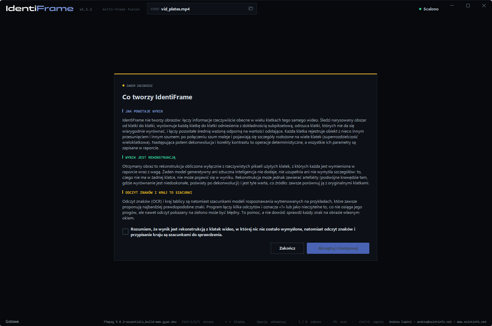
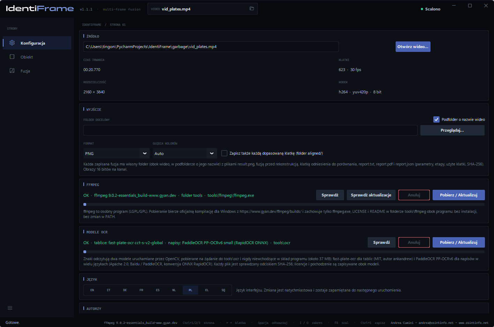
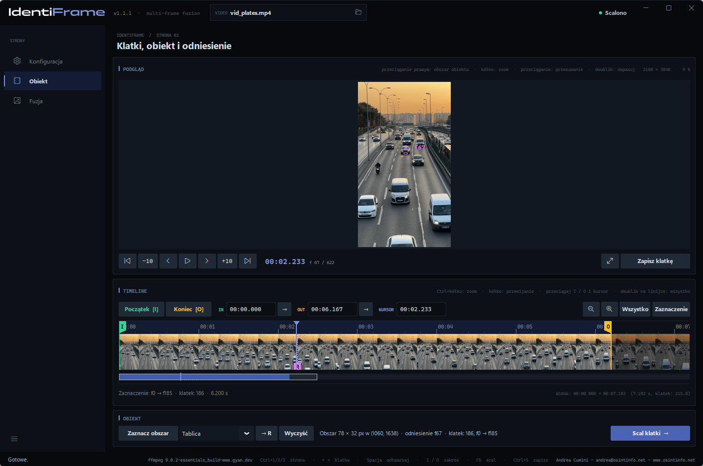
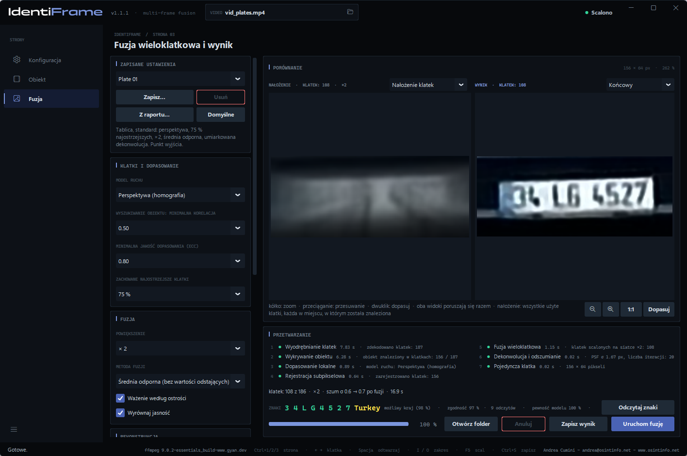
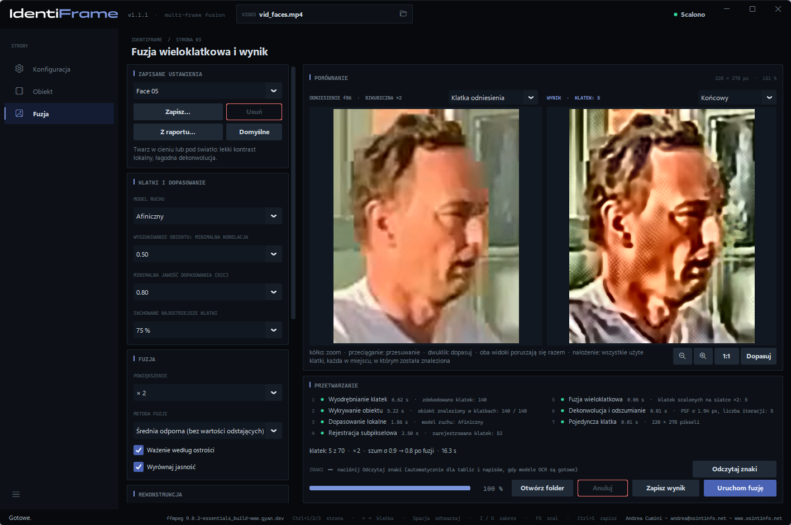
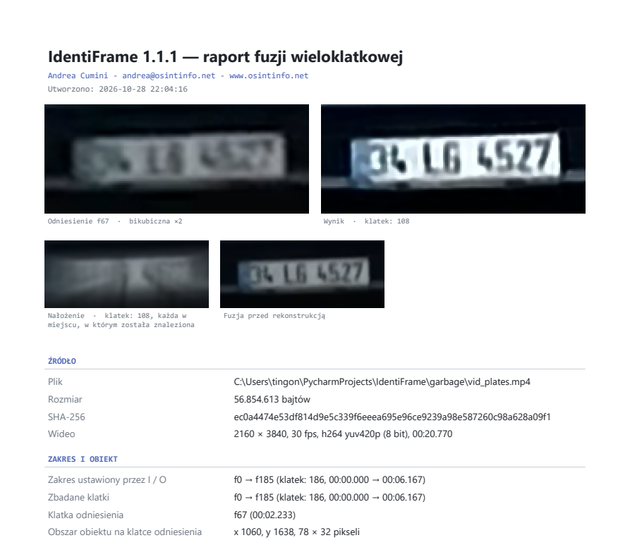
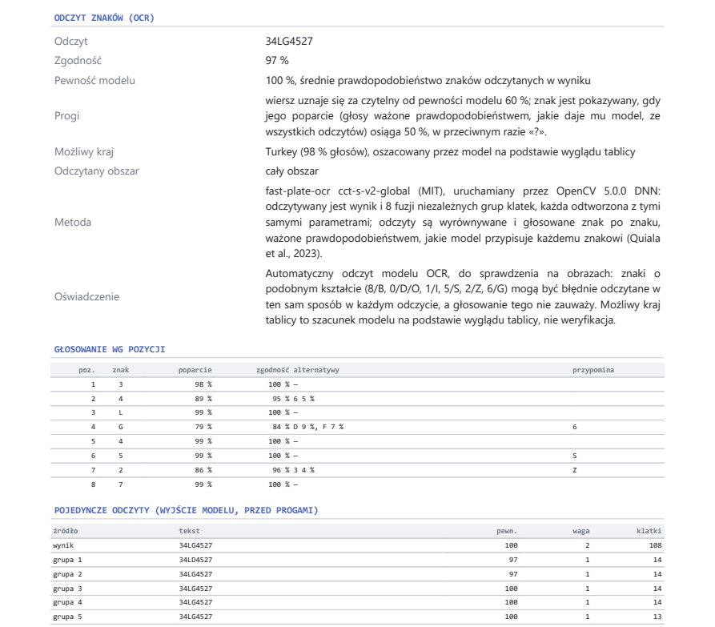

# IdentiFrame — Podręcznik użytkownika

[English](manual.en.md) · [Italiano](manual.it.md) · [Deutsch](manual.de.md) · [Français](manual.fr.md) · [Español](manual.es.md) · [Nederlands](manual.nl.md) · **Polski** · [Ελληνικά](manual.el.md) · [Shqip](manual.sq.md)

IdentiFrame poprawia czytelność drobnego szczegółu — tablicy rejestracyjnej,
twarzy, napisu — zarejestrowanego na kilku klatkach wideo. Program dopasowuje
te klatki z dokładnością subpikselową, scala je na gęstszej siatce, redukuje
szum i rozmycie oraz tworzy **jeden pojedynczy obraz** wraz z raportem, który
dokumentuje każdy parametr i każdy etap.

*Andrea Cumini — www.osintinfo.net — andrea@osintinfo.net*

## Spis treści

1. [Jak to działa](#1-jak-to-działa)
2. [Instalacja i pierwsze uruchomienie](#2-instalacja-i-pierwsze-uruchomienie)
3. [Strona Konfiguracja](#3-strona-konfiguracja)
4. [Strona Obiekt: klatki, obiekt i odniesienie](#4-strona-obiekt-klatki-obiekt-i-odniesienie)
5. [Strona Fuzja](#5-strona-fuzja)
6. [Zapisywanie: obrazy i raport](#6-zapisywanie-obrazy-i-raport)
7. [Jak uzyskać najlepszy wynik dla tablicy lub twarzy](#7-jak-uzyskać-najlepszy-wynik-dla-tablicy-lub-twarzy)
8. [Ograniczenia i prawidłowe użycie](#8-ograniczenia-i-prawidłowe-użycie)
9. [Skróty klawiaturowe](#9-skróty-klawiaturowe)
10. [Modele OCR (opcjonalne)](#10-modele-ocr-opcjonalne)

## 1. Jak to działa

Każda klatka wideo rejestruje obiekt w nieco innym położeniu względem siatki
pikseli i z własnym, losowym szumem. IdentiFrame to wykorzystuje: odnajduje
obiekt na każdej klatce, dopasowuje wszystkie klatki z dokładnością
subpikselową do jednej z nich — jest nią **klatka odniesienia** — i łączy je.
Szum maleje, a część szczegółów utraconych na każdej pojedynczej klatce
powraca. Nic nie jest wymyślane: wynik zawiera tylko to, co potwierdzają klatki.

Praca przebiega w siedmiu etapach, widocznych w panelu *Przetwarzanie*:

| Etap | Co się dzieje |
| --- | --- |
| 1. Wyodrębnianie klatek | Wybrany zakres jest dekodowany przez FFmpeg z dokładnością co do klatki. |
| 2. Wykrywanie obiektu | Obiekt jest śledzony klatka po klatce, w przód i w tył od klatki odniesienia. |
| 3. Dopasowanie lokalne | Każda klatka jest dopasowywana do klatki odniesienia (algorytm ECC; model ruchu: przesunięcie, obrót, afiniczny lub perspektywa). |
| 4. Rejestracja subpikselowa | Dopasowanie jest doprecyzowywane w pełnej rozdzielczości; wybierane są klatki najostrzejsze i najlepiej dopasowane. |
| 5. Fuzja wieloklatkowa | Klatki są przepróbkowywane na siatce nawet 4 razy gęstszej i łączone z odrzuceniem wartości odstających. |
| 6. Dekonwolucja i odszumianie | Automatyczne poziomy, opcjonalna redukcja szumu i dekonwolucja Richardsona-Lucy na luminancji. |
| 7. Pojedyncza klatka | Obraz końcowy, nałożenie klatek, porównanie z klatką odniesienia, dane do raportu. |

## 2. Instalacja i pierwsze uruchomienie

**Plik wykonywalny (Windows 10/11, 64-bit).** Archiwum `IdentiFrame-<wersja>-windows-x64.zip`
należy rozpakować w dowolnym miejscu i uruchomić `IdentiFrame.exe`. Python nie
jest potrzebny. Plik wykonywalny nie jest podpisany: przy pierwszym
uruchomieniu Windows SmartScreen może poprosić o potwierdzenie.

**Ze źródeł.** Wymagany jest Python 3.10 lub nowszy:

```bash
python -m pip install -r requirements.txt
python IdentiFrame.py
```

**Komunikat przy uruchomieniu.** Przy każdym uruchomieniu pojawia się
komunikat do zaakceptowania: wyjaśnia, że wynik jest rekonstrukcją obliczoną
wyłącznie z rzeczywistych pikseli klatek, w której nic nie zostało
wymyślone, natomiast odczyt znaków i kraj są szacunkami do sprawdzenia.
*Akceptuj i kontynuuj* staje się aktywne po zaznaczeniu oświadczenia. Przy
pierwszym uruchomieniu najpierw pojawia się pytanie o język, a komunikat
wyświetla się w wybranym języku.



**FFmpeg.** IdentiFrame używa FFmpeg do odczytu plików wideo, ale go nie
zawiera. Jeśli przy pierwszym uruchomieniu brakuje FFmpeg, otwiera się strona
**Konfiguracja** z panelem *FFmpeg*: przycisk **Pobierz / Aktualizuj** pobiera
oficjalną kompilację dla Windows do folderu `tools\ffmpeg` obok programu. Nic
nie jest instalowane w systemie.

Wideo można też otworzyć z wiersza poleceń:
`IdentiFrame.exe video.mp4`.

## 3. Strona Konfiguracja



- **Źródło** — **Otwórz wideo…** (lub Ctrl+O, lub ikona folderu w polu *VIDEO*
  u góry okna). Tutaj wyświetlane są czas trwania, liczba klatek, rozdzielczość
  i kodek. Po otwarciu wideo program przechodzi na stronę *Obiekt*.
- **Wyjście** — *Folder docelowy*, w którym zapisywane są fuzje (puste = obok
  wideo), *Podfolder o nazwie wideo*, *Format* (PNG lub TIFF) oraz *Głębia
  kolorów* (*Auto* = 16 bitów na kanał dla fuzji). Opcja *Zapisz także każdą
  dopasowaną klatkę (folder aligned/)* dodaje folder `aligned/` ze wszystkimi
  użytymi klatkami, dopasowanymi do klatki odniesienia.
- **FFmpeg** — gdzie znajduje się FFmpeg i w jakiej wersji: **Sprawdź**,
  **Sprawdź aktualizacje**, **Pobierz / Aktualizuj**.
- **Modele OCR** — dwa opcjonalne modele, które odczytują znaki tablic i napisów, pobierane na żądanie do `tools\ocr` (około 37 MB): **Sprawdź** i **Pobierz / Aktualizuj**. Bez nich program działa, tylko bez odczytu znaków. Zob. [10. Modele OCR](#10-modele-ocr-opcjonalne).
- **Język** — interfejs i raporty są dostępne w dziewięciu językach: EN, IT,
  DE, FR, ES, NL, PL, EL, SQ. Zmiana jest natychmiastowa i zostaje zapamiętana.
- **Autorzy** — autor i licencja.

## 4. Strona Obiekt: klatki, obiekt i odniesienie



Panel *Podgląd* pokazuje klatkę pod kursorem: **kółko** powiększa obraz wokół
wskaźnika myszy (aż do rzeczywistych pikseli), **przeciąganie** przesuwa
widok, a **dwuklik** ponownie dopasowuje klatkę do okna. Przyciski pod
podglądem przesuwają kursor o jedną lub dziesięć klatek; to samo robią
klawisze **← →** i **Shift+← →**.

Przycisk **odtwórz** pośrodku odtwarza podgląd od kursora i podczas
odtwarzania zmienia się w **pauzę** (Spacja robi to samo); kursor i oś czasu
podążają za nim, więc można zaznaczyć zakres klawiszami I i O podczas
oglądania. Kliknięcie osi czasu lub przejście o klatkę zatrzymuje
odtwarzanie.

Panel *Timeline* pokazuje całe wideo jako taśmę filmową (oś czasu).
**Ctrl+kółko** powiększa, **kółko** przewija; kliknięcie lub przeciąganie
przesuwa kursor. Przyciski *Wszystko* i *Zaznaczenie* dopasowują widok.

**1. Wybór klatki odniesienia.** Należy przejść do klatki, na której obiekt
jest **największy i najostrzejszy** — w przypadku nadjeżdżającego pojazdu jest
to zwykle jedna z ostatnich klatek, na których cała tablica jest jeszcze
widoczna.

**2. Zaznaczenie obszaru obiektu.** Należy przeciągnąć
**prawym przyciskiem myszy** po tablicy lub twarzy albo nacisnąć
**Zaznacz obszar** i przeciągnąć lewym przyciskiem. Obiekt należy objąć z niewielkim marginesem. Wyświetlana
klatka to od tej chwili **klatka odniesienia** (znacznik **R** na osi czasu;
przycisk **→ R** przenosi do niej kursor) i **fuzja rozpocznie się sama**:
program przejdzie na stronę *Fuzja*. Narysowanie nowego obszaru w trakcie
fuzji uruchamia ją od nowa. Przycisk **Wyczyść** usuwa obszar.

**3. Wybór zakresu.** Przyciski **Początek [I]** i **Koniec [O]** (klawisze I i
O) ustawiają pierwszą i ostatnią klatkę do użycia: te, na których obiekt jest
widoczny i niezasłonięty. Znaczniki I i O można też przeciągać, a pola IN / OUT
przyjmują czas (`1:23.456`) lub numer klatki (`f2000`). Przy każdym narysowaniu
obszaru zakres zostaje ustawiony na 30 sekund przed klatką odniesienia i 30 po
niej (w granicach wideo): to tylko granice wyszukiwania. Fuzja śledzi obiekt od
klatki odniesienia na zewnątrz i w każdym kierunku zatrzymuje się po sekundzie
bez obiektu; następnie znaczniki I i O zawężają się do klatek, w których był
śledzony (raport to odnotowuje). Zakres przesunięty ręcznie pozostaje bez zmian.
Po zmianie zakresu przycisk **Scal klatki →** (lub F5) ponownie uruchamia fuzję.
Najwyżej 3601 klatek w zakresie.

## 5. Strona Fuzja



**Porównanie.** Po lewej **Nałożenie klatek**: wszystkie użyte klatki
nałożone na siebie, każda w miejscu, w którym została znaleziona, przed
dopasowaniem. Widać, co trafia do fuzji i jak bardzo przemieszcza się
obiekt. W menu nad lewym widokiem można zamiast tego wybrać **Klatka
odniesienia**: klatkę odniesienia powiększoną interpolacją bikubiczną, czyli
rzetelny obraz „przed”. Po prawej wynik: **Końcowy** albo **Tylko fuzja**
(przed redukcją szumu i dekonwolucją). Oba widoki powiększają się i
przesuwają razem. Oprócz kółka przyciski pod widokami pomniejszają (**−**,
także poniżej rozmiaru dopasowanego, aby zobaczyć wynik w małej skali),
powiększają (**+**), pokazują w skali **1:1** lub **dopasowują** do widoku;
z klawiatury **−**, **+** i **0**.



Drugi obraz pokazuje twarz, z ustawieniem **Face 05** i klatką odniesienia po
lewej.

**Znaki.** Gdy modele OCR są pobrane, po każdej fuzji *Tablicy* lub *Tekstu* wiersz **ZNAKI** w polu *Przetwarzanie* pokazuje odczytane znaki (**Odczytaj znaki** powtarza odczyt). Odczytywany jest wynik i osiem fuzji niezależnych grup klatek, a odczyty są głosowane znak po znaku. Modele rozpoznawania zawsze proponują najbardziej prawdopodobne znaki, nawet tam, gdzie nic nie da się odczytać: wiersz jest pokazywany dopiero od pewności modelu 60 %, w przeciwnym razie program pisze **nieczytelne**, a znak, który nie zbierze co najmniej 50 % ważonych głosów, pojawia się jako **«?»**. W przypadku tablicy **możliwy kraj** oszacowany przez model pojawia się na żółto obok znaków tylko wtedy, gdy odczyt jest czytelny, a jeden kraj ma większość głosów; w przeciwnym razie jest wśród szczegółów, ze swoim udziałem. Szczegóły podają też **zgodność** odczytów, **pewność modelu**, **wątpliwe** pozycje i znaki do **sprawdzenia okiem** (8/B, 0/D/O, 1/I, 5/S, 2/Z, 6/G). *Tekst* może mieć kilka wierszy, oddzielonych «|», głosowanych osobno. Na pierwszym obrazie tablica jest bardzo mała (znaki wysokie na około 12 pikseli w wideo) i jest odczytana jako 34LG4527, możliwy kraj Turkey. Odczyt i kraj to szacunki: zawsze porównuj z obrazem.

**Przetwarzanie.** Siedem etapów z ich wynikiem i czasem; poniżej podsumowanie
(użyte klatki, powiększenie, szum przed fuzją i po niej), pasek postępu oraz
przyciski **Otwórz folder**, **Anuluj**, **Zapisz wynik**, **Uruchom fuzję**.
Etapy 1–4 zależą wyłącznie od wideo, zakresu, klatki odniesienia, obszaru
i modelu ruchu: gdy zmieniają się tylko parametry fuzji lub rekonstrukcji,
ich wyniki są używane ponownie, a nowa fuzja trwa ułamek sekundy (na liście
etapów: *ponownie użyto*).

### Parametry

Kolumna po lewej grupuje parametry według etapów.

**Typ obiektu.** Menu obok *Zaznacz obszar*, w polu *Obiekt* strony *Obiekt*, określa, co jest poprawiane. **Tablica** i **Tekst**: płaski, sztywny obiekt, jeden model ruchu na klatkę; różnią się odczytem znaków (model do tablic albo model do napisów w jednym lub wielu wierszach, w wielu językach). **Twarz**: między klatkami głowa się obraca, a mimika się zmienia, więc po sztywnym dopasowaniu każda klatka otrzymuje lokalne niesztywne doprecyzowanie, które śledzi te ruchy w granicach kilku pikseli; części nadal różne liczą się mniej, klatki z inną pozą lub mimiką są pomijane, odtwarzanie jest lżejsze, a automatyczne poziomy łagodniejsze dla skóry i cieni. Zmiana typu wczytuje jego wartości domyślne i ponawia dopasowanie. Nic nie jest wymyślane: doprecyzowanie przesuwa tylko o kilka pikseli to, co zawierają klatki. Dla twarzy model ruchu jest domyślnie afiniczny, dopasowanie odrzuca deformacje, które nie są możliwym ruchem głowy, a poza elipsą wpisaną w obszar wynik pokazuje klatkę odniesienia, bo tło porusza się inaczej.

**Zapisane ustawienia.** Nazwane zestawy parametrów: **Zapisz…** pyta o nazwę
i zapisuje bieżące parametry; wybranie nazwy w menu wczytuje je; **Usuń**
usuwa wybrany zestaw; **Domyślne** przywraca domyślne wartości wszystkich
parametrów. **Z raportu…** wczytuje parametry z pliku `report.json` wcześniej
zapisanej fuzji, aby dokładnie ją powtórzyć. Parametry w użyciu są też
zapamiętywane przy zamykaniu programu.

**Wbudowane ustawienia.** Menu *Zapisane ustawienia* zawsze zaczyna się od pięciu ustawień dla typu obiektu wybranego na stronie Obiekt: **Plate 01** standard, **02** noc lub szum, **03** odległa mała tablica, **04** pojazd w ruchu z rozmyciem, **05** cień lub pod światło; **Text 01–05** te same pięć przypadków dla napisów; **Face 01** standard, **02** noc lub szum, **03** minimalne przetwarzanie, **04** odległa mała twarz, **05** cień lub pod światło. Wiersz pod menu opisuje wybrane; nie można ich zmienić ani usunąć, a po nich są twoje ustawienia.

| Panel | Parametr | Działanie |
| --- | --- | --- |
| Strona Obiekt | Rodzaj obiektu | Tablica (domyślnie) lub Tekst dla płaskiego, sztywnego obiektu (różnią się odczytem znaków); Twarz dodaje lokalne niesztywne doprecyzowanie i lżejsze odtwarzanie. |
| Klatki i dopasowanie | Model ruchu | Przesunięcie, Obrót + przesunięcie, Afiniczny, **Perspektywa (homografia)** — domyślny; śledzi obiekt, który się zbliża, oddala lub obraca. Jeśli na danej klatce model nie jest zbieżny, próbowany jest prostszy. |
| | Wyszukiwanie obiektu: minimalna korelacja | Poniżej tej wartości obiekt uznaje się za nieznaleziony na danej klatce. |
| | Minimalna jakość dopasowania (ECC) | Klatki dopasowane gorzej są pomijane (domyślnie 0.80). |
| | Zachowane najostrzejsze klatki | Domyślnie 75 %: pomijana jest najmniej ostra ćwiartka (rozmycie ruchu). |
| Fuzja | Powiększenie | Od × 1 (tylko redukcja szumu) do × 4. Zwykle właściwym wyborem jest × 2 lub × 3. |
| | Metoda fuzji | **Średnia odporna (bez wartości odstających)** — domyślna; Mediana; Shift-and-add (splot znormalizowany). |
| | Ważenie według ostrości | Ostrzejsze klatki mają znacznie większą wagę. |
| | Wyrównaj jasność | Kompensuje zmiany ekspozycji między klatkami. |
| Rekonstrukcja | Redukcja szumu | Brak, Lekka, Średnia, Silna (filtr bilateralny). |
| | Iteracje dekonwolucji | Richardson-Lucy: więcej iteracji bardziej wyostrza, ale wzmacnia też szum i halo. Domyślnie 20. |
| | PSF σ (piksele wyjściowe) | Szerokość rozmycia do usunięcia. *Automatycznie* mierzy ją na krawędziach scalonego obrazu. |
| | Regularyzacja (wariacja całkowita) | Hamuje szum podczas dekonwolucji. Domyślnie: Średnia. |
| Prezentacja | Automatyczne poziomy | Czerń i biel na percentylach 0,5 i 99,5 luminancji, przed dekonwolucją. |
| | Korekta kontrastu lokalnego (CLAHE) | Wyrównanie strefowe: przydatne przy tablicach w cieniu lub pod światło. |
| | Skala szarości | Usuwa kolor: często daje czytelniejsze znaki. |

## 6. Zapisywanie: obrazy i raport

**Zapisz wynik** (Ctrl+S na stronie *Fuzja*) tworzy w folderze docelowym nowy
folder `fusion_f<odniesienie>_<data-godzina>`, który zawiera:

| Plik | Zawartość |
| --- | --- |
| `result.png` | obraz końcowy |
| `fused.png` | fuzja przed redukcją szumu i dekonwolucją |
| `ghost.png` | nałożenie użytych klatek |
| `reference_x<k>.png` | obszar klatki odniesienia powiększony interpolacją bikubiczną, do porównania |
| `reference_crop.png` | ten sam obszar w rozdzielczości wideo |
| `report.pdf` | raport złożony na stronach A4, z obrazami |
| `report.txt` | ten sam raport jako zwykły tekst |
| `report.json` | te same dane w postaci strukturalnej, łącznie z ustawieniami (**Z raportu…** wczytuje je ponownie) |
| `aligned/` | na żądanie: wszystkie użyte klatki, dopasowane do klatki odniesienia |



Z odczytem znaków raport ma sekcję **Odczyt znaków (OCR)**: odczyt, zgodność, pewność modelu, dla tablicy możliwy kraj i odczytany obszar, dla tekstu znalezione wiersze, metodę, głosowanie według pozycji z alternatywami i podobnymi znakami oraz każdy pojedynczy odczyt.



Raport jest sporządzany w języku interfejsu. Zawiera źródło (ścieżka, rozmiar,
suma kontrolna **SHA-256**, format), zakres, klatkę odniesienia i obszar,
wszystkie parametry, siedem etapów z zastosowanymi metodami i czasami, tabelę
klatek (wynik wyszukiwania, współczynniki dopasowania, przesunięcie
subpikselowe, ostrość, waga, przyczyna wykluczenia), szacunki szumu oraz sumy
SHA-256 każdego zapisanego obrazu. Osoba czytająca raport może powtórzyć
przetwarzanie i sprawdzić, czy pliki nie zostały zmienione.

Przycisk *Zapisz klatkę* na stronie *Obiekt* zapisuje natomiast pojedynczą
klatkę znajdującą się pod kursorem, w pełnej rozdzielczości i bezstratnie.

## 7. Jak uzyskać najlepszy wynik dla tablicy lub twarzy

- **Twarz**: najpierw wybierz rodzaj obiektu *Twarz*; obejmij całą twarz z niewielkim marginesem, najlepiej na klatce, na której patrzy w kamerę, i ogranicz zakres do klatek o tej samej pozie. Raport podaje, ile klatek odrzucono z powodu innej pozy lub mimiki i jak szeroka jest twarz w wideo: poniżej około 60 pikseli spodziewaj się czystszego ogólnego wyglądu, nie cech identyfikujących.
- **Klatka odniesienia**: klatka, na której obiekt jest największy i najostrzejszy.
- **Zakres**: tylko klatki, na których obiekt jest w pełni widoczny. Klatki
  odległe od klatki odniesienia (znacznie mniejszy obiekt, inna perspektywa)
  wnoszą niewiele i często i tak są pomijane przez próg jakości.
- **Obszar**: cała tablica lub twarz z niewielkim marginesem; jak najmniej
  tła, które może poruszać się inaczej.
- **Powiększenie**: × 2 lub × 3. × 4 opłaca się tylko przy wielu klatkach.
- **Znaki wciąż nieostre?** Należy zwiększyć *PSF σ* o jeden stopień (np.
  z wartości Automatycznie na następną wartość powyżej tej podanej w raporcie)
  albo liczbę w polu *Iteracje dekonwolucji*.
- **Halo lub „ringing” wokół znaków?** Należy zmniejszyć *PSF σ* lub liczbę
  iteracji albo zwiększyć wartość parametru *Regularyzacja (wariacja całkowita)*.
- **Tablica w cieniu lub pod światło**: *Korekta kontrastu lokalnego (CLAHE)*
  na poziomie Lekka lub Średnia, często w połączeniu z opcją *Skala szarości*.
- Wynik należy zawsze **porównywać** z widokiem *Klatka odniesienia*,
  przybliżając znaki: to, czego nie da się tam odczytać, a co pojawia się
  dopiero po silnym wyostrzeniu, należy traktować z ostrożnością.
- Zestaw parametrów, który sprawdza się dla danej kamery, warto zapisać
  przyciskiem **Zapisz…** i używać go ponownie.

## 8. Ograniczenia i prawidłowe użycie

- Wynik jest **ulepszeniem** zarejestrowanych klatek, a nie rekonstrukcją
  rzeczywistości: nie może odtworzyć tego, czego nie zawiera żadna klatka.
- Drobne szczegóły na granicy rozdzielczości oraz podobne do siebie znaki
  (8/B, 0/D, 1/7, 5/S) należy sprawdzić na klatkach źródłowych przed
  wyciągnięciem wniosków.
- Zysk jest największy przy wielu klatkach, niewielkich przesunięciach między
  nimi, niezależnym szumie i dostatecznie ostrej klatce odniesienia. Rozmycie
  ruchu w obrębie pojedynczej klatki nie jest usuwane.
- Silna kompresja powoduje błędy, które są takie same na kolejnych klatkach:
  fuzja redukuje je w mniejszym stopniu niż szum losowy.
- Tablice rejestracyjne i twarze to dane osobowe: z programu należy korzystać
  zgodnie z przepisami, które obowiązują użytkownika.

## 9. Skróty klawiaturowe

| Klawisze | Działanie |
| --- | --- |
| Ctrl+1 / Ctrl+2 / Ctrl+3 | Strona Konfiguracja / Obiekt / Fuzja |
| Ctrl+O | Otwórz wideo |
| ← / → | Poprzednia / następna klatka |
| Shift+← / Shift+→ | 10 klatek wstecz / naprzód |
| Spacja | Odtwarzanie lub pauza podglądu |
| Home / End | Pierwsza / ostatnia klatka |
| I / O | Początek / koniec zakresu na kursorze |
| + / − | Powiększenie / pomniejszenie osi czasu |
| F | Całe wideo na osi czasu |
| Przeciąganie prawym przyciskiem na podglądzie | Zaznaczenie obszaru obiektu (fuzja się rozpoczyna) |
| Esc | Wyjście z trybu *Zaznacz obszar* |
| − / + / 0 (strona Fuzja) | Pomniejsz / powiększ / dopasuj wynik |
| F11 | Większy podgląd: ukrywa lub pokazuje oś czasu (strona Obiekt) |
| F5 | Uruchomienie fuzji |
| Ctrl+S | Zapis wyniku (strona Fuzja) lub klatki (strona Obiekt) |


## 10. Modele OCR (opcjonalne)

Odczyt znaków korzysta z dwóch modeli sieci neuronowych, uruchamianych przez OpenCV, które jest już częścią programu. **Nie są dołączone** do IdentiFrame i są **opcjonalne**: bez nich wszystko inne działa jak zwykle, pusty pozostaje tylko wiersz ZNAKI. Aby ich użyć, naciśnij **Pobierz / Aktualizuj** w polu **Modele OCR** strony *Konfiguracja*: trafiają do folderu `tools\ocr` obok programu (około 37 MB), a pole pokazuje, które są obecne.

| Obiekt | Model | Licencja |
| --- | --- | --- |
| Tablica | [fast-plate-ocr](https://github.com/ankandrew/fast-plate-ocr) `cct-s-v2-global`, autor ankandrew: odczytuje całą tablicę i szacuje jej możliwy kraj spośród 65 | MIT, kod i wagi ([potwierdzone przez autora](https://github.com/ankandrew/fast-plate-ocr/issues/97)) |
| Tekst | [PaddleOCR](https://github.com/PaddlePaddle/PaddleOCR) PP-OCRv6 small, Baidu / PaddleOCR, w konwersji ONNX [RapidOCR](https://github.com/RapidAI/RapidOCR): znajduje wiersze tekstu i odczytuje je w wielu językach | Apache 2.0 |

Każdy plik jest sprawdzany odciskiem SHA-256, zanim zostanie zachowany; obok modeli zapisywane są teksty licencji i plik `SOURCE.txt` z pochodzeniem. Kraj jest szacunkiem na podstawie wyglądu tablicy, nie weryfikacją, i jest pokazywany z angielską nazwą.

*Filmy testowe i zrzuty ekranu, z Pexels, użyte zgodnie z [licencją Pexels](https://www.pexels.com/license/): „[Busy Highway Traffic at Sunset](https://www.pexels.com/it-it/video/traffico-autostradale-intenso-al-tramonto-31779728/)” autorstwa [Şeyhmus Kino](https://www.pexels.com/@seyhmuskino/) (pojazdy i tablice), ruch uliczny w Tajpej na Tajwanie autorstwa [Levi Wedge](https://www.pexels.com/@levi-wedge-266970209/) ([film](https://www.pexels.com/it-it/video/citta-auto-traffico-veicoli-13271103/), napisy) i „[Charming European Street with Cyclist](https://www.pexels.com/it-it/video/affascinante-strada-europea-con-ciclista-33476096/)” autorstwa [Tuba Din](https://www.pexels.com/@tubadinn/) (twarz). Tablice, napisy i twarz widoczne na zrzutach pochodzą z tych nagrań.*

---

IdentiFrame jest wolnym oprogramowaniem na licencji GNU GPL v3 z wymogiem
wskazania autora: zob. `LICENSE` i `NOTICE`. Andrea Cumini - andrea@osintinfo.net - www.osintinfo.net
