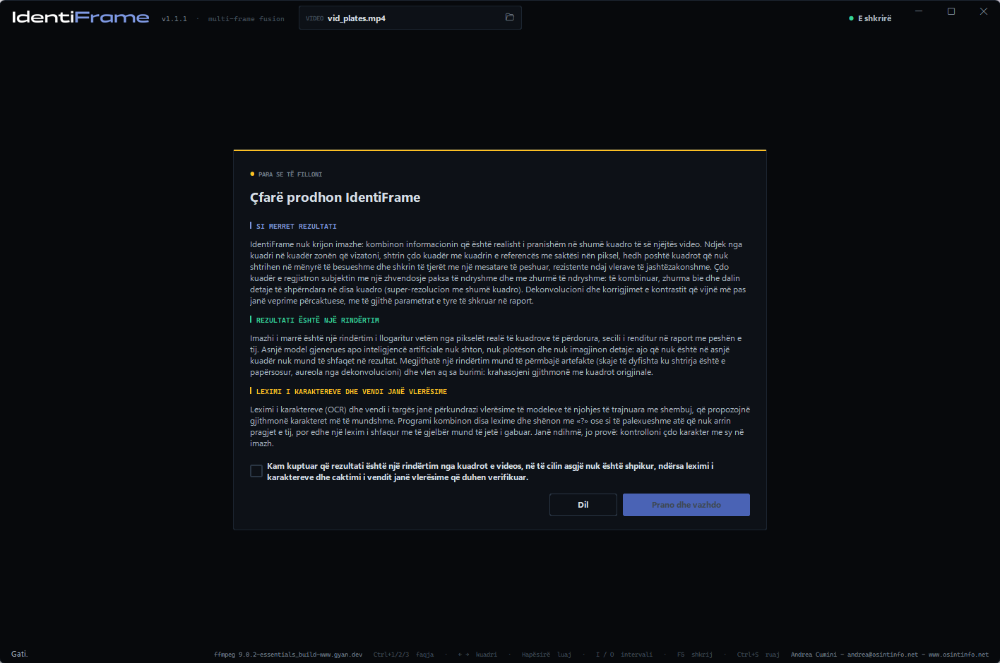
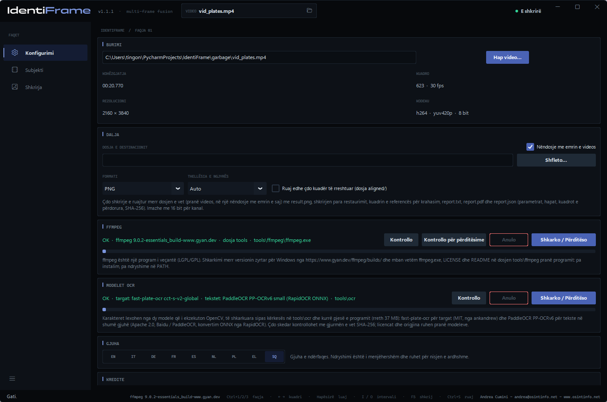
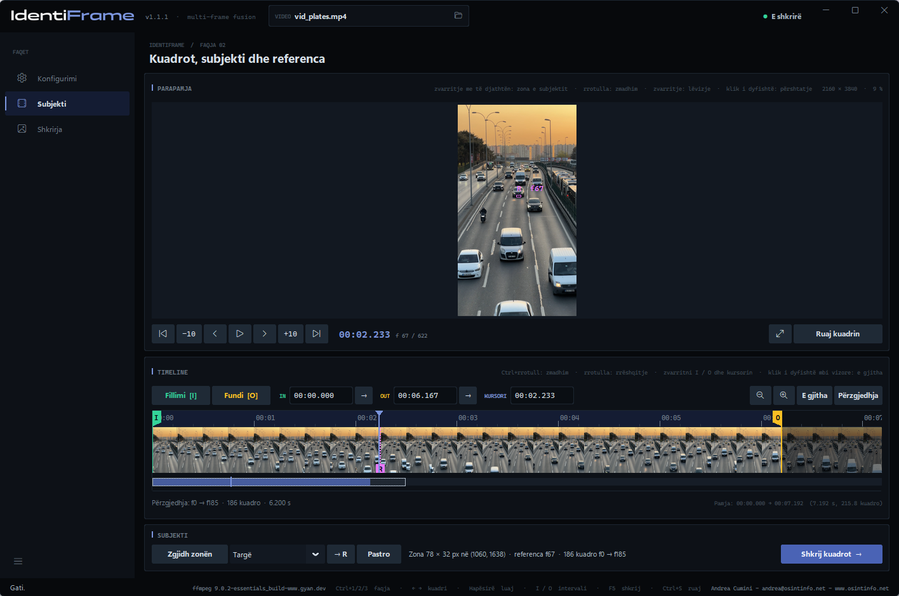
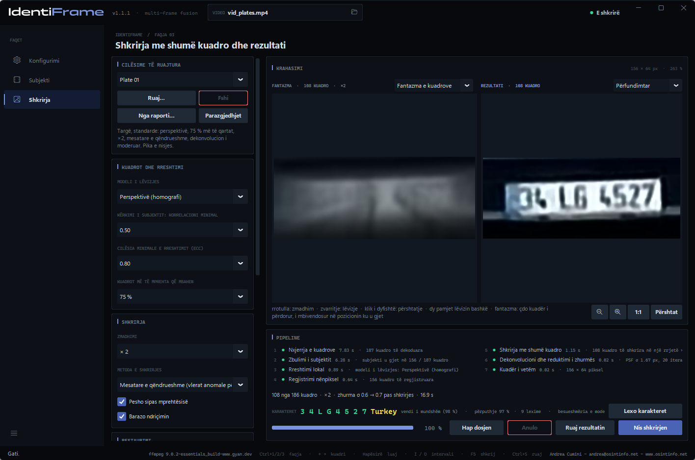
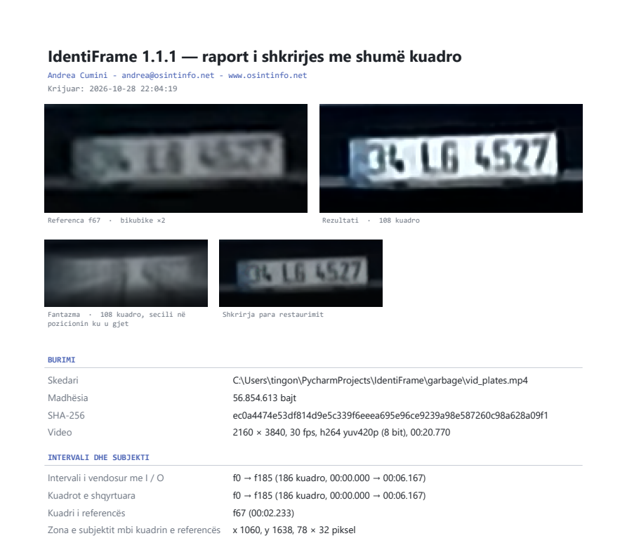
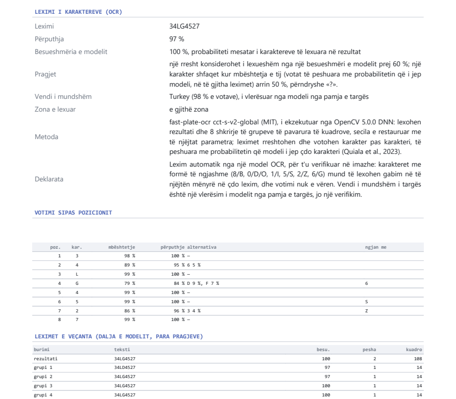

# IdentiFrame — Manuali i përdoruesit

[English](manual.en.md) · [Italiano](manual.it.md) · [Deutsch](manual.de.md) · [Français](manual.fr.md) · [Español](manual.es.md) · [Nederlands](manual.nl.md) · [Polski](manual.pl.md) · [Ελληνικά](manual.el.md) · **Shqip**

IdentiFrame përmirëson lexueshmërinë e një detaji të vogël — një targe, një
fytyre, një tabele — të filmuar në disa kuadro të një videoje. Ai i rreshton
këto kuadro me saktësi nënpiksel, i shkrin në një rrjetë më të imët, redukton
zhurmën dhe turbullirën, dhe prodhon **një imazh të vetëm** me një raport që
dokumenton çdo parametër dhe çdo hap.

*Andrea Cumini — www.osintinfo.net — andrea@osintinfo.net*

## Përmbajtja

1. [Si funksionon](#1-si-funksionon)
2. [Instalimi dhe nisja e parë](#2-instalimi-dhe-nisja-e-parë)
3. [Faqja Konfigurimi](#3-faqja-konfigurimi)
4. [Faqja Subjekti: kuadrot, subjekti dhe referenca](#4-faqja-subjekti-kuadrot-subjekti-dhe-referenca)
5. [Faqja Shkrirja](#5-faqja-shkrirja)
6. [Ruajtja: imazhet dhe raporti](#6-ruajtja-imazhet-dhe-raporti)
7. [Si të nxirrni maksimumin nga një targë ose një fytyrë](#7-si-të-nxirrni-maksimumin-nga-një-targë-ose-një-fytyrë)
8. [Kufizimet dhe përdorimi i duhur](#8-kufizimet-dhe-përdorimi-i-duhur)
9. [Shkurtoret e tastierës](#9-shkurtoret-e-tastierës)
10. [Modelet OCR (opsionale)](#10-modelet-ocr-opsionale)

## 1. Si funksionon

Çdo kuadër i një videoje e regjistron subjektin në një pozicion paksa të
ndryshëm në raport me rrjetën e pikselëve, dhe me zhurmën e vet të
rastësishme. IdentiFrame e shfrytëzon këtë: e gjen subjektin në çdo kuadër, i
rreshton të gjitha kuadrot me saktësi nënpiksel me një kuadër të vetëm,
**kuadrin e referencës**, dhe i kombinon. Zhurma ulet dhe rikthehet një pjesë
e detajeve që humb secili kuadër më vete. Asgjë nuk shpiket: rezultati përmban
vetëm atë që e mbështetin kuadrot.

Puna kryhet në shtatë hapa, të shfaqur në kutinë *Pipeline*:

| Hapi | Çfarë ndodh |
| --- | --- |
| 1. Nxjerrja e kuadrove | Intervali i zgjedhur dekodohet nga FFmpeg, i saktë deri në kuadër. |
| 2. Zbulimi i subjektit | Subjekti ndiqet kuadër pas kuadri, përpara dhe prapa nga referenca. |
| 3. Rreshtimi lokal | Çdo kuadër rreshtohet me referencën (algoritmi ECC; model zhvendosjeje, rrotullimi, afin ose perspektive). |
| 4. Regjistrimi nënpiksel | Rreshtimi rafinohet me rezolucion të plotë; zgjidhen kuadrot më të mprehta dhe të rreshtuara më mirë. |
| 5. Shkrirja me shumë kuadro | Kuadrot rikampionohen në një rrjetë deri në 4 herë më të imët dhe kombinohen, duke përjashtuar vlerat anomale. |
| 6. Dekonvolucioni dhe reduktimi i zhurmës | Nivele automatike, reduktim opsional i zhurmës dhe dekonvolucion Richardson-Lucy mbi luminancën. |
| 7. Kuadër i vetëm | Imazhi përfundimtar, fantazma e kuadrove, krahasimi me referencën, të dhënat për raportin. |

## 2. Instalimi dhe nisja e parë

**Skedari i ekzekutueshëm (Windows 10/11, 64-bit).** Shpaketojeni
`IdentiFrame-<versioni>-windows-x64.zip` në çfarëdo dosje dhe nisni
`IdentiFrame.exe`. Python nuk nevojitet. Skedari i ekzekutueshëm nuk është i
nënshkruar: herën e parë, Windows SmartScreen mund të kërkojë konfirmim.

**Nga kodi burimor.** Me Python 3.10 ose më të ri:

```bash
python -m pip install -r requirements.txt
python IdentiFrame.py
```

**Njoftim në nisje.** Në çdo nisje shfaqet një njoftim që duhet pranuar:
shpjegon që rezultati është një rindërtim i llogaritur vetëm nga pikselët
realë të kuadrove, në të cilin asgjë nuk është shpikur, ndërsa leximi i
karaktereve dhe vendi janë vlerësime që duhen verifikuar. *Prano dhe vazhdo*
aktivizohet pasi të shënohet deklarata. Në nisjen e parë fare pyetet më parë
gjuha, dhe njoftimi shfaqet në gjuhën e zgjedhur.



**FFmpeg.** IdentiFrame përdor FFmpeg për të lexuar videot, por nuk e
përfshin. Në nisjen e parë, nëse FFmpeg mungon, faqja **Konfigurimi** hapet te
kutia *FFmpeg*: **Shkarko / Përditëso** merr versionin zyrtar për Windows në
dosjen `tools\ffmpeg` pranë programit. Asgjë nuk instalohet në sistem.

Një video mund të hapet edhe nga rreshti i komandave:
`IdentiFrame.exe video.mp4`.

## 3. Faqja Konfigurimi



- **Burimi** — **Hap video…** (ose Ctrl+O, ose ikona e dosjes në kutinë
  *VIDEO* lart). Këtu shfaqen kohëzgjatja, numri i kuadrove, rezolucioni dhe
  kodeku. Kur hapet një video, programi kalon te faqja *Subjekti*.
- **Dalja** — *Dosja e destinacionit* ku ruhen shkrirjet (bosh = pranë
  videos), *Nëndosje me emrin e videos*, *Formati* (PNG ose TIFF) dhe
  *Thellësia e ngjyrës* (*Auto* = 16 bit për kanal për shkrirjen). *Ruaj
  edhe çdo kuadër të rreshtuar (dosja aligned/)* shton dosjen `aligned/` me
  çdo kuadër të përdorur, të rreshtuar me referencën.
- **FFmpeg** — ku ndodhet FFmpeg dhe cili është versioni i tij: **Kontrollo**,
  **Kontrollo për përditësime**, **Shkarko / Përditëso**.
- **Modelet OCR** — dy modelet opsionale që lexojnë karakteret e targave dhe teksteve, të shkarkuara sipas kërkesës në `tools\ocr` (rreth 37 MB): **Kontrollo** dhe **Shkarko / Përditëso**. Pa to programi punon, pa leximin e karaktereve. Shih [10. Modelet OCR](#10-modelet-ocr-opsionale).
- **Gjuha** — ndërfaqja dhe raportet janë të disponueshme në nëntë gjuhë:
  EN, IT, DE, FR, ES, NL, PL, EL, SQ. Ndryshimi është i menjëhershëm dhe
  ruhet.
- **Kredite** — autori dhe licenca.

## 4. Faqja Subjekti: kuadrot, subjekti dhe referenca



*Parapamja* shfaq kuadrin nën kursor: **rrotulla** zmadhon rreth treguesit të
miut (deri te pikselët realë), **zvarritja** lëviz pamjen, një **klik i
dyfishtë** e përshtat përsëri kuadrin. Poshtë, butonat lëvizin me një ose
dhjetë kuadro; **← →** dhe **Shift+← →** bëjnë të njëjtën gjë nga tastiera.

Butoni **luaj** në mes luan pamjen paraprake nga kursori dhe gjatë luajtjes
bëhet **pauzë** (Hapësira bën të njëjtën gjë); kursori dhe vija kohore
ndjekin, kështu që mund të shënohet një interval me I dhe O ndërsa shikoni.
Një klikim në vijën kohore ose një zhvendosje kuadri e ndalon luajtjen.

Kutia *Timeline* (vija kohore) shfaq të gjithë videon si një shirit filmi.
**Ctrl+rrotull** zmadhon, **rrotulla** rrëshqet; klikimi ose zvarritja
lëviz kursorin. *E gjitha* dhe *Përzgjedhja* përshtatin pamjen.

**1. Zgjidhni kuadrin e referencës.** Shkoni te kuadri në të cilin subjekti
është **më i madh dhe më i mprehtë** — për një automjet që afrohet, zakonisht
një nga kuadrot e fundit në të cilat e gjithë targa është ende e dukshme.

**2. Zgjidhni zonën e subjektit.** Zvarritni me **butonin e djathtë të miut**
mbi targë ose mbi fytyrë, ose shtypni **Zgjidh zonën** dhe zvarritni me
butonin e majtë. Rrethojeni subjektin duke lënë pak hapësirë rreth tij.
Kuadri i shfaqur bëhet **referenca** (shenja **R** në vijën kohore, **→ R** e
kthen kursorin tek ai) dhe **shkrirja nis vetë**: programi kalon te faqja
*Shkrirja*. Nëse vizatoni një zonë të re ndërsa shkrirja është në vazhdim, ajo
rinis. **Pastro** e heq zonën.

**3. Zgjidhni intervalin.** **Fillimi [I]** dhe **Fundi [O]** (tastet I dhe O)
vendosin kuadrin e parë dhe të fundit që do të përdoren: kuadrot në të cilat
subjekti është i dukshëm dhe i pambuluar. Shenjat I dhe O mund të zvarriten
gjithashtu, dhe fushat IN / OUT pranojnë një kohë (`1:23.456`) ose një kuadër
(`f2000`). Sa herë që vizatohet zona, intervali vendoset në 30 sekonda para dhe
30 pas referencës (brenda videos): këta janë vetëm kufijtë e kërkimit. Shkrirja
e ndjek subjektin nga referenca drejt jashtë dhe ndalet, në secilin drejtim, pas
një sekonde pa të; pastaj shenjat I dhe O ngushtohen te kuadrot ku u ndoq
(raporti e shënon). Një interval i lëvizur me dorë mbetet siç është. Pas
ndryshimit të intervalit, **Shkrij kuadrot →** (ose F5) e nis përsëri shkrirjen.
Më së shumti 3601 kuadro në interval.

## 5. Faqja Shkrirja



**Krahasimi.** Majtas, **Fantazma e kuadrove**: të gjitha kuadrot e
përdorura, të mbivendosura në pozicionin ku u gjet secili, para rreshtimit.
Ajo tregon se çfarë hyn në shkrirje dhe sa lëviz subjekti. Nëse zgjidhni te
menyja sipër saj zërin **Kuadri i referencës**, pamja e majtë shfaq në vend
të fantazmës kuadrin e referencës, të zmadhuar me interpolim bikubik: ky
është imazhi «para» i paanshëm për krahasim. Djathtas, rezultati:
**Përfundimtar**, ose **Vetëm shkrirja** (para reduktimit të zhurmës dhe
dekonvolucionit). Dy pamjet zmadhohen dhe lëvizin bashkë. Përveç rrotës,
butonat poshtë pamjeve zvogëlojnë (**−**, edhe nën madhësinë e përshtatur,
për ta parë rezultatin të vogël), zmadhojnë (**+**), e tregojnë në **1:1**
ose e **përshtatin** me pamjen; me tastierë **−**, **+** dhe **0**.


Imazhi i dytë tregon një fytyrë, me paravendosjen **Face 05** dhe kuadrin e
referencës majtas.

**Karakteret.** Me modelet OCR të shkarkuara, pas çdo shkrirjeje të një *Targe* ose të një *Teksti* rreshti **KARAKTERET** i kutisë *Pipeline* tregon karakteret e lexuara (**Lexo karakteret** e përsërit). Lexohen rezultati dhe tetë shkrirje të grupeve të pavarura të kuadrove, dhe leximet votohen karakter pas karakteri. Modelet e njohjes propozojnë gjithmonë karakteret më të mundshme, edhe ku nuk lexohet asgjë: një rresht shfaqet vetëm nga një besueshmëri e modelit prej 60 %, përndryshe programi shkruan **e palexueshme**, dhe një karakter që nuk mbledh të paktën 50 % të votave të peshuara shfaqet si **«?»**. Për një targë, **vendi i mundshëm** i vlerësuar nga modeli shfaqet me të verdhë pranë karaktereve vetëm kur leximi është i lexueshëm dhe një vend ka shumicën e votave; përndryshe është ndër detajet, me pjesën e tij. Detajet japin gjithashtu **përputhjen** e leximeve, **besueshmërinë e modelit**, pozicionet **e dyshimta** dhe karakteret për t'u **kontrolluar me sy** (8/B, 0/D/O, 1/I, 5/S, 2/Z, 6/G). Një *Tekst* mund të ketë disa rreshta, të ndarë me «|», secili i votuar më vete. Në imazhin e parë targa është shumë e vogël (karaktere rreth 12 piksel të larta në video) dhe lexohet 34LG4527, vend i mundshëm Turkey. Leximi dhe vendi janë vlerësime: krahasoni gjithmonë me imazhin.

**Pipeline.** Shtatë hapat me përfundimin dhe kohën e tyre; poshtë,
përmbledhja (kuadrot e përdorura, zmadhimi, zhurma para dhe pas shkrirjes),
shiriti i progresit dhe butonat **Hap dosjen**, **Anulo**, **Ruaj
rezultatin**, **Nis shkrirjen**. Hapat 1–4 varen vetëm nga videoja,
intervali, referenca, zona dhe modeli i lëvizjes: kur ndryshojnë vetëm
parametrat e shkrirjes ose të restaurimit, ata ripërdoren dhe një shkrirje e
re zgjat vetëm një pjesë të sekondës (*i ripërdorur* në listën e hapave).

### Parametrat

Kolona majtas i grupon parametrat sipas hapave.

**Lloji i subjektit.** Menyja pranë *Zgjidh zonën*, në kutinë *Subjekti* të faqes *Subjekti*, tregon se çfarë po përmirësohet. **Targë** dhe **Tekst**: një subjekt i sheshtë dhe i ngurtë, një model lëvizjeje për kuadër; ndryshojnë në leximin e karaktereve (një model për targat, ose një për tekstet në një ose më shumë rreshta, në shumë gjuhë). **Fytyrë**: nga një kuadër te tjetri koka kthehet dhe shprehja ndryshon, prandaj pas rreshtimit të ngurtë çdo kuadër merr një përpunim lokal jo të ngurtë që i ndjek këto lëvizje brenda pak pikselëve; pjesët që mbeten ndryshe vlejnë më pak, kuadrot me pozë ose shprehje tjetër lihen jashtë, restaurimi është më i lehtë dhe nivelet automatike më të buta me lëkurën dhe hijet. Ndryshimi i llojit ngarkon vlerat e tij të paracaktuara dhe përsërit rreshtimin. Asgjë nuk shpiket: përpunimi zhvendos vetëm me pak piksel atë që përmbajnë kuadrot. Për një fytyrë modeli i lëvizjes është afin si parazgjedhje, rreshtimi refuzon deformimet që nuk janë lëvizje e mundshme e kokës dhe, jashtë elipsit të brendashkruar në zonë, rezultati tregon kuadrin e referencës, sepse sfondi lëviz ndryshe.

**Cilësime të ruajtura.** Grupe parametrash me emër: **Ruaj…** kërkon një
emër dhe ruan parametrat aktualë; zgjedhja e një emri në meny i ngarkon ata;
**Fshi** heq grupin e zgjedhur; **Parazgjedhjet** e kthen çdo parametër në
vlerën e parazgjedhur. **Nga raporti…** ngarkon parametrat nga skedari
`report.json` i një shkrirjeje të ruajtur më parë, për ta përsëritur saktësisht. Parametrat
në përdorim ruhen gjithashtu kur programi mbyllet.

**Paracaktimet e integruara.** Menyja *Cilësime të ruajtura* fillon gjithmonë me pesë paracaktime për llojin e subjektit të zgjedhur në faqen Subjekti: **Plate 01** standard, **02** natë ose zhurmë, **03** targë e largët dhe e vogël, **04** mjet në lëvizje me turbullim, **05** hije ose kundër dritës; **Text 01–05** të njëjtat pesë raste për tekstet; **Face 01** standard, **02** natë ose zhurmë, **03** përpunim minimal, **04** fytyrë e largët dhe e vogël, **05** hije ose kundër dritës. Një rresht poshtë menysë përshkruan atë të zgjedhur; nuk mund të ndryshohen as të fshihen, dhe pas tyre vijnë cilësimet tuaja.

| Kutia | Parametri | Efekti |
| --- | --- | --- |
| Faqja Subjekti | Lloji i subjektit | Targë (parazgjedhje) ose Tekst për një subjekt të sheshtë dhe të ngurtë (ndryshojnë në leximin e karaktereve); Fytyrë shton përpunimin lokal jo të ngurtë dhe një restaurim më të lehtë. |
| Kuadrot dhe rreshtimi | Modeli i lëvizjes | Zhvendosje, Rrotullim + zhvendosje, Afin, **Perspektivë (homografi)** — e parazgjedhur; ndjek një subjekt që afrohet, largohet ose kthehet. Nëse një kuadër nuk konvergon, provohet një model më i thjeshtë. |
| | Kërkimi i subjektit: korrelacioni minimal | Nën këtë vlerë subjekti konsiderohet i pagjetur në një kuadër. |
| | Cilësia minimale e rreshtimit (ECC) | Kuadrot e rreshtuara më keq se kjo vlerë përjashtohen (0.80 si parazgjedhje). |
| | Kuadrot më të mprehta që mbahen | 75 % si parazgjedhje: çereku më pak i mprehtë (turbullira nga lëvizja) përjashtohet. |
| Shkrirja | Zmadhimi | Nga × 1 (vetëm reduktim i zhurmës) deri në × 4. × 2 ose × 3 është zakonisht zgjedhja e duhur. |
| | Metoda e shkrirjes | **Mesatare e qëndrueshme (vlerat anomale përjashtohen)** — e parazgjedhur; Mediana; Zhvendosje dhe mbledhje (konvolucion i normalizuar). |
| | Pesho sipas mprehtësisë | Kuadrot më të mprehta kanë shumë më tepër peshë. |
| | Barazo ndriçimin | Kompenson ndryshimet e ekspozimit midis kuadrove. |
| Restaurimi | Reduktimi i zhurmës | Asnjë, E lehtë, Mesatare, E fortë (filtër bilateral). |
| | Iteracionet e dekonvolucionit | Richardson-Lucy: më shumë iteracione mprehin më shumë, por përforcojnë edhe zhurmën dhe aureolat. 20 si parazgjedhje. |
| | PSF σ (piksel të daljes) | Gjerësia e turbullirës që duhet hequr. *Automatike* e mat atë në skajet e imazhit të shkrirë. |
| | Rregullarizimi (variacioni total) | E frenon zhurmën gjatë dekonvolucionit. Mesatare si parazgjedhje. |
| Paraqitja | Nivele automatike | E zeza dhe e bardha në përqindëset 0,5 dhe 99,5 të luminancës, para dekonvolucionit. |
| | Kontrast lokal (CLAHE) | Barazim sipas zonave: i dobishëm për targat në hije ose kundër dritës. |
| | Shkallë gri | Heq ngjyrën: shpesh jep një imazh më të pastër për leximin e shkronjave. |

## 6. Ruajtja: imazhet dhe raporti

**Ruaj rezultatin** (Ctrl+S në faqen *Shkrirja*) krijon një dosje të re
`fusion_f<referenca>_<data-ora>` në dosjen e destinacionit, me:

| Skedari | Përmbajtja |
| --- | --- |
| `result.png` | imazhi përfundimtar |
| `fused.png` | shkrirja para reduktimit të zhurmës dhe dekonvolucionit |
| `ghost.png` | fantazma e kuadrove të përdorura |
| `reference_x<k>.png` | zona e referencës e zmadhuar me interpolim bikubik, për krahasim |
| `reference_crop.png` | e njëjta zonë me rezolucionin e videos |
| `report.pdf` | raporti i faqosur në A4, me imazhet |
| `report.txt` | i njëjti raport si tekst i thjeshtë |
| `report.json` | të njëjtat të dhëna në formë të strukturuar, përfshirë cilësimet (**Nga raporti…** i ringarkon) |
| `aligned/` | sipas kërkesës, çdo kuadër i përdorur, i rreshtuar me referencën |



Me një lexim karakteresh, raporti ka seksionin **Leximi i karaktereve (OCR)**: leximin, përputhjen, besueshmërinë e modelit, për një targë vendin e mundshëm dhe zonën e lexuar, për një tekst rreshtat e gjetur, metodën, votimin sipas pozicionit me alternativat dhe karakteret e ngjashme, dhe çdo lexim të veçantë.



Raporti shkruhet në gjuhën e ndërfaqes. Ai përmban burimin (shtegun,
madhësinë, gjurmën **SHA-256**, formatin), intervalin, kuadrin e referencës
dhe zonën, të gjithë parametrat, shtatë hapat me metodat e përdorura dhe
kohët e tyre, tabelën e kuadrove (vlerësimi i kërkimit, koeficientët e
rreshtimit, zhvendosja nënpiksel, mprehtësia, pesha, arsyeja e përjashtimit),
vlerësimet e zhurmës dhe SHA-256 të çdo imazhi të shkruar. Kushdo që e lexon
mund ta përsërisë përpunimin dhe të verifikojë që skedarët nuk kanë ndryshuar.

*Ruaj kuadrin* në faqen *Subjekti* ruan, përkundrazi, vetëm kuadrin nën
kursor, me rezolucion të plotë dhe pa humbje.

## 7. Si të nxirrni maksimumin nga një targë ose një fytyrë

- **Fytyrë**: zgjidhni së pari llojin e subjektit *Fytyrë*; kornizoni gjithë fytyrën me një kufi të vogël, mundësisht në një kuadër ku shikon kamerën, dhe kufizoni intervalin te kuadrot me të njëjtën pozë. Raporti thotë sa kuadro u lanë jashtë për pozë ose shprehje tjetër dhe sa e gjerë është fytyra në video: nën rreth 60 piksel prisni një pamje të përgjithshme më të pastër, jo tipare identifikuese.
- **Referenca**: kuadri në të cilin subjekti është më i madh dhe më i mprehtë.
- **Intervali**: vetëm kuadrot në të cilat subjekti është plotësisht i
  dukshëm. Kuadrot larg referencës (shumë më të vogla, me perspektivë tjetër)
  sjellin pak dhe gjithsesi shpesh përjashtohen nga pragu i cilësisë.
- **Zona**: e gjithë targa ose fytyra me pak hapësirë rreth saj; jo shumë
  sfond, i cili mund të lëvizë ndryshe.
- **Zmadhimi**: × 2 ose × 3. × 4 ia vlen vetëm me shumë kuadro.
- **Shkronjat janë ende të turbullta?** Ngrini *PSF σ* me një nivel (p.sh. nga
  *Automatike* te vlera e parë mbi atë që tregohet në raport), ose parametrin
  *Iteracionet e dekonvolucionit*.
- **Aureola ose «ringing» rreth shkronjave?** Ulni *PSF σ* ose iteracionet,
  ose ngrini parametrin *Rregullarizimi (variacioni total)*.
- **Targë në hije ose kundër dritës**: *Kontrast lokal (CLAHE)* në nivelin
  *E lehtë* ose *Mesatare*, shpesh së bashku me *Shkallë gri*.
- **Krahasoni** gjithmonë me pamjen *Kuadri i referencës*, duke zmadhuar mbi
  shkronjat: ajo që nuk lexohet aty dhe shfaqet vetëm pas një mprehjeje të
  fortë duhet trajtuar me kujdes.
- Një grup parametrash që funksionon për një kamerë ruajeni me **Ruaj…** dhe
  ripërdoreni.

## 8. Kufizimet dhe përdorimi i duhur

- Rezultati është një **përmirësim** i kuadrove të regjistruara, jo një
  rindërtim i realitetit: ai nuk mund të rikuperojë atë që nuk e përmban
  asnjë kuadër.
- Detajet e imëta në kufirin e rezolucionit, dhe shkronjat që ngjajnë me
  njëra-tjetrën (8/B, 0/D, 1/7, 5/S), duhet të verifikohen mbi kuadrot
  burimore para se të nxirren përfundime.
- Përfitimi është më i madh me shumë kuadro, zhvendosje të vogla midis tyre,
  zhurmë të pavarur dhe një referencë mjaftueshëm të mprehtë. Turbullira nga
  lëvizja brenda një kuadri të vetëm nuk hiqet.
- Ngjeshja e fortë prodhon gabime që janë të njëjta në kuadro të
  njëpasnjëshme: shkrirja i redukton ato më pak se zhurmën e rastësishme.
- Targat dhe fytyrat janë të dhëna personale: përdoreni programin brenda
  rregullave që zbatohen për ju.

## 9. Shkurtoret e tastierës

| Tastet | Veprimi |
| --- | --- |
| Ctrl+1 / Ctrl+2 / Ctrl+3 | Faqja Konfigurimi / Subjekti / Shkrirja |
| Ctrl+O | Hap video |
| ← / → | Kuadri i mëparshëm / kuadri tjetër |
| Shift+← / Shift+→ | 10 kuadro prapa / përpara |
| Hapësirë | Luan ose ndal pamjen paraprake |
| Home / End | Kuadri i parë / i fundit |
| I / O | Fillimi / fundi i intervalit te kursori |
| + / − | Zmadho / zvogëlo vijën kohore |
| F | E gjithë videoja në vijën kohore |
| Zvarritje me të djathtën mbi parapamje | Zgjidh zonën e subjektit (shkrirja nis) |
| Esc | Dil nga mënyra *Zgjidh zonën* |
| − / + / 0 (faqja Shkrirja) | Zvogëlon / zmadhon / përshtat rezultatin |
| F11 | Parapamje më e madhe: fsheh ose shfaq vijën kohore (faqja Subjekti) |
| F5 | Nis shkrirjen |
| Ctrl+S | Ruaj rezultatin (faqja Shkrirja) ose kuadrin (faqja Subjekti) |


## 10. Modelet OCR (opsionale)

Leximi i karaktereve përdor dy modele rrjeti nervor, të ekzekutuara nga OpenCV, që është tashmë pjesë e programit. **Nuk përfshihen** në IdentiFrame dhe janë **opsionale**: pa to gjithçka tjetër punon si zakonisht, mbetet bosh vetëm rreshti KARAKTERET. Për t'i përdorur, shtypni **Shkarko / Përditëso** në kutinë **Modelet OCR** të faqes *Konfigurimi*: shkojnë në dosjen `tools\ocr` pranë programit (rreth 37 MB), dhe kutia tregon cilat janë të pranishme.

| Subjekti | Modeli | Licenca |
| --- | --- | --- |
| Targë | [fast-plate-ocr](https://github.com/ankandrew/fast-plate-ocr) `cct-s-v2-global`, nga ankandrew: lexon gjithë targën dhe vlerëson vendin e saj të mundshëm ndër 65 | MIT, kodi dhe peshat ([konfirmuar nga autori](https://github.com/ankandrew/fast-plate-ocr/issues/97)) |
| Tekst | [PaddleOCR](https://github.com/PaddlePaddle/PaddleOCR) PP-OCRv6 small, nga Baidu / PaddleOCR, në konvertimin ONNX të [RapidOCR](https://github.com/RapidAI/RapidOCR): gjen rreshtat e tekstit dhe i lexon në shumë gjuhë | Apache 2.0 |

Çdo skedar kontrollohet me gjurmën e vet SHA-256 para se të mbahet; pranë modeleve ruhen tekstet e licencave dhe një skedar `SOURCE.txt` me origjinën. Vendi është një vlerësim nga pamja e targës, jo një verifikim, dhe shfaqet me emrin në anglisht.

*Videot e provës dhe pamjet e ekranit, nga Pexels, të përdorura sipas [licencës Pexels](https://www.pexels.com/license/): «[Busy Highway Traffic at Sunset](https://www.pexels.com/it-it/video/traffico-autostradale-intenso-al-tramonto-31779728/)» nga [Şeyhmus Kino](https://www.pexels.com/@seyhmuskino/) (mjete dhe targa), trafik në një rrugë të Taipeit, Tajvan, nga [Levi Wedge](https://www.pexels.com/@levi-wedge-266970209/) ([video](https://www.pexels.com/it-it/video/citta-auto-traffico-veicoli-13271103/), tekste) dhe «[Charming European Street with Cyclist](https://www.pexels.com/it-it/video/affascinante-strada-europea-con-ciclista-33476096/)» nga [Tuba Din](https://www.pexels.com/@tubadinn/) (fytyrë). Targat, tekstet dhe fytyra në pamjet e ekranit vijnë nga ky material.*

---

IdentiFrame është program i lirë nën GNU GPL v3 me atribuim të autorit:
shihni `LICENSE` dhe `NOTICE`. Andrea Cumini - andrea@osintinfo.net - www.osintinfo.net
